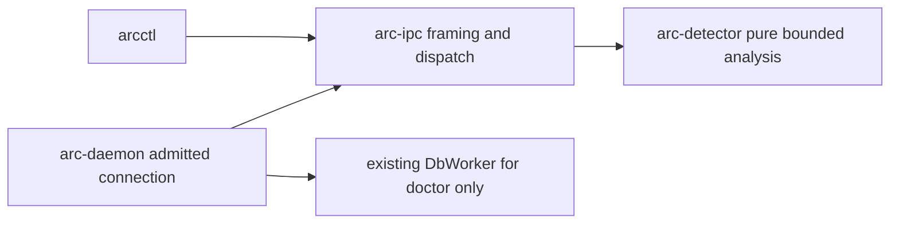

# Phase 0 command-classification contract

Status: task-1 contract amended with the Chief disposition for task-2/task-4 synchronization and independent QA. This document specifies behavior; it does not report implemented or verified classifier behavior. Authority is the supplied mission and owned task. Skill used: oma-architecture, Recommendation Mode. Only this file and contract.json are owned by this task; no source, manifest, lockfile, migration, harness, mission state, or .agents definition is changed.

## Problem and scope

Add one bounded, deterministic, non-executing command classifier to the existing Rust workspace. The architecture concern is how to carry command data through protocol 1 without losing the payload at the daemon boundary, blocking health, or introducing execution and persistence paths. The implementation owner consumes this contract as task-4 input. Existing ARC transport and resource controls remain in charge.

The result describes recognized command syntax. It does not attest which executable PATH, aliases, shell functions, SSH configuration, or actual host topology would select at runtime. There is no tool discovery, script loading, environment expansion, endpoint verification, scheduling, queueing, permit, job creation, execution, or automatic retry. No numeric confidence is inferred. Wider SRS detector coverage, scheduling, managed-execution, desktop and native Windows acceptance remain open. UNKNOWN/OBSERVE is an observation result, never an enforcement instruction.

## Chief disposition: one shared analysis contract

Authority: the Chief disposition supplied in this task-1 amendment. This resolves the input/output conflict reported in implementation/repair-3-report.md; it preserves prior acceptance and budgets. Detector, job.classify and arcctl share one analysis contract. A valid analysis observation is successful even when it cannot resolve a command. CLI usage, typed-request and transport failures remain failures. This is a contract decision; no measured usability benefit is claimed.

| Input or state | Required outcome | CLI exit / stderr |
| --- | --- | --- |
| Explicit empty string or whitespace-only command | ok; UNKNOWN/UNKNOWN/EMPTY_COMMAND/OBSERVE | 0 / empty |
| Command exceeds 16384 UTF-8 bytes, with a valid typed request fitting the unchanged transport frame | ok; UNKNOWN/UNKNOWN/INPUT_LIMIT/OBSERVE before scanning | 0 / empty |
| Token, invocation, nesting or work budget exhausted | ok; UNKNOWN/UNKNOWN with TOKEN_LIMIT, INVOCATION_LIMIT, NESTING_LIMIT or WORK_LIMIT and OBSERVE | 0 / empty |
| Unsupported shell string, including empty shell string | ok; UNKNOWN/UNKNOWN/UNSUPPORTED_SHELL/OBSERVE | 0 / empty |
| Missing/extra positional arguments or unknown CLI options | Input-free usage failure; empty stdout, no classification request | Nonzero / input-free usage diagnostic |
| Malformed typed request or invalid request JSON | Existing INVALID_REQUEST failure, subject to version-first ordering | Nonzero / fixed error code without input |
| Transport-frame violation, including a frame above 1048576 bytes | Existing transport failure; no successful result | Nonzero / fixed error code without input |

The byte check uses the original command length before trimming or scanning, including for whitespace-only input. Preserve the existing ordering: transport/envelope decoding, protocol version check before typed payload validation, then byte precheck, shell-kind resolution and left-to-right analysis. EMPTY_COMMAND applies within the byte limit for a supported shell; an earlier byte-limit or unsupported-shell result retains precedence. An omitted command is malformed; an explicitly supplied empty string is valid. Omitted --shell defaults to sh; --shell remains optional and maps directly to shell_kind. No second CLI interpretation or stricter local analysis limit is introduced.

Human stdout is exactly these five lines with enum substitutions, one LF after every line including the last, and no additional UNKNOWN sentence or blank line:

```text
Classification: <enum>
Locality: <enum>
Reason: <enum>
Uncertainty: <enum>
Command not executed.
```

JSON stdout is exactly one object containing classification, locality, reason and uncertainty, followed by one LF; no envelope or additional field/text is added. Key order is not semantic. These formats and empty stderr apply to every successful observation, including EMPTY_COMMAND, INPUT_LIMIT, other exhausted budgets and unsupported shell.

The consumed cli-requirements.md at amendment input revision 2cdfc8f985bf09cbdb54c68e7139e22afc342089 conflicts at Syntax and input / C03 (empty input), limits / C15 / Failures and recovery (oversized analysis versus transport), Successful output (Class: and extra UNKNOWN sentence), and syntax (omitted optional --shell). Task-2 owns synchronization of that file; task-4 consumes the synchronized artifacts and refreshes affected checks. This task changes only the contract pair and does not certify the other artifact or product as synchronized. Existing fixtures and all five counting rules remain intact; contract.json adds disposition fixtures without replacing them.

## Source provenance and inspection limits

Original task-1 inspection (historical; retained unchanged below):

Accepted committed baseline: `05f0812d0841485bbe07b3f1f8f6fde3861a1d55`; its verified tree is `ab739c266e893550181917a906051ec34a441b51`. Actual Actor HEAD inspected: `0ad7663e2bf52c3de9f221aded257320713be924`, with the same verified tree. The supplied snapshotCommit is that Actor HEAD; snapshotTree matches baselineTree. Supplied snapshotRef and workerRef could not be resolved in this checkout; they are retained as supplied identifiers in contract.json, not asserted as locally verified refs. The initial scoped status/diff for crates, Cargo.toml, Cargo.lock, the owned output directory and the harness was empty. The contract files are new Actor-local deliverables, absent from the accepted baseline.

Global Git inspection printed `av.yaml: Operation not permitted`; it does not establish a globally clean workspace. No bypass was attempted. Serena discovery returned no available tools; source inspection used direct reads of known paths. An incidental mise tracked-config symlink attempt reported operation-not-permitted warnings while Python ran successfully. No configuration repair was attempted. Memory lookup found no relevant ARC entry and supplied no contract facts.

The external ARC SRS was read at `/Users/gracefullight/Downloads/Agent_Resource_Control_ARC_Requirements_SRS_2026-11-06.md`: SHA-256 `a8ef945251f9f3fd7c3e337d4efc77ff9914f95114212ca9e6c90ae2ce3e3d9e`. Sections 8.1–8.5 and 8.7 (lines 638–778) define classes, quoting/compound needs, conservative locality and non-execution. Sections 13.1–13.5 (lines 1667–1780) define framing, job.classify, compatibility and input bounds. The numeric limits and exact types below are slice decisions fixed by the mission, not numbers attributed to the SRS. SRS features beyond this slice are not silently claimed as delivered.

Baseline source references, all byte-equal to the inspected Actor snapshot:

| Path | Observed interface or invariant |
| --- | --- |
| Cargo.toml:1–25 and five crate manifests | Rust 2021, existing Serde/serde_json, Tokio and Clap; no detector crate |
| crates/arc-ipc/src/lib.rs:19–67, 301–353 | Protocol 1; Request/Response; dispatch(request, doctor); version-first rejection |
| crates/arc-daemon/src/connection.rs:87–131 | Payload nulled before dispatch and before database await |
| crates/arc-daemon/src/limits.rs:22–40 | 64 connections, 16 requests, queue 8, finite deadlines, 3500 ms shutdown |
| crates/arc-daemon/src/main.rs:31 | Two Tokio workers |
| crates/arc-daemon/src/platform.rs:14–76 | Native same-user socket peer checks |
| crates/arc-cli/src/main.rs:23–123 | Status/doctor, fixed error codes, generated request IDs and existing exchange |
| crates/arc-ipc/src/tests/dispatch.rs:4–69 | Version, hello/health, doctor and unsupported-operation regressions |
| crates/arc-daemon/tests/resident/lifecycle.rs:4–146 | Socket permissions, status/doctor text, SIGTERM and migration invariants |

Migration SHA-256: `046610c920709f0d9371ccaff6254fbd1c1c46cc6e930890869ff0ffc4fb1384` (`crates/arc-storage/migrations/0001_phase0.sql`). Harness SHA-256: `93140173df8b8bd28b067aff68301134b0398b643240b0b1e6a13da4487ebe33` (`scripts/harness/validate.sh`). Both match baseline bytes. Per-input Git blob IDs, hashes and line counts are in contract.json. Prior receipts are historical evidence only; no Cargo gate or harness was run by task-1.

Prior decision index is docs/decisions/README.md (index.md is absent). Inspected prior runtime/state and Chief ownership decisions concern Agent Valley orchestration, not ARC classifier semantics. The Turso decision concerns a separate team ledger. This contract changes none of those decisions. Explicit task ownership places both deliverables here; no ADR, sidecar, run report or workflow-state output is created elsewhere.

## Request and result types

Retain the existing Request/Response envelope and protocol_version=1. Add operation constant `OPERATION_JOB_CLASSIFY = "job.classify"`. Classification payload is exactly:

```json
{"command":"cargo test","shell_kind":"sh"}
```

`command` is a required JSON string; explicit empty and whitespace-only strings are valid analysis input, distinct from an absent field. `shell_kind` is an optional JSON string, default `sh` when omitted; null is invalid. Supported exact, case-sensitive values are `sh`, `bash`, `zsh`, all using the restricted grammar below, not complete dialect implementations. Any other string (including empty, powershell, pwsh or cmd) is a valid request yielding UNKNOWN/OBSERVE with UNSUPPORTED_SHELL. Do not invoke a dialect executable. No cwd, environment, declared locality or metadata fields are accepted in this payload.

Reject unknown payload keys, missing command, wrong field types, null/array/scalar payload, and malformed request JSON using existing `INVALID_REQUEST`, with no parser error detail or raw input. Preserve the existing top-level envelope behavior: unknown envelope fields are ignored; required envelope fields retain existing decoding requirements. JSON duplicate-key handling remains the existing serde_json Value behavior (last value retained), not a new duplicate-detection layer. A version mismatch must win over classification payload validation and return `PROTOCOL_INCOMPATIBLE`. Unknown operations retain `UNSUPPORTED_CAPABILITY`. Transport framing errors and the 1 MiB frame cap remain unchanged and fail the request. A valid typed request fitting that frame whose command exceeds 16384 UTF-8 bytes returns ok UNKNOWN/UNKNOWN/INPUT_LIMIT/OBSERVE before scanning; this analysis byte cap is not a transport rejection.

A valid request returns status `ok`, exactly this typed result shape, no echoed command and no diagnostic snippet:

```json
{"classification":"TEST","locality":"HOST_LOCAL","reason":"CARGO_TEST","uncertainty":"NONE"}
```

| Field / Rust type | Stable serialized values |
| --- | --- |
| classification / JobClass | BUILD, TEST, LINT, REMOTE_CI, REMOTE_EXEC, MIXED, UNKNOWN |
| locality / Locality | HOST_LOCAL, REMOTE, MIXED, UNKNOWN |
| reason / Reason | Closed enum listed below; never arbitrary text |
| uncertainty / Uncertainty | NONE, OBSERVE |

NONE means fully resolved within this documented syntax subset, not runtime certainty or enforcement authority. Every UNKNOWN result has locality UNKNOWN and uncertainty OBSERVE. Every other class has uncertainty NONE. BUILD/TEST/LINT use HOST_LOCAL; REMOTE_CI/REMOTE_EXEC use REMOTE; MIXED uses MIXED. No decision, execution_mode, job_id, permit_id, token, raw stage list or command-derived signature is returned. Rust enum names can be idiomatic but explicit Serde names must preserve wire values.

Closed reason values: `CARGO_BUILD`, `CARGO_TEST`, `CARGO_CLIPPY`, `CARGO_FMT`, `GH_WORKFLOW_RUN`, `GH_RUN_WATCH`, `GH_RUN_VIEW`, `SSH_REMOTE_COMMAND`, `COMPOUND_LOCAL`, `COMPOUND_REMOTE`, `COMPOUND_MIXED`, `EMPTY_COMMAND`, `UNSUPPORTED_SHELL`, `UNSUPPORTED_SYNTAX`, `UNRESOLVED_COMMAND`, `UNRESOLVED_SCRIPT`, `UNRESOLVED_EXPANSION`, `UNRESOLVED_COMPOUND`, `SSH_FORWARDING`, `SSH_AMBIGUOUS`, `DOCKER_ENDPOINT_UNKNOWN`, `INPUT_LIMIT`, `TOKEN_LIMIT`, `INVOCATION_LIMIT`, `NESTING_LIMIT`, `WORK_LIMIT`.

## Supported grammar and literal handling

Use an in-memory, quote-aware scanner and a small parser for:

```text
list     := pipeline (("&&" | "||" | ";" | newline) pipeline)* [";" | newline]
pipeline := primary ("|" primary)*
primary  := simple | "(" list ")"
simple   := word+
```

Space and tab separate words; LF separates lists and CRLF counts as one separator. Leading/trailing blank lines are allowed. Empty or whitespace-only command returns UNKNOWN/EMPTY_COMMAND/OBSERVE. Empty pipe/conditional operands, unmatched quotes/parentheses and dangling escape return UNKNOWN/UNSUPPORTED_SYNTAX/OBSERVE. NUL and control bytes other than tab/CR/LF are unsupported syntax. Valid UTF-8 Unicode is preserved as literal word data; never normalize text or resolve a path. Standalone CR is unsupported. One trailing list separator is allowed; repeated separators other than blank lines are unsupported. Operators use longest match.

A word concatenates bare, single-quoted and double-quoted fragments. Quotes are removed only for lexical comparison. Single quotes preserve every interior byte literally. Backslash outside quotes escapes the following character; in double quotes it escapes only backslash, double quote, dollar and backtick. Escaped LF/CRLF joins lines. Preserve whether metacharacters were quoted or escaped so literal `$`, `;`, `|`, parentheses or command-looking arguments do not become operators or invocations.

Unescaped dollar or backtick in bare/double-quoted text means unresolved expansion (including $(), ${}, $VAR and arithmetic); return UNKNOWN/UNRESOLVED_EXPANSION without evaluating or scanning expansion contents as invocations. Bare glob/tilde syntax (*, ?, [, ~) is also unresolved expansion. These characters inside single quotes or appropriately escaped are literal. Double quotes do not neutralize command substitution. Unsupported redirections, heredocs, comments, background &, brace groups, functions, loops, conditionals, process substitution and shell keywords yield UNKNOWN/UNSUPPORTED_SYNTAX. No successful class may be inferred by skipping unsupported syntax. Assignment-prefixed commands and generic env/timeout/nice/sudo/xargs/eval wrappers return UNRESOLVED_COMMAND in this slice rather than being stripped heuristically.

Only literal nested shell wrappers are expanded: exact executable words `sh`, `bash`, `zsh`, followed by exactly `-c` or `-lc`, followed by one literal command word and no other words. Analyze that decoded word using the same grammar, counters and supported shell kind; wrapper depth increases by one. Retain its effective leaves for root aggregation. `bash -lc 'cargo test'` resolves to TEST. Shell wrappers with a script path, other flags, extra operands or no literal command return UNRESOLVED_SCRIPT. A literal substitution string passed into a nested shell becomes active syntax on the nested pass: `sh -c 'cargo test $(touch marker)'` is UNKNOWN/UNRESOLVED_EXPANSION. Never start the nested shell. Do not recursively parse arbitrary quoted arguments, filenames or SSH remote text.

Absolute/relative executable paths, aliases and unknown executable names are UNRESOLVED_COMMAND; do not use basename matching to turn `./cargo` into trusted cargo semantics. Any executable word ending in `.sh`, including `./build.sh`, plus `sh build.sh`, `npm run build`, `bun run build`, `pnpm run deploy`, `make`, `just` and `task` are UNRESOLVED_SCRIPT. This small recognized-script list only selects a reason; other unresolved scripts remain UNKNOWN as well. Files are never opened. All docker and docker-compose invocations are DOCKER_ENDPOINT_UNKNOWN, even if a context or endpoint looks local or remote. No context, environment, Docker API, GitHub API or SSH configuration is inspected.

## Command rules and aggregation

Recognize exact literal executable/subcommand words at invocation positions only. Required patterns have no intervening options. Remaining arguments may be literal words (including options) but are never reparsed as commands. Expansion/unsupported syntax anywhere still makes the whole analysis unresolved.

| Pattern | classification | locality | reason |
| --- | --- | --- | --- |
| cargo build [literal arguments...] | BUILD | HOST_LOCAL | CARGO_BUILD |
| cargo test [literal arguments...] | TEST | HOST_LOCAL | CARGO_TEST |
| cargo clippy [literal arguments...] | LINT | HOST_LOCAL | CARGO_CLIPPY |
| cargo fmt [literal arguments...] | LINT | HOST_LOCAL | CARGO_FMT |
| gh workflow run [literal arguments...] | REMOTE_CI | REMOTE | GH_WORKFLOW_RUN |
| gh run watch [literal arguments...] | REMOTE_CI | REMOTE | GH_RUN_WATCH |
| gh run view [literal arguments...] | REMOTE_CI | REMOTE | GH_RUN_VIEW |
| ssh [--] destination nonempty-literal-remote-command... | REMOTE_EXEC | REMOTE | SSH_REMOTE_COMMAND |

The SSH destination is a nonempty literal non-option word, optionally user@host. Explicit localhost, *.localhost, loopback IPv4 (127/8), ::1, [::1], empty host and malformed destination are SSH_AMBIGUOUS. For the resolved subset, destination is an optional ASCII user plus @ followed by an ASCII hostname word, or a bracketed IPv6 address. User characters are letters/digits/dot/underscore/hyphen; hostname begins with a letter/digit and continues with letters/digits/dot/underscore/hyphen; bracketed IPv6 contains hex digits and colons. Anything outside this subset is SSH_AMBIGUOUS. Loopback hostname matching is ASCII case-insensitive. A named non-loopback destination such as build01 denotes SSH remote-execution syntax; this is not DNS/topology proof. No options except the optional `--` are resolved in this slice. `-L`, `-R`, `-D`, `-W`, `-N` and their attached/combined option forms yield SSH_FORWARDING, including forwarding plus a command. Other options, missing destination or missing/nonempty remote command uncertainty yield SSH_AMBIGUOUS. Remote command words are opaque remote data after outer-shell validation; they are not local stages. A quoted remote command may contain remote substitutions; ARC never runs them. Active substitutions in the outer shell still force UNKNOWN.

Analyze every syntactically present stage of &&, ||, pipes and lists; never infer exit status or conditional reachability. Parentheses only group stages and increase depth. A nested shell wrapper contributes its inner effective leaves; it is not a separate local computation stage for aggregation. Flatten all recognized leaves in source order and aggregate once at the root; do not convert a partial same-locality heterogeneous set into UNKNOWN before seeing later remote/local leaves. Thus `(cargo build && cargo test) && gh run watch` is MIXED, while `cargo build && cargo test` alone is UNKNOWN/UNRESOLVED_COMPOUND. Rules in order:

1. Any limit exhaustion immediately discards partial results and returns that limit's UNKNOWN reason. No later scan occurs.
2. Other syntax/expansion errors invalidate the whole input. For multiple such errors, use the first detected by deterministic left-to-right parsing; do not attempt recovery.
3. If any stage is UNKNOWN, the entire result is UNKNOWN/UNKNOWN/OBSERVE using the first unresolved stage's reason in source order. A known local/remote pair never masks an unresolved third stage.
4. One effective stage returns its own reason (grouping and literal shell wrappers do not change it).
5. All resolved stages with at least one HOST_LOCAL and one REMOTE yield MIXED/MIXED/COMPOUND_MIXED/NONE, independent of operator or local class differences.
6. All resolved stages with one identical class/locality yield that class/locality and COMPOUND_LOCAL or COMPOUND_REMOTE. Distinct local classes alone, or REMOTE_CI plus REMOTE_EXEC alone, yield UNKNOWN/UNRESOLVED_COMPOUND/OBSERVE. MIXED is reserved for proven local-plus-remote syntax.

## CLI interface input for task-4

Add `arcctl classify [--shell <shell_kind>] [--json] -- <command>`, where command is exactly one required UTF-8 argument, not an argv list reconstructed with spaces. CLI --shell maps to payload shell_kind; omission uses sh. Accept a literal unsupported shell string so the daemon can return the typed observation. Missing/extra command arguments use Clap's existing usage-error path; explicit empty or whitespace-only string is sent and returns UNKNOWN/UNKNOWN/EMPTY_COMMAND/OBSERVE with exit 0. Unknown CLI options also use the input-free usage-error path; missing/extra positional arguments and unknown options send no classification request. CLI help shows single-quoted literal examples and explains that the caller's shell must preserve the argument before ARC receives it; ARC cannot prevent evaluation performed by the caller's shell. Do not add stdin mode or a second grammar in this slice.

Default stdout is exactly five labeled lines, each LF-terminated with one trailing newline and no blank line or additional UNKNOWN sentence, in this order: `Classification: <enum>`, `Locality: <enum>`, `Reason: <enum>`, `Uncertainty: <enum>`, `Command not executed.` JSON stdout is only the four-field result object plus newline, with no extra human text. Both modes avoid ANSI, input echo, prompts and retries. Valid UNKNOWN/OBSERVE exits 0 with empty stderr, including empty/whitespace input, analysis input above 16384 bytes that fits the transport frame, unsupported shell and every analysis-budget exhaustion. Protocol/request/transport failures exit nonzero with a fixed error code on stderr and no command content; preserve existing status/doctor error behavior. The new command distinguishes INVALID_REQUEST, PROTOCOL_INCOMPATIBLE, UNSUPPORTED_CAPABILITY, DAEMON_UNAVAILABLE and IPC_ERROR, while a completed limit/unsupported-syntax result remains exit 0. Validate response protocol, status, request ID correlation and the typed result before printing; malformed/unrecognized result enums or impossible field combinations are IPC_ERROR. Request IDs are generated independently from command data. These are concrete integration inputs; backend and CLI-requirements ownership must report any conflict to Chief instead of silently diverging.

## Analysis budgets

All counters are unsigned checked counters shared by the entire analysis, including every nested shell. Check before performing work or allocating the next element; exceeding a cap returns the corresponding UNKNOWN/OBSERVE result, never a partial classification or panic. Limits are inclusive. Transport JSON decoding is separately bounded by the existing 1 MiB frame cap, not charged to detector counters.

| Budget | Inclusive maximum | Counting rule | Exceeded reason |
| --- | --- | --- | --- |
| Command bytes | 16384 | UTF-8 bytes of original command, before trim/unquote; obtain length without scanning | INPUT_LIMIT |
| Tokens | 1024 | Each emitted word (even empty quoted word) and each operator/parenthesis token; whitespace is not a token; count nested re-tokenization again | TOKEN_LIMIT |
| Invocations | 128 | Each simple command node, including each nested-shell wrapper and each inner simple command; groups/operators do not count | INVOCATION_LIMIT |
| Nesting | 8 | Root depth 0; each open group or literal-shell expansion enters parent depth+1; shared along the active path | NESTING_LIMIT |
| Work steps | 65536 | Charging below across scanning, decoding, recognition, nested analysis and aggregation | WORK_LIMIT |

Work accounting must bound actual analysis loops, not merely token output. Charge (a) one unit before each source byte inspection, including repeated lookahead or rescanning; (b) one unit before each byte copied into decoded word/nested input storage; (c) one unit per token visit in parsing/recognition/wrapper inspection; (d) one unit for every byte inspected in equality/prefix/keyword/option/host checks, including library comparisons, plus one per length check; (e) one unit for node creation and one per child consumed during aggregation. Use borrowed slices where practical; do not copy a raw command for convenience. Decoded words may only shrink versus their source spans. Any extra pass must pay its byte/token charges; no uncharged regex, recursive search, normalization, reparsing or bulk comparison is allowed. Fixed-size enum dispatch and counter checks need no extra charge. Container operations must be amortized bounded; no repeated vector-front removal or quadratic joins.

A charge(n) uses checked_add and fails before the requested operation if used+n > 65536; a failed charge does not perform the operation. Counters are never reset for a nested shell, a stage or a wrapper. Byte-size precheck occurs first, shell-kind resolution second, then left-to-right scanning/parsing. For otherwise simultaneous structural limits, check depth before entering a scope, token before appending a token, invocation before constructing a simple node, and work before each charged operation. The first attempted failing operation selects the reason. Do not report counter details or source positions in wire errors. Test-only internal counters/budget helpers may be exposed within the crate; no mutable production limits or new runtime profile are needed.

Exact work totals may reflect the implementation's real operations; the backend must retain an instrumented deterministic trace/counter fixture binding those totals to its source. The formula above cannot be weakened to count only bytes once. This contract fixes externally observable caps, shared accounting and no-work-after-failure. It does not claim a platform-independent wall-clock bound. Integration tests must measure health and SIGTERM on actual maximum/limit-exhausting workloads under existing admission.

## Dependency and compatibility boundary

arc-detector owns the pure request/result enums and bounded classification API, with Serde derives using existing workspace Serde. arc-ipc depends on arc-detector and re-exports the public types; it owns payload decoding and job.classify response construction. arc-daemon and arc-cli consume arc-ipc. arc-detector depends on neither transport, daemon, storage nor core. No new third-party dependency is required. The existing core/storage and daemon database-worker relationships remain unchanged.



The diagram is included in this owned contract; no unowned diagram sidecar is generated. Keep `dispatch<F>(&Request, doctor: F) -> Response` and its closure signature intact. Extend its version-first match to classify synchronously via the pure detector, without ever invoking doctor for classification. This keeps existing callers source-compatible. Do not add a detector-to-IPC dependency or require a database callback for classification.

At connection.rs, route a protocol-1 job.classify request through dispatch before the existing payload discard. Obtain only the bounded typed response, clear/drop the request payload and any decoded command storage immediately after synchronous analysis, then write the response. All other operations retain payload disposal before any database await. Version-incompatible classification must hit the dispatch version guard before payload deserialization. Doctor still uses its existing asynchronous database adapter, deadlines and dispatch result. Do not move classification into DbWorker or hold raw command data across a database await. Existing raw frame allocation/decoding remains under admitted request bounds.

No subprocess, filesystem read/write, DNS, TCP, HTTP, tool lookup, environment read, logging, telemetry or cache call is allowed in arc-detector. CLI may connect only to the existing local owner-only IPC endpoint; daemon startup's existing SQLite/socket activity remains separate from classification. No raw command, argument, secret, error snippet or command-derived digest may enter database, runtime reports, logs or persistent caches. Temporary process memory is necessary for input; dropping it is not a claim of secure memory erasure. Return only fixed enums and preserve generated CLI request IDs independent of commands.

Preserve socket peer authentication and permissions, protocol 1, hello/health result bodies, exact status/doctor text and diagnostics command_classification=not_checked. Classification availability does not turn doctor into a detector self-test. Preserve 64 connection / 16 request admission, queue 8, frame/read/write/DB deadlines, owned task tracking and 3500 ms shutdown. Use bounded synchronous analysis inside existing request admission; add no unjoined task or worker pool. If responsiveness tests fail, report to Chief and repair within implementation ownership without widening existing bounds.

## Parser choice and cost

| Option | Required-case fit | Implementation / maintenance cost | Operational / future cost |
| --- | --- | --- | --- |
| Bounded scanner plus small grammar (selected) | Explicit quotes, operators, grouping, literal nested shells and conservative UNKNOWN cover this slice; all work can be charged before operations | Small dependency-free implementation; ownership of a narrow grammar and its negative fixtures; cannot pretend to parse full bash/zsh | No process/service; one bounded in-memory pass per nesting level; future dialect/script work remains separate |
| Maintained non-executing shell AST parser (not selected for this slice) | Can represent more syntax, but shell dialect fidelity and unknown-node policy still need tests; word splitting alone is insufficient | Adds parser API/version/licensing/dependency review and adaptation; difficult to enforce internal CPU/allocation budget unless parser exposes counters or runs behind a proven bounded boundary | No execution required in principle; future syntax expansion could benefit, but post-parse node limits alone do not cap parser work |

This is a source/requirements comparison, not a parser benchmark or current package-quality claim; no named parser was downloaded, evaluated or priced. The scanner is the smallest justified option for these fixed cases and limits. Reconsider an AST library when broader SRS grammar is assigned and equivalent pre-operation budgets can be demonstrated. Do not add a framework, runtime service, SDK, database migration or a shell-splitting package as a substitute for compound parsing. Monetary savings and latency differences are unmeasured.

## Deterministic acceptance fixtures for backend and independent QA

The fixture values below are literal input data, never shell commands for the test harness to execute. Compare all four result fields across detector, daemon and CLI where applicable. contract.json carries machine-readable fixtures. Unit, integration and CLI suites are implementation/QA obligations, not claimed results of this task.

| Literal input | Expected class / reason (locality and uncertainty follow type rules) |
| --- | --- |
| cargo build | BUILD / CARGO_BUILD |
| cargo test | TEST / CARGO_TEST |
| cargo clippy -- -D warnings | LINT / CARGO_CLIPPY |
| cargo fmt -- --check | LINT / CARGO_FMT |
| gh workflow run ci.yml | REMOTE_CI / GH_WORKFLOW_RUN |
| gh run watch | REMOTE_CI / GH_RUN_WATCH |
| gh run view 42 | REMOTE_CI / GH_RUN_VIEW |
| ssh build01 'make test' | REMOTE_EXEC / SSH_REMOTE_COMMAND |
| cargo test && gh workflow run ci.yml | MIXED / COMPOUND_MIXED |
| cargo build \| gh run watch | MIXED / COMPOUND_MIXED (the pipe is input data) |
| cargo fmt; cargo clippy | LINT / COMPOUND_LOCAL |
| cargo build && cargo test | UNKNOWN / UNRESOLVED_COMPOUND |
| cargo test && gh run view && ./deploy.sh | UNKNOWN / UNRESOLVED_SCRIPT |
| cargo test 'gh workflow run x; ssh host make' | TEST / CARGO_TEST |
| echo 'cargo build && gh run watch' | UNKNOWN / UNRESOLVED_COMMAND |
| 'cargo test' | UNKNOWN / UNRESOLVED_COMMAND (one executable word, not two) |
| bash -lc 'cargo test' | TEST / CARGO_TEST |
| ssh -L8080:localhost:80 build01 | UNKNOWN / SSH_FORWARDING |
| ssh build01 | UNKNOWN / SSH_AMBIGUOUS |
| ssh localhost 'cargo test' | UNKNOWN / SSH_AMBIGUOUS |
| docker --context prod build . | UNKNOWN / DOCKER_ENDPOINT_UNKNOWN |
| npm run build | UNKNOWN / UNRESOLVED_SCRIPT |
| cargo test $(touch marker) | UNKNOWN / UNRESOLVED_EXPANSION |
| cargo test '$(touch marker)' | TEST / CARGO_TEST |
| sh -c 'cargo test $(touch marker)' | UNKNOWN / UNRESOLVED_EXPANSION |
| cargo test > output | UNKNOWN / UNSUPPORTED_SYNTAX |

Boundary tests must isolate each limit so another does not mask it: 16384-byte input (including multibyte UTF-8) proceeds; 16385 yields ok UNKNOWN/UNKNOWN/INPUT_LIMIT/OBSERVE before scanning and CLI exit 0 when the typed request fits the transport frame. Include a whitespace-only oversized case to prove the byte precheck precedes empty-input recognition; a transport-frame violation still fails. One invocation with 1024 words proceeds; 1025 yields TOKEN_LIMIT. 128 cargo-test invocations joined by semicolons proceed; 129 yields INVOCATION_LIMIT below token/input/work caps. Eight parenthesized groups around cargo test proceed; nine yield NESTING_LIMIT. Repeat for literal shell wrappers and a combined group/wrapper active path. The work-budget primitive accepts exactly 65536 charged units then refuses the next unit before side effects; checked overflow fails safely. End-to-end nested literal-shell fixtures with long literal arguments must exhaust work while staying below byte/token/invocation/depth caps. Retain exact input generator and observed counter trace. Do not change production caps to make end-to-end exhaustion pass. Add repeated deterministic results, EOF recovery, unsupported shell, unknown keys, null/type errors, whitespace, Unicode, escaped quote/operator, malformed quote, active/backtick substitution and quoted-literal negatives.

Prove absence of execution/contact/persistence using combined evidence: pure code/dependency inspection; private executable traps for cargo/gh/ssh/docker/shell names; literal command-substitution strings targeting a private marker; a loopback monitored endpoint embedded as analyzed data; and before/after captured stdout/stderr, database (including WAL when present) and runtime-report checks for a unique synthetic secret. Trap executables are test fixtures only; do not evaluate the submitted text. A live classification test must not contact the monitored endpoint or create trap/marker output. Local IPC and the monitor itself are test infrastructure, not detector endpoint contacts. Retain bounded listener/child cleanup with existing shared fixtures. Negative probes alone do not prove universal absence; combine them with pure module boundaries. Never contact a real external endpoint for acceptance.

Under saturated maximum-size and exhaustion requests, verify hello/health remains responsive, malformed classification recovers on the same connection, existing admission caps hold and SIGTERM completes within existing documented shutdown limits. Run existing protocol/status/doctor/authentication/admission/lifecycle regressions. New source and tests, including untracked files, must each remain within 500 lines. Keep migration and harness byte hashes unchanged.

The final implementation/QA checks remain exactly `cargo fmt --all -- --check`, `cargo clippy --workspace --all-targets -- -D warnings`, `cargo test --workspace`, and unchanged `./scripts/harness/validate.sh`. Do not skip coverage or alter its command. Capture actual exits and complete source-bound logs under verification/; retain the actual unresolved test:coverage harness failure rather than adding dummy coverage tooling. Independent oma-qa reports under review/; Chief owns final-report.md and final-summary.json. No browser, Playwright, GUI, build-only command, installation, publication or external delivery is needed for this contract task.

## Handoff and remaining risks

Task-1 completion evidence is limited to direct interface/SRS inspection, source/baseline hash comparisons and JSON/Markdown consistency checks. Implementation, no-side-effect behavior, fitness/dependency checks, resource responsiveness, Cargo gates and harness results remain unverified until their assigned tasks run. No source edit is needed from task-1. Backend owns all coupled source, manifests, lockfile and tests; other Actors must not edit this contract to conceal an implementation mismatch. Report ownership/interface conflicts to Chief with the exact paths.

Main risks are scanner under-recognition, incorrect quote provenance, missed nested work charges, accidental command logging during error handling, and confusion between textual SSH classification and actual host topology. The fixtures, shared counters, pure dependency boundary and independent review address these risks without adding infrastructure. The contract intentionally supports a slice of SRS section 8; remaining detector catalogs/dialects/scripts, actual endpoint resolution, scheduling, managed-execution, desktop, native Windows and coverage acceptance remain open.

## Amendment provenance and document checks

This amendment inspected Actor-local HEAD/snapshotCommit `2cdfc8f985bf09cbdb54c68e7139e22afc342089`, tree `450602f3b80a7204ff58929917b191b810869e95`. This snapshot includes implementation/evidence beyond accepted baseline `05f0812d0841485bbe07b3f1f8f6fde3861a1d55`, tree `ab739c266e893550181917a906051ec34a441b51`; it is not the committed baseline. The four amendment inputs matched their bytes at that snapshot. Input SHA-256 records, including the original contract pair, are retained in contract.json. New contract edits are uncommitted Actor-local changes for integration, not baseline source changes. The supplied attempt-2 snapshotRef and workerRef failed local resolution (exit 128); actual HEAD and snapshot commit/tree were verified directly, without substituting another revision.

Checks for this amendment: direct reads of the complete contract pair, cli-requirements.md and implementation/repair-3-report.md; git rev-parse for actual HEAD, snapshot and baseline trees; Python JSON parse, Markdown digest, complete-pair enum/output/outcome/fixture checks, all 18 historical baseline source hashes/blob IDs and preserved-interface/counter comparisons; git diff --check and scoped status/diff. The checked fixtures are data, never analyzed shell text executed by this task. The first consistency pass caught an accidentally refreshed historical Markdown input hash; that input hash was restored and the complete check was rerun. Both owned documents remain below 500 lines. Historical provenance and validation records remain scoped to their original inspection. Global Git inspection again reported av.yaml access denial; Serena discovery again exposed no tools. Python emitted mise tracking-link permission warnings but completed successfully. No denied operation was bypassed.

Remaining handoff: task-2 synchronizes its owned CLI requirements; task-4 and independent QA verify actual product behavior and refresh source-bound receipts after consuming this pair. The repair-3 report's TCP-bind prerequisite failure and harness coverage failure are reported evidence, not resolved by a document amendment. No Cargo check or harness was run for this contract-only task; no product file, test, manifest, lockfile, migration, harness, mission state or additional report was written. Remaining detector, scheduling, managed-execution, desktop and native Windows obligations stay open.
