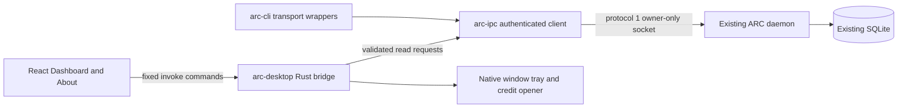

# Desktop foundation: implementation and evidence contract

Status: task-1 attempt-2 contract repair delivered; implementation and native acceptance pending. Author: Technical Director, using `oma-architecture` in recommendation mode. This document is the dependency deliverable for the scaffold, Rust, interface, integration and QA owners. It defines the assigned foundation; it does not amend the mission, its assignments or its immutable verification contract. Only this file is owned by task-1. The assignment's single-file boundary takes precedence over the skill's default separate ADR, result and diagram-sidecar locations; no OMA workflow or mission state is changed.

## 1. Starting source, access and observed work

The original inspection occurred on 2026-11-11 UTC / 2026-11-12 Australia/Sydney. This attempt-2 repair re-inspected the saved assignment, inherited reports, checkout and relevant inputs. Current source provenance is:

| Field | Supplied or observed value | Meaning |
|---|---|---|
| Accepted committed baseline / `baselineHead` | `a9e7a31566e833dceeb82d6d75cd7c6a399583ab` | The accepted cross-workspace source, verified to be a local commit object. |
| `baselineTree` | `c4506e64abaef97daf6f701cac2870c98cfeb91f` | Verified by `git rev-parse a9e7a31566e833dceeb82d6d75cd7c6a399583ab^{tree}`. |
| Actor-local inspected HEAD / supplied `snapshotCommit` | `2ea612184633b0463b427559641b77618c87fc80` | Actual `git rev-parse HEAD`; parent is the accepted baseline. This Actor snapshot is not the accepted baseline commit. |
| Actor HEAD tree / supplied `snapshotTree` | `153e250274ea20e038e012566e69e5e5fa99ca32` | Verified by `git rev-parse HEAD^{tree}`; its input overlay adds the three inherited reports listed below. |
| Actor branch | `av-task/8bb32cc241dc9a3c-7afaa346b4bf92bf-2` | Verified with `git symbolic-ref --short HEAD`. |
| Supplied `snapshotRef` | `refs/agent-valley/task-evidence/8bb32cc241dc9a3c-7afaa346b4bf92bf-2/snapshot` | `git rev-parse --verify` exited 128, `fatal: Needed a single revision`; not locally resolvable. The supplied snapshot commit itself is present and matches actual HEAD. |
| Supplied `workerRef` | `refs/agent-valley/task-evidence/8bb32cc241dc9a3c-7afaa346b4bf92bf-2/worker` | The same resolution failure; no invented resolved worker revision. Record actual HEAD separately. |

The retained attempt-1 report identified its local snapshot as `6e98c7ad11097d4422fa62da5c48af4f296a3134`, tree `c4506e64abaef97daf6f701cac2870c98cfeb91f`, on branch `av-task/8bb32cc241dc9a3c-7afaa346b4bf92bf-1`; those are historical observations, not the attempt-2 revision. This repair began with `contract.md` already tracked in the Actor snapshot: 57,177 bytes, SHA-256 `eb8dac0162601e0ebf10fb1eaa6015c8c3cdcc3127d1702413579b18f83660c3`. `git diff --name-status a9e7a31566e833dceeb82d6d75cd7c6a399583ab HEAD` reported only three additions: `.arc-verify/desktop-foundation/contract.md`, `experience.md` and `value.md`. Their presence in this snapshot does not put them in the accepted baseline or prove they are tracked in the review checkout. The sibling reports are preserved unchanged.

Before this repair, `git status --short --untracked-files=all` and `git diff --name-status` exited 0 with empty stdout and `av.yaml: Operation not permitted` on stderr. `git diff --cached --name-status` and `git ls-files --others --exclude-standard` exited 0 with empty stdout/stderr. Thus no staged changes or untracked files were reported, and no unstaged changes were reported for accessible paths. This is a qualified inspection, not an assertion that every file is readable or the entire checkout is clean. Existing work was not reset or staged. Exact-path checks confirm `apps/desktop` and `bun.lock` remain absent.

Serena was sought again in the available tool registry and no Serena tools were present. `.agents/oma-config.yaml` is absent; accessible `.agents/oma-config.cue` configures `providers.code_intelligence: "serena"`. Per the code-intelligence fallback, source was read only at already supplied/located paths; no replacement recursive source search, provider installation or project registration was performed. Native search was limited to the external SRS and plain documentation/memory. No relevant prior memory was used. Attempt 1 inspected `docs/decisions/README.md` and the proposed runtime-execution/state-ownership ADR: their AV orchestration boundaries are historical context, not an ARC desktop requirement; its checked legacy design/result directories were absent. The supplied Director findings remain source evidence, not authority to change the assignment.

The external SRS was read in place: `/Users/gracefullight/Downloads/Agent_Resource_Control_ARC_Requirements_SRS_2026-11-06.md`, SHA-256 `a8ef945251f9f3fd7c3e337d4efc77ff9914f95114212ca9e6c90ae2ce3e3d9e`. Relevant sections: §1.3–1.4 (local users/non-goals), §4 (daemon/desktop boundary), §15.1–15.9 (stack, state, tray and credits), AT-GUI-01/04, Phase 0 and §26.1. These are external requirement observations, not files added to the accepted Git tree.

The direct `av.yaml` read was re-attempted and again raised `PermissionError: [Errno 1] Operation not permitted`. Its contents remain **unknown**, not confirmed absent or deleted. This access observation is informational and does not block acceptance. Accessible `av.example.yaml` contains commented container-observation examples; they do not configure this mission. The supplied attempt-2 review context explicitly establishes **no container/service observation policy for this mission**. Use that mission context as the applicability basis for `targets.satisfied=true`, with `observationPolicy: null`, `status: "not_applicable"` and `basis: "supplied-mission-review-context"`. Record `av.yaml` access separately as `access_denied`, `blocking: false`. This receipt asserts neither an empty target inventory nor healthy services; it requires no target inventory or health checks. Any target acceptance actually configured by a mission policy remains applicable, but none is supplied for this mission. No service/container inspection, deployment, restart or GUI workaround was attempted.

Root `LICENSE`, `LICENSE.md`, `LICENSE.txt`, `COPYING` and `NOTICE` were absent at the checked exact paths; inspected root Cargo package metadata declares version `0.1.0`/edition `2021` and no product license. SRS §26.1 explicitly describes Apache-2.0 as a **proposed** default. No authoritative product license was found in this scope. Metadata must return `license: null` and About must show `Unavailable` until authoritative license material is supplied. Dependency notices and dependency licenses are separate evidence; do not turn their licenses into a product license.

## 2. Architecture problem, choice and source anchors

The problem is to add an inexpensive inspection client without creating a second execution owner, a second authentication implementation or false outcome/health claims. Existing daemon-owned SQLite, CLI admission/retry behavior, migrations and protocol 1 remain the authority for execution. React owns presentation; the desktop Rust layer owns bounded typed reads and local shell actions.

| Option | Implementation and team cost | Operational and future cost | Decision |
|---|---|---|---|
| Extract the existing authenticated exchange into `arc-ipc`; retain CLI wrappers; add one Tauri crate | One mechanical extraction and DTO projection; frontend/backend meet at a fixed contract | No new service, process supervisor or transport dependency; one place to maintain authentication/deadlines | Selected within the assigned scope. |
| Desktop shells out to `arcctl` and parses human output, or copies its socket client | Initially less extraction, but requires subprocess/output contracts or duplicated failure logic | Additional process overhead; output drift and two security/retry implementations; harder freshness and malformed-reply tests | Rejected. No measured latency or monetary comparison is claimed. |

The direct tray-to-Dashboard journey is selected over a separate status popover plus Dashboard; it implements one selection/detail surface. This is a scope/cost decision, not a usability-study result. No agent orchestration controls, policy edits, telemetry, new database or additional application/state framework are needed for this slice.



Source anchors below refer to the accepted commit above. Attempt 2 re-read and byte-compared 25 explicitly named manifest/source/evidence inputs, including every code path in this table, with `git show a9e7a31566e833dceeb82d6d75cd7c6a399583ab:<path>`; all matched. The five SHA-256 anchors below and the external SRS hash were also reverified unchanged. These are baseline observations, not observations of future implementation.

| Source at accepted baseline | Relevant behavior |
|---|---|
| `crates/arc-cli/src/exec/transport.rs:42–125,167–322,324–484` | Two-second default, shared absolute deadline, tracked writes/uncertainty, bounded attempts, busy backoff, validated response envelopes and cancellable nonblocking socket I/O. |
| `crates/arc-cli/src/exec/transport/peer.rs:15–60,63–116` | macOS `getpeereid`, Linux `SO_PEERCRED`, effective-user comparison, unsupported-platform rejection and PID-plus-birth identity. |
| `crates/arc-cli/src/exec/transport/endpoint.rs:10–50`; `continuity.rs:3–30` | Endpoint versus local failure classification and ambiguity across daemon identities. |
| `crates/arc-ipc/src/lib.rs:24–53,82–103,343–374` | Protocol/version/envelopes, redacted Debug, framing exchange; health returns only running, protocol and Sweeper off. |
| `crates/arc-ipc/src/jobs.rs:94–136,146–176` | Typed Recent/ById requests; 50-row maximum, safe timestamps, `liveness_fresh=false`, bounded lifecycle request decoding. |
| `crates/arc-ipc/src/jobs/types.rs:4–24,32–162`; `jobs/validation.rs:13–87` | Exact job ID/enums, summaries without outcomes, snapshots with recorded outcomes and cross-field validation. |
| `crates/arc-cli/src/job.rs:38–141,152–170,219–300` | Validate selected identity; recorded exit 0/17 differs; preserve outcomes during Traffic failure; last-known/unknown labeling. |
| `crates/arc-core/src/lib.rs:68–107` | Stable per-user instance anchor independent of socket/database overrides, and shared path resolution. |
| `crates/arc-daemon/tests/support/mod.rs:9–65`; `support/runtime.rs:13–58,144–201` | Cross-process fixture serialization, private directories, endpoint configuration and owned-child cleanup. |
| `scripts/coverage/config.ts:1–8`; `source.ts:118–162`; `accounting.ts:47–125`; `run.ts:14–98` | Seven-crate inventory, current hardcoded roots, production/test accounting, fresh profiles and pinned native collection. |
| `scripts/coverage/terminal-outcomes.test.ts:26–110`; `.arc-verify/terminal-outcomes/gates.json` | Historical HEAD/current-input/raw-log coupling requiring the explicit separation in §9. |
| `scripts/harness/validate.sh:15–20,419–448` | Tracked-file scan and mandatory nested `bun run test:coverage`. |

Preflight SHA-256 anchors: `Cargo.toml` = `79eaf16e2fa7d5263b974a6980012115f1c6b11906e1f785dd52fe8c549a3380`; `Cargo.lock` = `424e3a77d5c517f2616655c4c1a2c4ce1e2485ce4be2117020271ab92887dd7e`; CLI `transport.rs` = `8f7395f6e5f8569bc803cb2d035ab62d31cb2851356d4c65e1c3eef970b82c8e`; protocol `jobs/types.rs` = `9459b9a22f0e3cd2ca2c921e5039117007adc928354587612759ad840380ff7b`; historical `gates.json` = `3a9788af04441d1aafa1ae6f9cebbd29d7baa1cef072893b032d843047890509`. These hashes describe pre-task inputs, not the delivered product identity.

## 3. Ownership and the smallest shared extraction

The Integration and Gates Engineer is the **single shared-manifest/lockfile writer**: root Cargo/Bun manifests and locks, crate dependency declarations, Bun configuration, Biome/Vite/TS/Tauri scaffold configuration, coverage registry/accounting and evidence checker. The Rust owner supplies a concrete dependency request through this artifact; source owners do not race the writer on manifests. A handoff requires the delivered scaffold/interface artifact before a consumer edits its allocated files. No manifest is changed by task-1.

The Rust owner implements the authenticated client extraction, bridge/commands and lifecycle callbacks/tests. The interface owner implements components, externalized English-default strings and component/contract tests against §4. The gate owner integrates real-daemon tests and receipts. Independent oma-qa follows integrated source/receipts and is read-only over product, tests and configuration. Implementation/test/gate Actors use the installed backend-engineer profile with both `oma-backend` and `oma-frontend`, as already assigned; this document does not reassign them.

Extract the exchange engine and its deadline stream, endpoint classification, peer verification and continuity support into `arc-ipc::client` (Unix-gated). Use `crate` references inside arc-ipc, and add only the existing workspace `libc` dependency there. Keep `crates/arc-cli/src/exec/transport.rs` as thin wrappers/re-exports with its existing call signatures and Failure behavior. Preserve client-local behavioral tests when moving the engine; do not remove cases because their private module changed. Do not add an `arc-client` crate or make desktop depend on the CLI binary.

A sufficient shared Rust entry point is the following shape; exact module splitting remains the Rust owner's implementation detail:

```rust
pub fn exchange_until(
    socket: &std::path::Path,
    request: &crate::Request,
    deadline: std::time::Instant,
    cancelled: &dyn Fn() -> bool,
    possibly_committed: &mut bool,
    options: ExchangeOptions<'_>, // retry_busy and optional borrowed Continuity
) -> Result<serde_json::Value, Failure>;
```

CLI wrappers construct the request once using the existing CLI request-ID generator; all retries reuse that request ID and payload. The desktop can construct its own correlation ID without a new dependency. The shared API is a native Rust API, never an arbitrary JS operation/payload proxy. `Continuity` remains per-execution/per-call state; its Cell/RefCell internals must not be put into a shared Sync singleton to satisfy Tauri state bounds.

Preserve these invariants during the extraction:

- Protocol 1 only. Frame body is one UTF-8 JSON object with a four-byte big-endian length; reject zero length and bodies exceeding `MAX_FRAME_BYTES=1,048,576` before allocating the declared body. Reuse arc-ipc framing and error handling.
- Authenticate the connected server as **same-user** before sending request bytes; the daemon continues authenticating clients. Retain macOS/Linux implementations, effective-UID comparison, optional process identity for continuity, descriptor close-on-exec and endpoint error distinctions. Unsupported platforms are explicit, not unauthenticated fallback.
- Preserve the default two-second absolute exchange **deadline**, at most three non-busy attempts, per-attempt cap of 600 ms, 25 ms poll wakeups and 20 ms DB_BUSY backoff bounded by the same overall deadline. `retry_busy=false` continues returning Busy immediately. Busy retries are deadline-bounded, not falsely described as three in total. Preserve cancellation checks and `possibly_committed` updates after bytes may have been sent.
- Require matching response protocol/request ID and exactly `(ok, result present, error absent)` or a valid error envelope. Preserve capability/STATUS_V2/uncertain/rejected distinctions used by CLI execution. Malformed JSON, arrays, oversize/empty frames and mismatched envelopes are invalid replies, never healthy data.
- Preserve CLI execution, fallback/retry, queue admission, continuity/witness and native argv/environment/cwd/stdio/signal/exit semantics. Do not move spawn/admission logic into desktop, change migrations or change accepted protocol-1 DTOs. A reconnect/status request never replays work. Existing read-only ById observation may update daemon observation records; it still never launches a child.

## 4. Fixed commands and serialized DTOs

The three daemon data commands return `Result<Received<T>, DesktopError>`. Local `desktop_metadata` returns `Result<DesktopMetadata, DesktopError>` independently of daemon availability; opener/window actions return `Result<(), DesktopError>`. DTOs use snake_case in JSON on both sides, with nulls explicit. Use `#[tauri::command(rename_all = "snake_case")]` for parameters, so `job_by_id` receives `{ job_id }` and `open_credit_link` receives `{ link }`. Rust structs derive Serialize; deserialize and validate daemon wire types before projection. JS invokes only the names below and validates received object shapes before committing UI state. No JS-supplied socket, arbitrary URL, SQL, operation name or payload is accepted.

| Command | Parameters | Result / production source |
|---|---|---|
| `daemon_health` | none | `Received<DaemonHealth>` from `daemon.health`, payload null. Validate daemon=`running`, protocol_version=1, sweeper=`off`; no synthetic metrics or daemon timestamp. |
| `recent_jobs` | none | `Received<RecentJobs>` from `job.status`, `{ "query": "RECENT" }`. Validate StatusResult::Recent and `is_valid()`, <=50 jobs, `liveness_fresh=false`, timestamps and unique job IDs. Preserve daemon order/truncated flag. |
| `job_by_id` | `job_id: string` | `Received<JobLookup>` from `job.status`, `{ "query": "BY_ID", "job_id": id }`. Validate the ID before I/O, the expected result variant and full `JobSnapshot::is_valid()`, and require `job.job_id == requested_id`. |
| `desktop_metadata` | none | Local `DesktopMetadata`; no IPC and no daemon ownership. |
| `open_credit_link` | `link: CreditLink` | Unit on opener success, safe error otherwise; Rust maps the enum to the three exact URLs in §6. |

Window actions `open_dashboard`, `hide_dashboard` and `quit_desktop` are local unit-returning commands for the shared lifecycle dispatcher in §5, with safe errors if needed. No daemon stop, job start/cancel or policy mutation command is added.

Canonical TypeScript wire shapes follow. `Ms`/`Revision` are integer numbers in `0..=9_007_199_254_740_991`; revisions are positive. All finite unions below are exhaustive, not arbitrary daemon strings. This uses the existing protocol enum spellings rather than introducing another domain taxonomy.

```ts
type Ms = number;
type Revision = number;
type JobId = string; // exactly /^[0-9a-f]{32}$/
type Phase = "REGISTERED" | "LAUNCHING" | "RUNNING" | "COMPLETED"
  | "SIGNALED" | "SPAWN_FAILED" | "OUTCOME_UNKNOWN";
type LifecycleReason = "NONE" | "REGISTERED_NOT_CLAIMED" | "CLAIMED_NOT_ATTACHED"
  | "OBSERVER_MISSING_NOT_CLAIMED" | "OBSERVER_MISSING" | "PROCESS_MISSING"
  | "IDENTITY_MISMATCH" | "IDENTITY_UNAVAILABLE" | "CHILD_VERIFIED"
  | "OBSERVED_EXIT" | "OBSERVED_SIGNAL" | "OBSERVED_SPAWN_FAILURE";
type ObservationTarget = "OBSERVER" | "CHILD" | "NONE";
type ObservationStatus = "VERIFIED_MATCH" | "MISSING" | "MISMATCH"
  | "INDETERMINATE" | "NOT_ATTACHED";
type SpawnReason = "NOT_FOUND" | "PERMISSION_DENIED" | "INVALID_INPUT"
  | "RESOURCE_UNAVAILABLE" | "OTHER";
type Outcome =
  | { kind: "EXITED"; code: number } // integer u8, 0..255
  | { kind: "SIGNALED"; signal: number; core_dumped: boolean }
  | { kind: "SPAWN_FAILED"; reason: SpawnReason; os_code: number | null };
type IdentityObservation = {
  target: ObservationTarget; status: ObservationStatus;
  observed_at_ms: Ms; reason: LifecycleReason;
};
type Received<T> = { data: T; received_at_ms: Ms };
type DaemonHealth = { daemon: "running"; protocol_version: 1; sweeper: "off" };
type JobSummary = {
  job_id: JobId; phase: Phase; registered_at_ms: Ms; updated_at_ms: Ms;
  reason: LifecycleReason;
};
type RecentJobs = {
  jobs: JobSummary[]; truncated: boolean; observed_at_ms: Ms;
  liveness_fresh: false; limit: 50;
};
type JobDetail = {
  job_id: JobId; phase: Phase; reason: LifecycleReason;
  observation: IdentityObservation; outcome: Outcome | null;
  registered_at_ms: Ms; launch_claimed_at_ms: Ms | null;
  completed_at_ms: Ms | null; updated_at_ms: Ms; revision: Revision;
};
type JobLookup = { kind: "found"; job: JobDetail } | { kind: "not_found" };
type CreditLink = "github" | "linkedin" | "oma";
type DesktopMetadata = {
  product_name: "Agent Resource Control"; version: string;
  build_commit: string | null; build_dirty: boolean | null;
  os: string; architecture: string; license: string | null;
  open_source_notices: string;
};
type ErrorCode = "unavailable" | "uncertain" | "busy" | "rejected"
  | "protocol" | "invalid_reply" | "invalid_request" | "invalid_endpoint"
  | "local" | "cancelled" | "unsupported" | "opener_failed"
  | "window_unavailable";
type DesktopError = { code: ErrorCode; retryable: boolean };
```

Matching Rust declarations use `arc_ipc::jobs` types for domain fields (re-export or alias them; do not loosen their validators):

```rust
use arc_ipc::jobs::{IdentityObservation, JobId, JobSummary, LifecycleReason, Outcome, Phase};
// Every struct below derives serde::Serialize. Wire field names remain snake_case.
pub struct Received<T> { pub data: T, pub received_at_ms: u64 }
pub struct DaemonHealth { pub daemon: DaemonRunning, pub protocol_version: u32,
    pub sweeper: SweeperOff }
pub struct RecentJobs { pub jobs: Vec<JobSummary>, pub truncated: bool,
    pub observed_at_ms: u64, pub liveness_fresh: bool, pub limit: u8 }
pub struct JobDetail { pub job_id: JobId, pub phase: Phase, pub reason: LifecycleReason,
    pub observation: IdentityObservation, pub outcome: Option<Outcome>,
    pub registered_at_ms: u64, pub launch_claimed_at_ms: Option<u64>,
    pub completed_at_ms: Option<u64>, pub updated_at_ms: u64, pub revision: u64 }
// #[serde(tag = "kind", rename_all = "snake_case")]
pub enum JobLookup { Found { job: JobDetail }, NotFound {} }
// #[serde(rename_all = "snake_case")]
pub enum CreditLink { Github, Linkedin, Oma }
pub struct DesktopMetadata { pub product_name: String, pub version: String,
    pub build_commit: Option<String>, pub build_dirty: Option<bool>,
    pub os: String, pub architecture: String, pub license: Option<String>,
    pub open_source_notices: String }
pub struct DesktopError { pub code: ErrorCode, pub retryable: bool }
// ErrorCode is the Rust enum matching the TS values above, serialized snake_case.
// DaemonRunning::Running -> "running"; SweeperOff::Off -> "off".
```

The Rust example is a declaration contract, not compiled implementation in this task. Safe-integer checks apply even to serde u64 fields. Reuse full snapshot validation **before** dropping process identities and classification from the presentation projection. Do not return raw peer JSON or process/command/path data merely because it was successfully decoded. Required null outcome/time fields must not be silently defaulted from missing JSON. Signal bounds use the existing platform validator; `os_code` must fit i32. Recent summaries must pass their ordering constraints. Metadata strings come only from local build/package material; the commit is a verified 40/64-character lowercase hex object ID or null. Packaged notices retain their actual content without truncating license text.

`apps/desktop/src/bridge/client.ts` imports `invoke` from `@tauri-apps/api/core`, calls `daemon_health`, `recent_jobs`, `job_by_id`, `desktop_metadata`, the enum opener and local lifecycle commands through typed functions, and normalizes rejected invocations to DesktopError. No raw Tauri/serde/OS diagnostic or arbitrary string reaches the UI. Component tests can inject this interface. The interface owner writes the shared golden cases at `apps/desktop/tests/fixtures/bridge.json`; Rust registered-handler tests compare actual serialized replies against the same cases, and the mandated TS contracts test validates/consumes them. Include deterministic health/recent/found exit-0/found exit-17/unknown/not-found/metadata/error cases with an injected receipt clock. This binds both consumers to the produced interface without a generator, separate runtime prerequisite for Bun tests or two unrelated sets of examples. No code-generation package is needed for this small interface.

Failure mapping preserves shared native Failure values, without interpreting an IPC lookup failure as a failed child. Unavailable/Uncertain/Busy are transient and retryable for these read commands; Protocol/InvalidReply/InvalidRequest/InvalidEndpoint/Unsupported are not automatically retried as compatible replies. Explicit rejected/local failures have static explanations and manual retry; Cancelled is silent during hide/quit. CLI-only Witness remains unchanged in CLI and maps to a static local desktop error if encountered. Peer auth failure retains the shared transport's unavailable classification; do not invent proof of a distinct authentication diagnosis. Tauri argument-decoding rejections are sanitized by the wrapper. User-facing messages are local externalized strings keyed by code; peer-provided `message`, payloads and raw errors are never formatted/logged.

### Truth, timestamps and freshness

`received_at_ms` is the **desktop native client** wall-clock receipt after authentication, decoding and validation. It is not a daemon measurement time. Health has no daemon observation timestamp; show “Last successful check” using this receipt. `RecentJobs.observed_at_ms` is the **daemon** observation timestamp for the last-known list. `JobDetail.observation.observed_at_ms` is that daemon identity observation; registered/launch/completed/updated times are the recorded lifecycle times. A successful lookup is not successful child execution. Render readable local dates/times with an accessible exact ISO/Unix time. Use a local monotonic clock for age/timeouts; a wall-clock adjustment must not make stale data fresh.

Only validated `Outcome::Exited { code: 0 }` means recorded success; code 17 (or another nonzero code) means recorded failure with that exit code. Signal and spawn failures retain their distinct reason. Null outcome, unresolved details, `OUTCOME_UNKNOWN` and a Recent summary alone never establish success. Even `COMPLETED` in a summary is “Outcome unknown” until details establish the recorded exit. Full valid terminal snapshots require matching outcomes; a fabricated Completed/null snapshot is rejected, rather than accepted to manufacture an unknown result. Running/starting phases are last-known states at the displayed observation time, not proof the process is currently live. Traffic counters or a recent-list length must not become live queued/running totals; any later scheduling presentation must reuse validated Traffic capabilities/status without changing the three public data commands or CLI behavior.

CPU, memory, disk use/write totals, active agents, global running/queued totals, usage and reclaimed storage are **Unknown** with a short reason (“Not supplied by this daemon interface”). Never replace them with zero, 50-row counts, IPC request metrics, benchmark numbers or inferred host health. “Daemon connected” means the authenticated health exchange succeeded, not that every subsystem/vendor is healthy.

Use one refresh owner per window: run immediately on open/reopen/manual refresh, then schedule the next refresh five seconds after the preceding cycle settles. Each native read has its own maximum two-second deadline; no overlapping polling intervals or 50-row detail fanout. Fetch details only for the selected ID. Use a native try-acquired in-flight permit before spawning blocking socket work, so concurrent invocations return Busy instead of an unbounded queue of blocking tasks; keep the permit until the native call actually ends. Run socket I/O via the existing Tauri async/blocking facility, never on the window thread. A shutdown cancellation flag is checked by the shared client; hide stops new frontend timers and late results can be ignored until the bounded native operation ends.

Capture `(refresh_generation, connection_epoch, selection_generation, selected_id)` for each request. Commit only replies matching the relevant current generations/ID; advance generations on a new refresh, selection change, disconnect, hide/unmount and quit. A late health/list/detail reply cannot restore an older connection state or replace job B with job A. Within one job keep the higher recorded revision, checking nondecreasing recorded times; reject inconsistent regressions. Preserve selected ID and its last validated detail even if it falls outside the next 50 recent rows. Keep at most the 50-row list and selected detail rather than an accumulating job cache.

Connection state distinguishes initial Loading, Connected, Disconnected and incompatible/malformed/status-unavailable failures. Data freshness is independent: retained data is **Stale** after a failed refresh or ten seconds of monotonic age, and remains timestamped. `liveness_fresh=false` stays visibly last-known even just after receipt. Retain a recorded success/failure while disconnected; changing the connection must not erase or rewrite the recorded exit. Empty Recent = “No recorded jobs yet”; valid NotFound = “No matching record”; errors = “Status unavailable”/“Disconnected”, not an empty list. Explain that missing tracking does not establish that work never ran. Show the 50-record limit and truncation. Offer Retry connection/Refresh status; transient reconnect backoff is 1, 2, 4, 8, 16, then 30 seconds maximum, owned by the same refresh controller, paused while hidden, reset after success. Invalid/protocol replies require an explicit retry rather than silently claiming recovery. No status recovery launches work.

## 5. Native lifecycle seams and deterministic tests

Create one window labeled `main` and reuse its identity. Native tray menu IDs are fixed `open_dashboard` and `quit_desktop`; visible labels are `Open Dashboard` and `Quit Desktop (Daemon continues)`. Tray activation, Open Dashboard and macOS application reopen all use the same show/unminimize/focus dispatcher. About can be a tab/dialog in this window. Close means hide and keep tray/application alive; explicit quit ends only this desktop process/tray. A short first-use explanation is sufficient; no exit interception or confirmation flow is added.

Use a small injectable shell port (`hide_main`, `show_main`, `unminimize_main`, `focus_main`, `exit_desktop`) and close/exit prevention adapters, with `LifecycleEvent::{CloseRequested, OpenDashboard, Reopen, QuitDesktop}`. The actual production callbacks must delegate to this dispatcher:

- Installed `on_window_event`: for `main` CloseRequested, call the real close API's `prevent_close()` and hide the existing window; do not destroy/recreate it. Test prevention and hide through the callback adapter, not just an isolated enum reducer.
- Tray menu/activation and macOS `RunEvent::Reopen`: show/unminimize/focus the same `main`. No second WebView is created. Missing-window errors are explicit; normal close does not remove it.
- `quit_desktop`: mark explicit quitting, cancel desktop refresh and request the Tauri application exit. Any ExitRequested guard must allow this deliberate exit and keep the ordinary close-to-hide path alive. Production shutdown must not hold a daemon Child handle, send a daemon stop message, stop an execution observer/child, unlink the daemon socket, delete its DB or manage daemon instance locks.

Build handlers generically enough to install the **same** command router/state on `tauri::test::mock_builder()`/MockRuntime and production Wry. In `apps/desktop/src-tauri/tests/lifecycle.rs`, drive registered handlers through `tauri::test::get_ipc_response`/equivalent and drive the installed callback adapter through an injected prevention/exit port; test exactly `close_request_hides_existing_window`, `reopen_reuses_window`, `quit_desktop_never_stops_daemon`. Assert original window identity, close prevention, visibility/focus, explicit exit request and absence of daemon actions. Test names or a pure reducer alone do not satisfy wiring proof. Keep native adapter code compiled and in production coverage; the few genuinely unexecuted native lines remain uncovered.

In `apps/desktop/tests/lifecycle.test.ts`, deterministic component tests exercise accessible open/hide/quit actions and the real frontend command names, confirm cleanup/late-result protection and the daemon-continues wording. MockRuntime testing does not establish physical tray behavior. Do not start a native event loop or require a display in these tests.

Attempt 1 recorded consultation of these official references: [Tauri Rust test utilities](https://docs.rs/tauri/latest/tauri/test/index.html) and [frontend mock APIs](https://v2.tauri.app/develop/tests/mocking/), [native system tray](https://v2.tauri.app/learn/system-tray/), and [opener plugin](https://v2.tauri.app/plugin/opener/), with corresponding Context7 Rust/mock/opener examples. This repair did not refresh those external references. They identify an implementation route; API/type compatibility with the pinned resolved versions still requires the assigned smoke and tests. No browser/WebDriver/Playwright or GUI check was run or added.

## 6. Exact About/Credits and privacy

Preserve SRS §15.9 verbatim where fixed:

| Element | Required content / mapping |
|---|---|
| Product label | `Agent Resource Control` |
| Creator | `Created by Eunkwang Shin` |
| Personal GitHub | Icon-only Phosphor `GithubLogo`; `CreditLink::Github` / `"github"` -> `https://github.com/gracefullight` |
| LinkedIn | Icon-only Phosphor `LinkedinLogo`; `CreditLink::Linkedin` / `"linkedin"` -> `https://www.linkedin.com/in/gracefullight` |
| CTA | `Try OMA`; `CreditLink::Oma` / `"oma"` -> `https://github.com/first-fluke/oh-my-agent` |
| Metadata | Actual package version, available build commit and dirty flag, OS architecture, product license or Unavailable, open-source notices from actual resolved dependency material. |

GitHub and LinkedIn have an accessible name, tooltip, visible keyboard focus and icon-only visible content. All controls are keyboard-operable; connection changes are announced, selection has a meaningful accessible state, and status uses text as well as icons. Layout and externalized strings must accommodate Korean; avoid fixed English-only clipping.

Use the official Rust opener integration; map only the three CreditLink values to static HTTPS destinations and call the default-browser URL method. Do not expose arbitrary opener input to JS or grant it arbitrary filesystem/shell capabilities for these actions. Stub the opener port for deterministic exact-destination assertions; a mocked successful invocation is not evidence that a live browser opened. Product metadata must report the actual build's object ID when available, never substitute the accepted baseline for an Actor snapshot/integrated build. Null is preferable to an invented commit, architecture or license. Package actual third-party notices from resolved dependencies; label missing notices accurately rather than inserting placeholder license claims.

Privacy is unchanged: no command/chat text, argv, environment, working-directory paths, tokens, raw peer payloads or source bodies go to the Dashboard, desktop diagnostics, telemetry or receipts. The bridge projection contains only the documented IDs/enums/times/outcomes. Use redacted Debug and static errors. Do not add analytics/networking beyond explicit credit opens; no outreach/distribution is authorized. Test fixtures may use known sentinel text to prove it does not leak; logs must not contain real user input. Desktop never directly reads SQLite or manages its migrations.

## 7. Scaffold dependency and compatibility handoff

Add **only one Rust crate**, package `arc-desktop`, at `apps/desktop/src-tauri` in the root Cargo workspace; use the root Cargo.lock and inherited package version/edition. Existing seven crates stay members. Test-only helper binaries may belong to this package under its tests root; they are not new Rust crates or runtime services.

| Scope | Necessary dependencies/configuration |
|---|---|
| Native desktop | Tauri stable major 2 with native tray support; tauri-build 2 build dependency; official tauri-plugin-opener 2; existing workspace arc-core, arc-ipc, serde/serde_json. Use Tauri's existing async runtime instead of another executor. Test-only libc uses the existing workspace dependency for fixture support. Enable Tauri's testing utilities for MockRuntime tests. |
| Shared client | Existing workspace libc added directly to arc-ipc; no third-party transport/client crate. |
| Frontend | React/React DOM major 19, @tauri-apps/api major 2, Phosphor React icons, Base UI runtime used by maintained basecn source components. Record the actual basecn recipe/source revision; ordinary handwritten cards alone do not prove basecnUsed. |
| Tooling | Vite and its compatible React integration; actual TypeScript **7** compiler plus matching React types, Tailwind CSS 4 and its Vite integration, @biomejs/biome. Bun install/scripts and root `workspaces` entry for `apps/desktop`; preserve `test:coverage` and existing test discovery. |
| DOM tests | Bun test with one justified DOM environment (for example happy-dom) and React Testing Library plus required peers/types; deterministic components/events, no browser binary or E2E runner. |

Scaffold owner selects mutually compatible exact resolved versions and freezes `bun.lock`; dependency versions are not verified by this report. If the official compiler package is `@typescript/native-preview`, its invoked compiler must actually report major 7; a package label, alias, TypeScript 5/6 or Vite transpilation alone is insufficient. If the prescribed compiler/toolchain cannot be obtained, report that prerequisite failure rather than change stack/goal. Basecn components must be the smallest actually used maintained set; no alternative icon library, state framework, database, charts or service is justified here. Biome and TS typechecking are separate checks.

Before substantial UI work, capture successful `bun install --frozen-lockfile`, the actual compiler version plus no-emit TS7 check, a Vite production compilation and native Tauri compilation against those frontend assets. Use the scaffold's real scripts/CLI, saving exact argv and versions; do not describe cargo check alone as a built Tauri compatibility smoke or Vite as a TS typecheck. Compile the needed daemon/CLI/fixture binaries from these current inputs for integration. The mission authorizes these actions for the implementation/gate owners; task-1 deliberately runs none. No packaging, signing, deployment, installer delivery or live native interaction is implied by compilation.

## 8. Required behavioral evidence and real-daemon isolation

Mandated Bun files are `apps/desktop/tests/dashboard.test.ts`, `credits.test.ts`, `contracts.test.ts`, `lifecycle.test.ts`. Tests render actual components with deterministic DOM/clock/bridge fixtures and exercise selection/events; source-string searches or stand-alone mapping tests cannot replace them. Cover exit 0/17, unresolved outcome, unknown metrics, no data versus unavailable, stale/disconnected retention, exact timestamps, selection A/B reply races, refresh cancellation/reopen, 50-row truncation and accessibility of selection/credits. Contracts tests reject unsafe timestamps, invalid enums/null omissions, wrong result kinds, >50 rows, `liveness_fresh=true` and mismatched IDs and validate handler-produced fixtures.

`apps/desktop/src-tauri/tests/daemon_bridge.rs` must invoke the same production Rust bridge implementation called by registered Tauri commands, against an **isolated real daemon** for positive/recovery/survival cases. Existing `crates/arc-daemon/tests/managed_exec/cli.rs` and `traffic_cli/terminal_outcomes.rs` show real exit-0/17 and owned-child mechanisms; they do not themselves prove desktop bridge acceptance.

Reuse the serialization lock algorithm/path from `crates/arc-daemon/tests/support/mod.rs` (held through final owned-child reap) and private runtime Fixture/OwnedChild behavior. Socket/DB overrides alone do not isolate the production instance anchor (`arc-core::instance_anchor`). Do not create another independent fixture-lock path, race existing suites, restart an unrelated daemon or alter production admission to ease testing. If an unrelated process already owns the production anchor, report the prerequisite conflict rather than kill it or silently skip. The existing runtime fixture uses `env!("CARGO_BIN_EXE_arc-daemon")`; that macro is package-scoped and cannot simply be path-included into arc-desktop. Reuse the small fixture logic with injected, current-build executable paths, or coordinate an explicit test-support interface delivery with its owner. Resolve binaries from the verified current workspace target and receipt; do not copy a stale sibling binary or add a new support crate.

Required named cases and evidence:

| Test case token | Required assertion through the production bridge |
|---|---|
| `records_exit_zero` | A real managed command exits 0; selected ById details record code 0 and completion/observation times. |
| `records_exit_seventeen` | A real managed command exits 17; details preserve code 17 as failure, including a daemon recovery/restart read of that record. |
| `disconnect_reconnect` | Stop only the fixture-owned daemon; bounded failure, reconnect to its restarted private endpoint, recover the same recorded job/outcome. UI preservation is also tested deterministically. |
| `rejects_malformed_response` | An isolated same-user adversarial socket sends malformed/oversize/invalid-envelope replies; the production bridge rejects safely within deadline. This negative fixture is not mislabeled a real-daemon success reply. |
| `rejects_mismatched_job_id` | A structurally valid same-user response for a different selected job is rejected, alongside request-ID/protocol mismatch tests. |
| `daemon_survives_desktop_exit` | A separate headless desktop-client probe uses the production bridge, exits normally, and the same daemon PID-plus-birth identity remains alive and serves health/job reads afterward. |
| `active_child_survives_desktop_exit` | Start a real long-running managed fixture with a readiness barrier; capture child identity; exit the desktop-client probe; prove that exact child remains active and completes naturally afterward with its recorded outcome. A replacement process or PID-only kill(0) check is insufficient. |

The client probe is a test-only executable of arc-desktop, calls production bridge/shutdown seams and terminates as a real OS subprocess. It does not start or own the daemon or execution child. Tests exercise normal client exit and verify no daemon-stop side effects; registered lifecycle tests independently prove that the production Quit Desktop callback routes to that desktop exit. This headless combination is deterministic evidence, not a claim of physically clicking a tray menu. Finalize readiness/exit waits with deadlines and reap only owned processes after survival assertions; retain inherited LLVM profile output for these native children.

## 9. Coverage, gates and provenance

### Coverage roots and historical separation

Extend the **existing** coverage contract; do not build a second desktop-specific coverage gate. Define an explicit registry with manifest, production-source and test roots:

| Crates | Manifest/source/test roots |
|---|---|
| arc-core, arc-detector, arc-storage, arc-ipc, arc-daemon, arc-cli, arc-traffic | Each existing `crates/<crate>/Cargo.toml`, `crates/<crate>/src`, `crates/<crate>/tests`. |
| arc-desktop | `apps/desktop/src-tauri/Cargo.toml`, `apps/desktop/src-tauri/src`, `apps/desktop/src-tauri/tests`. |

Keep the historical six-crate baseline inventory unchanged, identify historical seven-crate receipts explicitly, and require the **current** ordered crate set `[arc-core, arc-detector, arc-storage, arc-ipc, arc-daemon, arc-cli, arc-traffic, arc-desktop]`. Generalize config/source/accounting/run together: no `path.split('/')[1]` crate inference for apps; no broad apps exclusion. Additional test-path classification must use the explicit roots, including test-only fixture bins and path-included shared fixtures. Include every production runtime source, startup/handler/callback adapter and missing/zero-hit line in the current accounting. Preserve LCOV/LLVM corroboration, canonical-path rejection, test-only cfg accounting, missing-file/crate errors, native child-profile/merge evidence, pinned tools and integer **covered * 100 >= total * 80** for each crate. Keep build/config scripts in freshness inputs; do not introduce blanket cfg/coverage feature exclusions to remove native adapters from the denominator.

Preflight confirmed `scripts/coverage/terminal-outcomes.test.ts:26–110` demands historical HEAD `6b5218cf63b174b7976e52d81d56c7e3bf81112d`, current-source hash equality and byte-identical root manifests. That commit object is present, but Actor HEAD is different. All 48 stdout/stderr references from its 24 command receipts point to absent `target/terminal-outcomes/task-5-attempt-9/...` files here. This is source-inspection evidence of a blocker, not a freshly executed failing Bun result.

The gate owner must preserve `.arc-verify/terminal-outcomes` historical receipts byte-for-byte, and keep historical provenance assertions active in the Bun suite while separating their scope. Compare immutable historical evidence bytes against the accepted Git object containing them and referenced original commits; bind historical source assertions to their actual original committed inputs and any recorded overlay, not today's files. Do not assume an old receipt's source overlay equals its acceptedHead: verify each hash/object relation. Mark missing historical raw logs unavailable, so their content cannot be independently authenticated here. Do not fabricate/replay predecessor outputs or claim those old passes as current. Fresh desktop/current-tree receipts replace the need for historical runtime passes **as current acceptance**, not the preserved historical records themselves.

Maintain migration and protocol-1 schema byte protections against the accepted baseline, current native execution/exit/status/privacy regressions, full active discovery and the current coverage floor. Legitimate Cargo additions are checked against current workspace/dependency inputs and fresh native receipts, rather than forced equal to an old manifest. A refactored historical check must assert correct historical object/receipt binding and explicit raw-log availability; it must not silently drop checks, return early, relabel historical success, ignore active test files or expand Bun ignore patterns. If a claimed historical source binding cannot be established, report it as an unresolved historical provenance gap distinct from current execution evidence.

### Gates and timeouts

The six mandated gates, unchanged, are:

1. `cargo fmt --all -- --check`
2. `cargo clippy --workspace --all-targets -- -D warnings`
3. `cargo test --workspace` — one explicit entry in the immutable verification contract.
4. `bun run test:coverage`
5. `./scripts/harness/validate.sh`
6. `bun test` — full active discovery, including the evidence check and desktop tests.

The harness invokes coverage again at lines 419–443; record that nested run with its own receipt/coverage identity. It is a mandated nested execution, not permission to set SKIP_COVERAGE or substitute a prior receipt. The explicit coverage collection and the harness collection both execute tests natively; distinguish them from gate 3 instead of claiming workspace tests ran only once in total. Avoid additional discretionary full collections after passes. Focused mandatory contract/component commands remain in the supplied verifier as written. Framework per-check timeout is **7,200,000 ms**, overriding the smaller planning estimates for actual termination; wrappers/replays must allow at least that much per check, subject to the mission's overall deadline. Do not change verification argv or acceptance criteria to fit a wrapper.

### Six-file evidence layout and receipt schema

Use these six files under `.arc-verify/desktop-foundation/`: `contract.md` (this task), `experience.md` (interface/interaction and exact content evidence), `value.md` (ARC commercial hypotheses, unmeasured CAC/LTV), `gates.json` (gate-owner machine receipt), `qa.md` (independent read-only reviewer) and `final.md` (Chief's decisions/results/lessons/next actions). The mission allows at most seven; this contract consumes no seventh slot. No per-attempt reports, copied logs or additional evidence manifests belong in this directory. Use one small active evidence check, `scripts/coverage/desktop-foundation.test.ts`, reusing existing parsers/accounting/helpers; it validates evidence rather than implementing another gate runner.

Raw stdout/stderr, version output, serialized handler fixtures, command metadata, source inventories, input manifests and native child/profile evidence go under unique `target/desktop-foundation/<run-id>/` paths. Existing coverage system outputs retain their prescribed location; reference them by hash rather than copy them into the six-file directory. A concise gates.json can reference hash-bound detail manifests under target.

`gates.json` fields required by the supplied verification contract are listed exactly below. Their values are **requirements for later measured receipts**, not claims that this task passed them. Initial/pending/failed checks must never be written as passed or true.

| JSON pointer(s) | Required accepted value and supporting material |
|---|---|
| `/acceptedHead` | `a9e7a31566e833dceeb82d6d75cd7c6a399583ab`; separate from actual checkout HEAD. |
| `/stack/verified`, `/stack/reactMajor`, `/stack/tauriMajor`, `/stack/tailwindMajor`, `/stack/basecnUsed`, `/stack/phosphorUsed`, `/stack/biomeConfigured` | `true`, `19`, `2`, `4`, `true`, `true`, `true`; resolved package versions, real component imports/provenance, configuration and compiled smoke. |
| `/smoke/frozenInstall/status`, `/smoke/typescript/status`, `/smoke/vite/status`, `/smoke/tauri/status`; `/smoke/typescript/major` | Each `passed`; compiler major `7`; exact invoked version/install/typecheck/compile receipts, frozen-lock hashes before/after. |
| `/tests/components/status`, `/tests/tauriHandlers/status`, `/tests/daemonBridge/status`; `/compatibility/status` | `passed`, with named executed tests/commands and output receipts; existing CLI/migration/protocol/privacy regressions included. |
| `/tests/daemonBridge/realDaemon` | `true`, backed by actual isolated daemon executable/input identity/readiness evidence. Negative response fixtures are labeled separately. |
| `/tests/daemonBridge/cases/exit0`, `/exit17`, `/disconnectReconnect`, `/malformedResponse`, `/mismatchedJobId`, `/daemonSurvival`, `/activeChildSurvival` | Each `passed` under that same `/tests/daemonBridge/cases` parent; bind named executed tests and native process identity/exit assertions. |
| `/gates/format/status`, `/gates/clippy/status`, `/gates/workspaceTest/status`, `/gates/coverage/status`, `/gates/architecture/status`, `/gates/activeBun/status` | Each `passed` from the unchanged command, exit 0 and parseable successful raw logs. |
| `/gates/activeBun/fullDiscovery`; `/gates/architecture/nestedCoverage/status` | `true`; `passed`, with active test inventory and a distinct nested coverage receipt. |
| `/coverage/minimumPercent`, `/coverage/workspaceCrates`, `/coverage/allCratesAtLeast80` | `80`, exact eight-crate order above, `true`; numerator/denominator, LCOV/LLVM/profiles and existing coverage receipt recomputed, not merely reported percentage strings. |
| `/targets/satisfied` | `true` on the supplied mission review context's no-policy basis; record `/targets/observationPolicy: null`, `/targets/status: "not_applicable"` and `/targets/basis: "supplied-mission-review-context"`. Keep the informational `av.yaml` observation as access-denied/nonblocking. No inventory or service-health receipt is required for this mission, and this value claims no service health. |
| `/evidence/currentInputsVerified`, `/evidence/rawLogHashesVerified`, `/evidence/historicalProvenanceSeparated` | `true` only after independent recomputation of the rules below; old unavailable raw logs cannot supply current proof. |

For every command, use this material record (in gates.json or its hash-bound target manifest): `id`, `argv` array, `cwd`, `startedAt`, `finishedAt`, actual duration, `timeoutMs`, `exitCode` or termination reason, `status`, native tool versions/host/architecture, safe relevant environment configuration, and `stdout`/`stderr` references `{path, sha256, bytes}`. Parsed case/summary references point back to the actual command/test names. Record failed attempts as well as successful ones; only the matching successful current receipt qualifies. No credentials/raw user inputs in environment capture. Expected fixture exit 17 belongs to the fixture assertion, not a falsely exit-zero wrapper receipt. The no-policy target applicability record above is grounded in supplied mission context, not an executed health check, and needs no fabricated command or raw log.

Keep `inputIdentity` as `{ sha256, files, manifest }` or an equivalent compact reference with its aggregate digest and hash-bound file map. Use the existing canonical sorted path-to-SHA256 method and capture it before/after each measured run. Inputs include root manifests/locks/toolchain/Bun/Biome config, all eight crates' sources/tests/manifests/migrations/build scripts, desktop TS/TSX/styles/HTML/tests, Vite/TS/Tauri/capability/assets/notices configuration, verification/harness/coverage scripts and this frozen interface contract. Include untracked/staged/unstaged product inputs that affect execution; do not rely on Git HEAD or tree alone. Exclude target outputs, node_modules, .git, generated gate/QA/final receipts and other generated evidence from the digest to prevent self-reference. Preserve existing protected accounting contracts in freshness inputs. Source/config/test inventory paths must be explicit and canonical; generated files cannot suppress missing input paths.

Raw references must be regular files with SHA-256 and byte size matching the bytes; reject symlinks, `..`, absolute/path escapes and files outside the specified target/coverage output roots. Check canonical containment and recompute hashes, including zero-byte stderr. A log missing from this checkout is unavailable, not authenticated by a matching string in JSON. Preserve actual build/executable/profile provenance in referenced manifests. A receipt's boolean fields are claims until these checks run.

For cross-workspace use preserve `baselineHead` and `baselineTree` exactly, plus original `snapshotCommit`, `snapshotTree`, `snapshotRef`, supplied `workerRef` and its actual resolution/access result, actual Actor HEAD, worktree/branch and changed-path hashes. Do not replace any source hash with the review checkout's HEAD. Task-1's contract was initially an untracked deliverable absent from the attempt-1 snapshot and baseline. The attempt-2 snapshot tracks the prior report, while this repair is an uncommitted change to that file and remains absent from the accepted baseline; integration must verify the delivered bytes, not substitute the snapshot's pre-repair version. When available, bind the framework delivery receipt and recompute current input identity in the integrated worktree. An Actor snapshot tracking a file does not establish that the review checkout tracks it. In particular, the architecture harness scans tracked files: integrate the required new paths before treating that scan as coverage of them, then verify the integrated source set. Keep historical artifact references and current receipt claims in distinct sections with their own revisions/availability.

## 10. Acceptance handoff, risks and checks performed

Contract acceptance is documentary: §§3–4 define protocol 1, same-user authentication, deadline/framing bounds, 50-record selection, concrete Rust/TS DTOs/errors/freshness and CLI/privacy invariants; §5 defines callback/registered-handler seams; §§7–9 define one added crate, one shared writer, coverage roots and six-file/current-receipt evidence. No product interface is implemented or claimed compatible yet. Consumers can proceed against this artifact without changing the task/mission graph; ownership or interface conflicts must go to Chief with exact paths.

Attempt-2 inspection commands were read-only: Git revision/tree/branch/log checks; `git diff --name-status` against the accepted commit and the local worktree; `git diff --cached --name-status`; `git ls-files --others --exclude-standard`; scoped `cat`/`sed` reads; external-SRS `rg`; and a read-only Python script using exact-path checks, SHA-256 and `git show` byte comparisons. All 25 compared inputs matched the accepted baseline, and the SRS hash matched the retained anchor. The exact comparison set is root Cargo.toml/Cargo.lock/package.json/mise.toml; CLI transport.rs plus peer.rs/endpoint.rs/continuity.rs and job.rs; IPC lib.rs/jobs.rs/jobs/types.rs/jobs/validation.rs; core lib.rs; daemon support/mod.rs/support/runtime.rs/managed_exec/cli.rs/traffic_cli/terminal_outcomes.rs; coverage config.ts/source.ts/accounting.ts/run.ts/terminal-outcomes.test.ts; historical terminal-outcomes/gates.json; and harness validate.sh, at the full paths already cited above. Snapshot/worker ref resolution attempts exited 128; actual HEAD and its tree resolved correctly. The initial combined revision command also exited 128 at the unresolved snapshot ref after printing the valid HEAD/base hashes; no missing ref was replaced with another revision.

The only write in this repair is the existing `contract.md`. Its target applicability paragraph, `/targets/satisfied` schema entry and remaining-risk paragraph now use the supplied no-policy mission context. Provenance and inspection notes were refreshed for the actual attempt-2 snapshot. The protocol/DTO/CLI, lifecycle, dependency, coverage and six-gate interfaces remain the same. Final scoped `git diff --check`, full patch readback, sibling-report hashes and changed-path inspection verify this documentary delivery; they are not native gate passes. Attempt 1's recorded new-file diff check is historical and is not reused as this repair's check. No formatting, Clippy, Cargo/Bun tests, coverage, architecture gate, install, compilation, service action, browser/GUI interaction or external delivery ran in this task.

Remaining implementation risks/prerequisites are actual TS7/native dependency compatibility; mechanical client extraction without changing uncertain execution behavior; full desktop crate production-line coverage; package-scoped test-binary wiring; and historical source-overlay authentication where raw logs are missing. They require the assigned owners' artifacts/checks, not operator implementation choices. Missing local snapshot/worker refs and the `av.yaml` access denial remain explicit evidence limitations; the latter is informational and creates no acceptance prerequisite under the supplied no-policy mission context. Product license stays unavailable without authoritative material. Cost and runtime overhead are unmeasured; the structural choice minimizes duplicated clients, processes and verification tooling without claiming savings.

Next required evidence is frozen stack/compilation, implemented component/handler/real-daemon tests, six native gates with per-crate coverage, then independent read-only oma-qa over **integrated** source and receipts. The final report must separately state **Live native tray interaction**, **Windows acceptance** and **Full Phase 0 completion** as unverified wherever no direct evidence exists. Deterministic macOS foundation proof alone cannot satisfy the SRS two-OS Phase 0 DoD.
