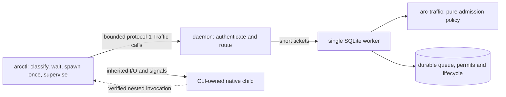

# Traffic slice: architecture and preflight

Status: implementation contract input for the Chief and assigned engineers, 2026-11-10. This is a recommendation, not evidence that scheduling is implemented or verified. The assigned task owns this file only. The Chief retains task and integration ownership.

## Decision and source scope

The problem is to coordinate the start of independently invoked, local Cargo jobs across working directories without moving child execution into the daemon or allowing retries to start a second child. Choose one durable SQLite coordinator behind a small `arc-traffic` policy boundary. Use the existing CLI as the only process launcher, the existing detector, protocol-1 transport, bounded database worker and lifecycle storage. A healthy queued CLI waits; an actual daemon outage still permits bounded fail-open. FIFO and resource limits apply to admitted ARC jobs, not to arbitrary processes or commands running during an outage.

Source provenance for this report:

| Item | Observed identity and limit |
| --- | --- |
| Accepted committed baseline | `4d2f71c1a1482925f6c9918296d7ceb3435b7592`, tree `4455896fdf976244313a70a9fa38b730b344b411`; both object IDs were verified locally. |
| Actor-local snapshot and inspected HEAD | `4b1908117ed0579b8939e330f416c4d015dc5463`, tree `008a73aa568b43b4f0a4a875d808ffea22c0f68a`, parent `4d2f71c1a1482925f6c9918296d7ceb3435b7592`. This snapshot is distinct from the accepted commit and tree. |
| Supplied snapshot and worker refs | `refs/agent-valley/task-evidence/4b0bc225f5b10fe1-7afaa346b4bf92bf-3/snapshot` and `refs/agent-valley/task-evidence/4b0bc225f5b10fe1-7afaa346b4bf92bf-3/worker` did not resolve in this Actor checkout. The snapshot commit and tree were verified directly; no substitute worker revision is asserted. The Chief must verify the collected worker and the uncommitted repair in the integrated worktree. |
| ARC SRS | `docs/bounded-ipc-targets.md` identifies `/Users/gracefullight/Downloads/Agent_Resource_Control_ARC_Requirements_SRS_2026-11-06.md`; its observed SHA-256 is `a8ef945251f9f3fd7c3e337d4efc77ff9914f95114212ca9e6c90ae2ce3e3d9e`. Read §9.1–9.11. Its version labels disagree, as the pointer document records; cite section and hash. |
| Current changes | Before this repair, `git status --short` and `git diff --stat` printed `av.yaml: Operation not permitted`; `ls -l av.yaml` was also denied. Status, staged diff and working diff with that path excluded were empty. This does not establish the complete worktree diff. The accessible baseline-to-snapshot comparison, excluding `av.yaml`, showed the three Traffic reports plus changes to `.arc-verify/rust-coverage/contract/accounting.{json,md}`, `scripts/coverage/` and the Traffic evidence/targets tests in `scripts/harness/`. The known Rust crate paths and workspace Cargo manifests have no accessible baseline-to-snapshot diff. This report was tracked in the Actor snapshot but is absent from the accepted commit. Do not bypass the restriction. |
| Discovery and configuration | Serena was not present in the exposed tool inventory. Inspection used the known paths named in the assignment and direct reads; no recursive native code search was substituted. The `av.example.yaml` container block is commented example data. The contents of `av.yaml` and any configured targets are unknown; absence of targets cannot be inferred. |

This report reflects the Actor-local snapshot and the accessible initial worktree reads, plus this task's uncommitted repair; it does not describe later Actor changes. The excluded `av.yaml` working content remains unknown. The unrelated Agent Valley decisions in `docs/decisions/README.md`, `adr-chief-decision-ownership.md` and `adr-runtime-execution-and-state-ownership.md` concern mission runtime ownership, not ARC Traffic policy; no conflicting ARC Traffic ADR was identified in that index.

Key source facts, all at the Actor-local snapshot unless noted otherwise:

- `crates/arc-detector/src/rules.rs` recognizes native argv `cargo build`, `cargo test`, `cargo clippy` and `cargo fmt` as build, test or lint; remote CI/SSH and UNKNOWN have distinct classifications. `crates/arc-detector/src/lib.rs` says classification is pure syntax, not execution or tool verification. Do not broaden detection implicitly.
- `crates/arc-cli/src/exec.rs` creates one random job ID, directly spawns one native child and owns its signals and outcome. `exec/preparation.rs` and `docs/managed-exec.md` describe a shared 1,800 ms preparation deadline and bounded fallback. Child I/O, argv, cwd, environment, signals and exit behavior must remain intact.
- `crates/arc-daemon/src/db_worker.rs`, `db_worker/jobs.rs`, `connection.rs` and `limits.rs` establish one owned SQLite worker, finite tickets and bounded requests. `crates/arc-storage/src/jobs/transitions.rs` uses `IMMEDIATE` transactions, immutable job identity and repeatable claim/completion; `jobs/reconcile.rs` probes outside the transaction and rejects stale revision evidence.
- `crates/arc-storage/migrations/0001_phase0.sql` has `jobs` timestamps and one `permits` row per job; `0002_managed_exec.sql` adds lifecycle data. Their observed SHA-256 values are respectively `046610c920709f0d9371ccaff6254fbd1c1c46cc6e930890869ff0ffc4fb1384` and `464a1c88270f01a56ccab6610f87eff7648e0640f276ebce53b8a97026c50814`. `src/migration.rs` registers both. Never edit either historical migration; add a forward `0003` if the missing durable ordering or lineage state needs schema.
- `crates/arc-ipc/src/jobs.rs` and `jobs/types.rs` deny unknown lifecycle fields and define a closed `Phase` enum. `crates/arc-storage/src/jobs/codec.rs` decodes `jobs.state` as that enum. New queue states or fields in the old result would therefore break old clients or storage decoding. `crates/arc-cli/src/job.rs` currently says scheduling is not implemented.
- At this snapshot, `arc_ipc::dispatch` in `crates/arc-ipc/src/lib.rs` returns `UNSUPPORTED_CAPABILITY` for an unknown operation. The existing CLI `exec/transport.rs` maps non-protocol error responses to `Rejected`; a compatible Traffic capability probe needs a specific, validated unsupported result without changing other rejection behavior.
- `crates/arc-daemon/src/platform.rs` checks the Unix socket peer's user, but this is not proof of the peer PID or ancestry. `crates/arc-core/src/process_identity.rs` supplies PID, start token, boot identity and native observations, not lineage proof.

## Options and cost

| Option | Implementation and operational cost | Complexity, future change and disposition |
| --- | --- | --- |
| **Selected: one SQLite coordinator plus pure Traffic policy** | Add a small local Rust crate, a forward migration, bounded typed IPC, worker operations and CLI waiting. Reuse the single writer and transactions; no new service, cache or third-party dependency is justified by the inspected stack. Each poll costs a bounded IPC/DB operation; tune polling after measurement. | Queue, permit, counters and lifecycle updates have one durable serialization point. Recovery and ownership are simpler to reason about, at the cost of head-of-line blocking and pressure on an already bounded worker. Policy can evolve separately from persistence. |
| **Alternative: in-memory scheduler beside SQLite** | Fast in-process admission, but needs a synchronized durable journal or reconstruction from SQLite for every mutation and restart. Without that journal a daemon crash loses ordering and permits. | Two authorities create commit/ack, cancellation, crash and duplicate-event races. A correct journal returns much of the same SQLite work plus reconciliation and operational complexity. Defer unless measured worker contention justifies it. |

These costs are qualitative; no latency, throughput, implementation time or dollar measurements were made here. The selected coordinator intentionally uses strict global FIFO, including head-of-line blocking. Fairness, backfilling, foreground priority, adaptive pressure and rate control remain outside this first slice even though the SRS describes broader Traffic behavior.



## Admission and durable state contract

1. Eligibility is a direct, positively classified `HOST_LOCAL` Cargo build, test or lint. `REMOTE_CI`, `REMOTE_EXEC`, UNKNOWN, ambiguous or other classifications bypass Traffic reservations immediately even with a full queue. Lifecycle observation may remain, but bypass must neither acquire a queue position nor consume a permit. No command, argv, path or ordinary environment value goes into scheduling data, status or logs.
2. Assign an immutable, monotonically increasing durable sequence inside the same write transaction that creates the eligible queue entry. A dedicated `traffic_jobs` table with an `INTEGER PRIMARY KEY AUTOINCREMENT` sequence and unique `job_id` is one suitable forward-migration design; millisecond timestamps, UUID ordering and in-memory arrival order are not sufficient. Preserve sequence across reopen and retries. A duplicate key with the same owner, classification and parameters returns the same state; conflicting data is rejected.
3. Treat the oldest live queued sequence as the global head. In a short `BEGIN IMMEDIATE` transaction, re-read the head and active permits, calculate per-class counts and aggregate CPU and memory reservations, and admit the head only when its class window and both global budgets fit. A later eligible request cannot pass that head. The head polls after release; no request or database ticket is held for its entire wait. Bound polls and release all transport/DB tickets between them. A stalled/dead head must be reconciled safely rather than silently overtaken.
4. `arc-traffic` owns a deterministic policy calculation over typed classification, effective class windows, integer CPU reservation units, memory bytes and active totals; storage owns the transactional snapshot and mutation. Persist and add CPU units exactly as integers, for example millicores, rather than relying on rounding in the legacy `REAL` estimate. Build, test and lint each have explicit positive windows and conservative finite class defaults. Document actual defaults and configuration; validate overflow, zero/impossible windows and budgets that cannot admit a configured class rather than leaving jobs permanently queued. Reservations are planning estimates, not OS-enforced resource caps or evidence of actual memory savings.
5. The transaction that grants a head atomically writes its reservation/permit and associated Traffic state. The existing `permits.job_id` uniqueness constraint and guarded updates make a repeated grant or release idempotent. A completion, proven cancellation before spawn, or spawn failure must update the relevant lifecycle/Traffic record and release exactly once in one transaction. A later duplicate completion/cancel cannot subtract resources twice or overwrite a conflicting outcome. A conditional update or permit generation must prevent a stale retry from releasing a later grant.
6. Preserve legacy `jobs.state` values and old lifecycle payloads. Keep Traffic queue/reservation states in a separately encoded table and expose them only through new operations; map legacy status to its existing phases. This also avoids `codec.rs` treating `QUEUED` as an invalid legacy `Phase`. Track queue and reservation timestamps and actual completion outcome using allowlisted metadata. Compute queue wait from recorded values, and distinguish a local observed outcome from an unconfirmed persisted outcome.
7. The SRS §9.2 asks for atomic `QUEUED -> RESERVED -> RUNNING`. SQLite cannot atomically commit an OS child spawn. Make admission and reservation one atomic transaction, then use a durable guarded start/attach transition and an atomic outcome/release transition. No SQLite transaction spans a child spawn or unbounded I/O. Test the gaps explicitly; do not describe the multi-step native launch as a single atomic database commit.

Suggested logical interface, to be settled between the actual owners without introducing a cycle:

```text
arc_traffic::decide(classification, candidate_reservation, active_totals,
                    effective_windows_and_budgets, is_fifo_head)
    -> Bypass(reason) | Wait(reason) | Admit(reservation)
storage Traffic operation(job_id, verified_owner, intent, policy, now)
    -> Queued(sequence, queued_at) | Reserved(permit, reservation)
       | Started | Completed(outcome) | Cancelled | Conflict
reconcile_fallback(job_id, verified_owner, optional_child_identity, optional_outcome)
    -> Abandoned | ReservationRetained | Completed | Conflict
```

The exact Rust names and wire spellings are implementation choices. The policy is pure and must not open SQLite, spawn processes or own IPC. Storage calls or is passed the pure decision while holding its short authoritative transaction; the daemon routes typed bounded operations through its existing worker. Avoid a dependency cycle between policy, IPC and storage.

## Protocol, waiting and failure behavior

- Add separately named Traffic operations, with a capability probe or an explicit `UNSUPPORTED_CAPABILITY` response, retaining protocol version 1 and the existing lifecycle operation/result schemas. A new client talking to an old daemon falls back to the existing Phase 0 lifecycle path only after a valid, authenticated, matching unsupported-capability response to the probe; preserve other existing rejection handling. An old client talking to a new daemon continues to use the unchanged old operations and is not scheduled by the new Traffic protocol. For a Traffic-owned job, legacy claim/complete calls must not sidestep the admission, owner verification or atomic permit transition; reject or safely route them while leaving legacy-only jobs unchanged. Test frozen old decoders and both pairings, including schema doctor reporting after any migration; the old count-only doctor may reject a newer schema and must not be misrepresented as successful.
- Once a valid response confirms `Queued`, wait without a global job-start timeout while the daemon remains responsive. Use a new bounded deadline for each exchange and the existing cancellation polling; a queue response is not an outage. Emit one plain, redacted queued notice on stderr before start and expose Traffic state in the new status path. A writable sink must observe the queued notice before the acceptance fixture releases the first build. A broken/full stderr must not block supervision or be falsely claimed to have received output.
- Preserve the existing bounded preparation fail-open when the daemon is absent, unreachable, stalls or loses replies. A timeout after a commit is **uncertain**, not proof that no reservation exists. Retry the same job ID while time remains; never allocate another ID or spawn from a retry. If fallback occurs, the CLI makes one irreversible local decision to launch at most once and never re-enters admission for that invocation. Its supervisor continues bounded, asynchronous reconciliation attempts using the same ID while it runs, and reports an observed child identity and outcome when available. These attempts are metadata only; they must not delay the fallback spawn, block child supervision, trigger a second spawn or extend the outage bound. Invalid protocol, authenticated rejection, local preparation failure and confirmed pre-spawn cancellation retain their existing non-spawn behavior.
- On cancellation, race the final pre-spawn cancellation check against the single spawn attempt. A confirmed queued cancellation removes its place and creates no child; a grant cancelled before spawn is released only when non-execution is established. A running child keeps the existing signal and wait semantics; release follows the recorded outcome or safe reconciliation. Tests must cover cancellation at each boundary and late duplicate completion.
- Lost acknowledgement before or after queue/grant/claim/attach/complete commit cannot itself authorize a second spawn or permit. Reconcile the same key after recovery. For an uncertain reservation or unobserved child, do not release based solely on elapsed time: retain an uncertainty state until reliable outcome or native process evidence establishes that release is safe. A timeout, a missing owner by itself, or a permission-denied probe is not proof that an unknown child has stopped. Never invent exit status.
- At daemon restart, restore committed queue order and reservations before new admissions. Reconcile abandoned unreserved entries and retain/reconcile uncertain grants as described below. Never replay an existing job. If a CLI starts during fail-open, it may run without a reservation; exact global concurrency and accounting cannot be guaranteed across that outage.

### Reconciliation after fail-open

An abandoned queue entry and an uncertain grant require different transitions. Implement the following as short, idempotent transactions in the existing SQLite writer. Authenticate the peer for a client-initiated report; for daemon-initiated cleanup, revalidate the recorded owner identity and revision using native evidence. Bind either operation to the original job ID and owner identity; a duplicate returns the current result, and a conflicting owner or intent is rejected. Terminal abandonment must be durable, so delayed enqueue or poll requests for the same ID cannot revive the entry or acquire a permit.

| State observed in the transaction | Required response to a verified fallback decision or safe owner reconciliation |
| --- | --- |
| No entry, or `QUEUED` with no permit | Create or transition to an `ABANDONED` tombstone and remove the entry from FIFO admission. No reservation is released. A fallback child may already be running; its existence does not justify keeping an unreserved queue position. This child is outside the admitted accounting during the outage. |
| `RESERVED`, starting, or running with a permit | Mark fallback/reconciliation in progress while retaining the same single permit and reservation. Attach a reliably identified child when evidence becomes available. A verified completion, verified spawn failure, or evidence that the associated execution is no longer live can finalize and release once; absence of an owner alone cannot. Repeated messages, stale grants and duplicate completion must not create, free or subtract another permit. |
| Already abandoned or finalized | Return the durable terminal state without re-enqueue, re-grant, re-spawn or another release. Preserve a tombstone for the lifetime needed to reject delayed requests; do not use a short timeout as proof that no retry can arrive. |

The supervisor's fallback notification is separate from admission: a late queued or granted reply is never permission to start another child. If the notification and its acknowledgement are both lost, retry it when communication returns. The daemon also reconciles the FIFO head on restart and during normal operation: probe the recorded owner outside the database transaction, then conditionally tombstone a still-queued, unreserved entry only if the same owner identity, state and revision still match. A confirmed missing or mismatched owner is enough to remove that **unreserved queue position**, even if a fallback child might survive. Indeterminate identity is not enough. If a grant raced the observation, the transaction must detect the changed state and use the reservation rule instead. This lets later jobs progress without pretending that the fallback child did not start.

A lost grant is different: if the owner has disappeared and the child was never reliably identified, the daemon cannot infer that an active child is gone. Keep that reservation uncertain rather than violate active-child protection. Recovery must use authenticated owner reports, attached native identities or equivalent reliable durable evidence; if none exists, automatic release and progress are not established. This is an implementation risk to report to the Chief, not permission to waive a failing acceptance test or to fabricate an outcome.

Required deterministic recovery cases:

1. Commit enqueue, lose its reply and every initial abandonment attempt, then fail open and keep the one child alive. Restore communication or restart the daemon; the supervisor's fallback report tombstones the unreserved entry. A later eligible job progresses, delayed enqueue/poll retries cannot revive the entry, and the fallback invocation starts exactly once.
2. Repeat with the wrapper gone but its fallback child still alive and with no owner report delivered. Restart or reconcile the head, prove the recorded owner is gone, tombstone only the unreserved entry, and show that a later job progresses while the surviving child is neither killed nor replayed. Assert no permit was released for the abandoned entry.
3. Commit a grant, lose its reply and fail open with one child. Restart while that child is alive; reconcile its identity and retain exactly one reservation. With a window of one, the next job remains queued until a verified completion or safe process observation releases that permit once, then starts. Replay grant, fallback and completion messages and assert no duplicate spawn, grant or release.
4. Lose the grant reply and owner before a child identity is available; inject indeterminate probes across restart. Assert the reservation remains uncertain, no execution is replayed and no false outcome or safe-release claim is made. A test requiring progress in this case must first establish reliable evidence that makes release safe.

## Nested execution and trust boundary

For a reserved execution, mint an unpredictable opaque context bound to its job and active permit and pass it only to that child environment. Preserve all other inherited environment entries; do not print or log the context, command, path or environment. The context is a lookup capability, not sufficient proof by itself. For every nested request the daemon must independently obtain the requesting socket peer's PID using supported native kernel evidence, bind its live PID/start-token/boot identity to that connection, and verify an OS ancestry chain to the recorded live execution lineage. Same-user authentication and a caller-supplied PID alone are insufficient. Recheck identities/revision before committing reuse; reject or take ordinary admission if evidence is unavailable, stale, forged, mismatched, reparented or PID-reused. Do not grant bypass on uncertainty.

A verified descendant under the active parent reservation is recorded as a subtask and reuses that permit without waiting for its own class window. Handle the race in which a child requests nested admission before the parent's post-spawn attach is recorded: use a verifiable active owner/execution ancestry anchored in the reserved wrapper, or an equivalent proof, rather than waiting for an attach that the parent may be blocked behind. Parent completion must not release a permit while a verified nested subtask still needs it; reconcile active lineage before the final release. The SRS distinguishes a separately resource-intensive nested request; expansion/fairness policy remains future work. Reusing a lineage is not proof that the reservation caps its actual resource use.

Peer-PID availability and ancestry race handling on the target macOS version are implementation prerequisites to test, not established by the current `getpeereid` code. A reply-loss proxy can change the daemon-observed peer PID: failure-injection fixtures must preserve authentic peer identity or explicitly test rejection, not weaken lineage checks for test convenience.

## Ownership and integration handoff

The following is a recommended interface map, not a claim that the saved mission graph has already assigned these exact files. The Chief must reconcile it with actual task ownership before dispatch; a change of shared ownership needs a real artifact dependency.

| Boundary / paths | Recommended single writer and consumers |
| --- | --- |
| `.arc-verify/traffic/architecture.md` | Technical Director, this task; contract input for both engineers. |
| `crates/arc-traffic/**`, `crates/arc-ipc/**`, `crates/arc-daemon/**`, `crates/arc-cli/**`, and their behavior tests/docs | Traffic Backend Engineer. Consumes the storage interface and forward migration; owns the wire shapes, native ancestry evidence and CLI execution behavior. |
| `crates/arc-storage/src/**`, `crates/arc-storage/migrations/0003_*.sql`, storage tests | Traffic Storage Engineer. Exposes atomic queue, permit, lifecycle and reconciliation operations to the backend. Preserve migration 0001/0002 bytes. |
| Root `Cargo.toml`, `Cargo.lock` and any manifests shared by both engineers | One writer in the implementation wave, recommended Traffic Backend Engineer; coordinate any storage dependency through an actual task/artifact dependency rather than concurrent edits. Each remaining crate-local manifest has one declared writer. No new third-party dependency without a demonstrated need. |
| `scripts/coverage/**`, `.arc-verify/rust-coverage/contract/accounting.json`, Traffic acceptance/evidence tooling | Verification Engineer after receiving the integrated crate and exact interfaces. Extend current seven-crate inventory while preserving the historical six-crate baseline checks and the per-crate 80% floor. No weakened negative validation. |
| `.arc-verify/traffic/qa.*` | Independent oma-qa reviewer after integration; no product-code ownership. Chief resolves exact-path conflicts rather than having either engineer overwrite the other. |

The initial workspace manifest lists six crates and has no `arc-traffic`; adding it requires root membership and a local path dependency. Existing Rust, Tokio, rusqlite, Serde and libc cover the inspected boundaries. This does not authorize editing other Actors' files from this task.

## Required validation for implementation and review

| Layer | Deterministic evidence required |
| --- | --- |
| Policy and storage | Unit-test independent class windows, both aggregate budgets, overflow/configuration rejection, FIFO ties, blocked head, bypass, duplicate and conflicting requests, concurrent polling, idempotent release, stale observation, transaction rollback and no over-allocation. Upgrade a version-2 database with records and permits; reopen, retry, interrupt/rollback, reject altered historical checksums and incompatible versions. |
| Failure and lineage | At each pre/post-commit acknowledgement boundary inject loss and retry the same job ID; assert one child attempt and at most one permit. Run all four fail-open recovery cases above, including progress after abandoned-queue reconciliation and after safe grant release. Cover queued/granted/running cancellation, spawn failure, lost attach/completion, daemon restart with queued and live children, uncertain identities and no invented outcome. Exercise valid nested reentry, pre-attach race, forged/copied context, wrong peer PID, stale PID/start/boot tuple and unavailable ancestry; validate terminal, signal, cwd, env and I/O behavior and redaction. |
| Protocol | Use old-client/new-daemon and new-client/old-daemon fixtures, malformed and explicit unsupported responses, unchanged legacy job payloads/phase values, and truthful migration/doctor reporting. Ensure healthy waiting releases bounded IPC and worker tickets and remains cancellable. |
| macOS CLI acceptance | Run the ordered experiment below with a healthy daemon, independent Cargo projects and targets, a build window of one, actual Cargo process lifetime observations, and a committed permit-release witness. Measure peak builds **2** bypassed and **1** scheduled; both invocations run once in each arm. Verify remote and UNKNOWN bypass while the first holds its permit and the second is confirmed queued. Record queue wait and actual completion outcomes. |
| Gates and independent review | After integration run the mission's deterministic tests, `cargo fmt --all -- --check`, `cargo clippy --workspace --all-targets -- -D warnings`, `cargo test --workspace`, `bun run test:coverage`, and `./scripts/harness/validate.sh` without skips; run the live evidence check after the final collection. Preserve at least 80% production lines in each existing and added crate, including negative checks for a missing/below-floor new crate. Run the Traffic evidence validator and independent oma-qa focused reproduction. Serialize collectors if they share evidence outputs. |

### macOS acceptance synchronization

1. Use two fresh, independent minimal Cargo projects with distinct canonical working and target directories. Launch actual `cargo build` processes, not simulated builds; have each project's build script write its own invocation marker and wait at a controllable barrier. Observe each Cargo child's spawn call, successful spawn and process identity, and exit/reap over its entire lifetime; the build-script marker is additional proof of invocation, not the start or end of a Cargo lifetime. Count Cargo spawns as well as markers so an accidental second launch cannot be hidden by a cached build. Use a common monotonic event clock or a causally ordered recorder and retain its raw observations under `target` with hashes. Spawn can precede the spawn return and exit can precede the reap observation; use the live-child and causal checks below to establish actual overlap or its absence rather than treating those observations as exact kernel timestamps.
2. With ARC bypassed, launch both builds, hold both barriers until native observation confirms both actual Cargo children are alive simultaneously, then release them and collect their real exit outcomes. Compute peak concurrency across the actual spawn-to-exit/reap intervals and assert **2**. Assert exactly one Cargo spawn and one build-script invocation per job.
3. With the daemon healthy and its build window set to one, launch the first build and wait until its Cargo child has reached the barrier and its durable permit is active. Launch the second and require an authenticated `Queued` response, a visible queued notice in a writable stderr sink and a durable queued entry. Before proceeding, assert that the first still holds its permit, the second has neither a permit nor a Cargo spawn, and the second's invocation marker is absent. Keep the first build's barrier closed throughout the next step.
4. While that first permit remains active **and** the second is confirmed queued, launch a classified remote command and an UNKNOWN command through the healthy daemon. Local test-owned executables may provide the observable effects for remote-classified argv without contacting a remote service. Confirm each starts and completes before the first barrier is released, and recheck that the first permit and second queued entry remain in place. For both bypass job IDs, assert there is no Traffic queue entry and no permit or reservation; aggregate reserved CPU and memory must remain unchanged. A separate legacy lifecycle record is allowed. These assertions must prove bypass during an occupied window with a waiter, not merely during an occupied window.
5. Release the first build-script barrier, observe the actual first Cargo child exit and be reaped, and witness the successful transaction that commits its permit release. A barrier release, a completion request, or a pending transaction is not a committed permit release. Establish the ordering `first Cargo exit/reap -> first permit release commit -> second grant commit -> matching grant reply -> second Cargo spawn call -> successful spawn` from the serialized database worker's actual commits and the CLI's spawn boundary. For example, a test observer can record the successful release commit on that worker before it handles the next grant, record the grant commit before its reply, and record the spawn call immediately before creating the actual Cargo child; an equivalent causal trace is acceptable. A delayed post-spawn marker alone cannot prove when the spawn occurred. Instrumentation must not manufacture the ordering by withholding the second launch after it has been granted. Assert that the second had not started before the commit, then let it run once, release its own barrier, and record both completion outcomes and the second's persisted queue wait. Peak measured Cargo concurrency must be **1**. An optional pre-commit latch can exercise the still-held permit, but it is not the release witness.
6. Use fixture-only paths and allowlisted classes, timings and outcomes in evidence; do not record command, environment or path secrets. Retain the raw log and its hash. Independent QA must inspect the test's commit and spawn observations as well as the summary; a JSON boolean or a timestamp labeled `release` is not sufficient evidence of its meaning.

The Actor-local snapshot `4b1908117ed0579b8939e330f416c4d015dc5463` includes a verification handoff at `scripts/coverage/traffic-evidence-contract.md`. Its current `TRAFFIC_EVENT` interface expects exactly 19 records, with `release` ordered after the first `end` and before the second `start`; `scripts/coverage/traffic-measurement.ts` checks those labels and timestamps but cannot by itself prove that `release` denotes a committed permit transaction or that remote and UNKNOWN bypassed while a waiter existed. The backend test must make those source-level assertions and bind its `release` event to the actual commit. The Chief should coordinate any necessary change to the event validator with its Verification Engineer owner; do not add extra `TRAFFIC_EVENT` records to that current interface without a corresponding validator update. These snapshot files are not evidence that the test has run or that the prior verification changes were accepted.

The saved verification contract specifies `timeoutMs: 120000` for each listed command; preserve those values. The supplied `mission.verificationCheckTimeoutMs` is `7200000` and is stated to be the framework's effective per-check timeout, while contract values are planning estimates. Replays and wrappers must therefore allow at least `7200000` ms without changing the saved contract. No verification settings were changed in this task.

Evidence must remain under 30 tracked mission files and 5 MB, with source-bound hashes and raw logs under `target`. This report is one file, not a gate receipt. Desktop, native Windows, vendor hooks, broader detection and remaining scheduling policy are outstanding.

## Checks performed for this report

Used `oma-architecture` in design-twice/recommendation mode and reviewed its checklist and shared execution policy. Read the cited SRS, the known classifier, lifecycle, IPC, storage and daemon paths, the snapshot's verification handoff and measurement validator, and relevant prior decisions. `shasum -a 256` verified the SRS and two migration hashes. `git rev-parse` and `git cat-file -p` verified the baseline and snapshot identities; the accessible excluded-path Git diffs/status, the full status/diff and `ls -l av.yaml` produced the preflight observations above. Both supplied evidence-ref resolution attempts failed in this checkout. `git diff --check -- .arc-verify/traffic/architecture.md` passed, and excluded-path status showed only this report changed. No product tests, compilation, build, coverage, harness, container operations or GUI checks were run for this documentation task; later mission gates remain required.
