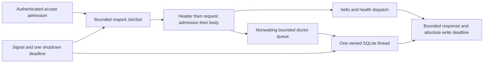

# Bounded IPC implementation contract

Status: task-1 interface handoff, revision 1, 2026-11-07. This specifies the implementation authorized by the saved mission; it does not claim that implementation or its acceptance tests have run. Baseline: `42f0178ec8c7542b010a7d43c1fb1d6daed8d8a0`.

## Problem and selected approach

`arc-daemon/src/server.rs::serve` currently starts one untracked OS thread per connection. Blocking framing has no server deadline; doctor holds the shared SQLite mutex. Closing the listener does not account for those handlers. Keep the five-crate workspace and replace only these runtime boundaries.

| Approach | Implementation and maintenance cost | Runtime and shutdown cost | Decision |
| --- | --- | --- | --- |
| Fixed blocking connection workers plus bounded input queue | Reuses synchronous framing, but requires worker admission and cancellation of blocking socket reads | Idle connections occupy workers; health competes with blocked reads; socket cancellation and joining remain separate mechanisms | Reject |
| Tracked Tokio connection tasks plus one dedicated SQLite thread | Small daemon-local readiness loops; reuses Tokio, protocol types, dispatch and rusqlite | Finite retained tasks and bodies; async socket cancellation; one explicit SQL cancellation/join boundary | Use |
| Database pool or per-request blocking tasks | More queues, connections, cancellation paths and dependencies | No needed database parallelism; started blocking tasks cannot be aborted by Tokio | Reject |

The comparison is qualitative. No cost savings or latency improvement has been measured. Keep synchronous `arc-ipc` and CLI APIs; do not put Tokio in `arc-ipc`, introduce an ORM, change the schema, or upgrade cached package versions.



The installed diagram resolver selected Mermaid; no renderer installation or visual check is required for this text contract.

## Ownership and integration boundary

The saved Actor assignments remain authoritative. The following names define the shared interface and proposed implementation split within those assignments. Report any conflict with a saved owned-file list to the Chief before crossing it; this document does not reassign an Actor.

| Writer | Paths / responsibility |
| --- | --- |
| Technical Director, this wave | `docs/bounded-ipc-contract.md`, `docs/bounded-ipc-targets.md`, workspace and crate `Cargo.toml` files, `Cargo.lock`; run report and dependency evidence |
| IPC Engineer | `crates/arc-daemon/src/{main,server,platform,limits,runtime_metrics,transport}.rs`; module declarations and transport integration; protocol busy constant in `crates/arc-ipc/src/lib.rs` if that path is assigned to this Actor |
| SQLite Engineer | `crates/arc-daemon/src/db_worker.rs` and its unit tests; worker implementation and cancellation. Keep `arc-storage` migration/open APIs intact; report any needed edit outside assigned ownership |
| Runtime Test Engineer | Focused `crates/arc-daemon/tests/bounded.rs`, `tests/worker_runtime.rs`, `tests/support/` fixtures and measurement artifacts within its saved scope; retain `resident.rs` assertions and CLI binary tests |
| Independent Reviewer | Verification reports and evidence only; no product repair |

All subsequent manifest/lock changes return to the Technical Director. A code consumer may import the signatures below before the producer exists; integration waits for both artifacts. The IPC Engineer alone declares daemon modules. The database worker must not modify `main.rs`, metrics implementation or manifests in parallel. Fixtures continue to take `tests/support/mod.rs::serial()` across processes and retain the fixture lock until children are reaped.

## Finite configuration

`limits.rs` owns `RuntimeLimits`; caps use `NonZeroUsize`, deadlines use positive `Duration`. `RuntimeLimits::default()` and `RuntimeLimits::validate() -> io::Result<()>` are required. Use defaults in the ordinary daemon. An explicit `ARC_IPC_PROFILE=test` may select the fixed test profile below for owned subprocesses; reject every other nonempty value and do not silently accept zero, unbounded or arbitrary configuration. Unit tests may construct validated smaller limits. This profile changes capacity and deadlines only; it cannot enable arbitrary SQL or bypass authentication.

| Limit / budget | Default | Fixed test profile | Scope |
| --- | ---: | ---: | --- |
| `connections` C | 64 | 8 | Retained connection tasks including completed but unreaped entries |
| `requests` R | 16 | 4 | Allocating/decoding/dispatching/writing requests, including error responses |
| `db_queue` Q | 8 | 2 | Reserved/enqueued doctor jobs; one additional job may execute |
| Native database threads | 1 | 1 | Same thread owns the connection through close |
| Tokio runtime workers | 2 | 2 | Explicit `worker_threads = 2`; no per-client native threads |
| Frame body | `arc_ipc::MAX_FRAME_BYTES` = 1,048,576 | same | Existing protocol limit, checked before allocation |
| Serialized response body | 1,048,576 | same | Bounded writer refuses growth above this size |
| `header_timeout` | 1,000 ms | 150 ms | All four prefix bytes, including idle wait for the next frame |
| `frame_timeout` | 2,000 ms | 300 ms | Header plus body from the same frame-start instant |
| `write_timeout` | 500 ms | 100 ms | Serialization, prefix, body and completion for one response |
| `db_response_timeout` | 1,500 ms | 500 ms | Queue reservation through reply; waiting does not restart this budget |
| `db_execution_timeout` | 1,000 ms | 300 ms | At most the remaining response budget |
| SQLite busy wait | 100 ms | 50 ms | Replace the opened connection's five-second wait inside the worker |
| Progress callback interval | 1,000 VM instructions | same | Check sticky stop, per-job cancellation and real monotonic deadline |
| Internal shutdown budget | 3,500 ms | same | One signal-observation deadline, with 1,500 ms external margin |

Validate `R <= C`, positive budgets, header <= frame, execution <= DB response, busy <= execution, and `frame + db_response + write <= 4 seconds` for these profiles. Caps must fit Tokio semaphore/channel limits and checked byte multiplication. The four-second sum is a server processing envelope, not a claim that the CLI's per-socket five-second timeouts form an absolute client deadline. Scheduling and native I/O still require measured verification.

## Admission and permit lifetimes

1. The accept loop owns exactly one `JoinSet<()>`. Drain ready completions with `try_join_next()` before admission, and continuously select `join_next()` alongside accept and both signals. Use shutdown-first selection so a ready signal prevents further admission. Never retain a list of all historical handles.
2. Authenticate the accepted Tokio socket using the existing native same-UID checks before spawning a handler. Generalize `platform::ensure_same_user` to `&(impl AsRawFd + ?Sized)`; do not change Linux credentials or macOS `getpeereid` policy. No async or blocking database work occurs here.
3. Admission is nonwaiting: require both `JoinSet::len() < C` and a successful connection `try_acquire_owned()`. Otherwise drop the accepted stream immediately. There is no spawned reject task, body read, log per attempt, handshake or semaphore wait. At most one accepted stream is being inspected outside the JoinSet; kernel listen backlog is a separate OS bound, not an application task count.
4. Count the handler before scheduling it. Its connection permit remains owned until handler destruction, including cancellation. Independently gate on JoinSet length so a completed but unreaped task cannot be replaced indefinitely. Only the accept loop updates the retained-task gauge after each spawn/reap.
5. Each handler processes one frame at a time. Read only a four-byte prefix first. Validate zero and oversized lengths using the existing `FrameError` variants. Before allocating or reading a valid body, use the global request semaphore's `try_acquire_owned()`. On failure close immediately; do not accumulate waiters or allocate a body merely to discover a request ID.
6. A request permit covers body storage, decoding, dispatch, DB reply waiting, response construction and writing. Hold it through error responses too. For invalid-length prefixes, acquire a request permit before constructing/writing the protocol error; if unavailable, close. EOF and timeout may close without a response. No request spawns a child task.
7. Drop the raw body after `Request::decode`. Drop unused payload data before awaiting the database; no request body or ID enters the database queue. Release the request permit only after response buffers and decoded input are dropped. A timed-out DB job retains its separate outstanding-work token until the worker discards or completes it.
8. Database admission uses `mpsc::Sender::try_reserve()` then immediate send; never `.send().await`, an unbounded channel, or a task waiting to enqueue. Q includes reserved queue slots. There are at most Q queued/reserved plus one executing job, even after client cancellation. Closed/full admission returns a small typed error immediately.

Hello and health use `arc_ipc::dispatch` without any DB queue operation, mutex or SQL. A saturated DB queue must leave a connection and request slot available in the health-independence test. Exhausting all C connections or all R bodies may reject health at transport admission; that is a separate case and must recover after the documented read/write deadlines. No bypass task or unbounded priority queue is permitted.

## Absolute transport deadlines and protocol behavior

Use `tokio::net::UnixStream::{readable,writable,try_read,try_write}` and `timeout_at`; retain frame-length rules and `Request::decode` from `arc-ipc`. A small readiness loop handles `WouldBlock`, `Interrupted`, short progress and EOF. Do not switch accepted streams into blocking mode. Do not reset deadlines when a byte arrives.

At frame start F, header expiry is F + header timeout and whole-read expiry is F + frame timeout. The body receives the latter deadline, never a fresh timeout after the header. Each response starts one write deadline W before serialization; prefix and body share W. Cancellation must drop the whole stream rather than resuming a partly consumed frame. Check the monotonic deadline between serialization and the first write. Timeouts close the connection and release guards; they do not begin another error-response budget.

Malformed JSON still receives `INVALID_REQUEST` and may continue if its bounded response succeeds. Zero/oversized length receives the current empty-ID `INVALID_REQUEST` / `FRAME_TOO_LARGE` response and closes, subject to request admission. EOF/truncation closes. Version mismatch takes precedence over operation/DB admission and still allows a later valid frame on that connection. Unknown operations retain `UNSUPPORTED_CAPABILITY`.

Add `pub const ERROR_DB_BUSY: &str = "DB_BUSY";` to `arc-ipc` when its assigned writer implements transport. An authenticated, decoded, protocol-1 doctor request rejected by the DB queue, stopped worker or response/execution deadline gets `Response::error(&request.request_id, ERROR_DB_BUSY)`. SQLite `DatabaseBusy`, `DatabaseLocked` and deadline/cancellation interrupts map to that code. Genuine integrity failure keeps `INTEGRITY_FAILED`; a lost worker is unavailable/busy, not evidence of corruption. On success pass the `DoctorReport` through existing `dispatch`; do not duplicate successful JSON or change the dispatch closure's public type.

The existing CLI checks `response.error` first. `DB_BUSY` therefore prints exactly `IPC_ERROR` to stderr and exits nonzero; predecode closure continues to print `DAEMON_UNAVAILABLE`. It must not be remapped to `INTEGRITY_FAILED` or `PROTOCOL_INCOMPATIBLE`. No new command, automatic retry or output wording is required. Preserve successful status/doctor text, no ANSI, five-second socket timeouts and `arcctl`'s lack of SQLite access.

Serialize `Response` directly with `serde_json::to_writer` into a daemon-local capped `Write` implementation. It must check the write deadline and length before extending its Vec, without first constructing another unrestricted `Value` or Vec. Existing decoded input is bounded by the 1 MiB frame and Serde's depth limit; JSON object/string allocations can amplify that input and are not an exact RSS estimate. If escaping an echoed request ID makes the serialized response exceed the frame cap, discard it and attempt one small empty-ID `FRAME_TOO_LARGE` response under the original write deadline, then close. Do not truncate IDs or recursively serialize fallback errors. Database error strings never enter responses or per-request logs.

## Shared Rust interface

All new types below are daemon-local `pub(crate)` unless a saved assignment establishes a different existing boundary. Methods may have private helpers; changing these shared signatures requires a written producer/consumer handoff to the Chief. `DbWorker` alone owns its native join handle; `DbClient` is cheap and clonable. `DbTicket` has one reply receiver and a cancellation-on-drop flag.

```rust
// db_worker.rs (SQLite Engineer)
use std::{io, num::NonZeroUsize, sync::Arc, time::{Duration, Instant}};
use arc_ipc::DoctorReport;
use rusqlite::Connection;
use crate::runtime_metrics::RuntimeMetrics;

pub(crate) struct DbConfig {
    pub queue_capacity: NonZeroUsize,
    pub busy_timeout: Duration,
    pub execution_timeout: Duration,
}
pub(crate) enum DbError {
    Busy, Stopping, Cancelled, Deadline, WorkerLost, ShutdownDeadline,
    Sql(rusqlite::Error), Io(io::Error),
}
pub(crate) struct DbWorker { /* sole thread handle, stop, interrupt, sender */ }
#[derive(Clone)]
pub(crate) struct DbClient { /* bounded sender and shared stop flag */ }
pub(crate) struct DbTicket { /* oneshot receiver and per-job cancellation */ }
pub(crate) struct DbExit {
    pub connection_closed: bool,
    pub worker_joined: bool,
}

impl DbWorker {
    pub(crate) fn start(connection: Connection, config: DbConfig,
        metrics: Arc<RuntimeMetrics>) -> Result<Self, DbError>;
    pub(crate) fn client(&self) -> DbClient;
    pub(crate) fn begin_shutdown(&mut self);
    pub(crate) async fn shutdown(&mut self, deadline: tokio::time::Instant)
        -> Result<DbExit, DbError>;
}
impl DbClient {
    pub(crate) fn try_doctor(&self, deadline: Instant) -> Result<DbTicket, DbError>;
}
impl DbTicket {
    pub(crate) async fn receive(self) -> Result<DoctorReport, DbError>;
}
// Dropping a DbTicket cancels its job; no detached timeout/watcher task.
```

`try_doctor` receives a real `std::time::Instant` fixed by transport at queue admission. `receive` uses the same deadline with `tokio::time::Instant::from_std`; it does not grant a new budget. Configure busy wait and progress hooks before moving the connection into the thread or announcing readiness. A job contains only deadline, reply sender, cancellation state and metrics guards. SQL is fixed doctor SQL; never accept client SQL. Worker replies are typed results without raw SQL/data in telemetry. Implement Display/Error without unbounded user-derived messages.

```rust
// transport.rs (IPC Engineer)
pub(crate) async fn read_header(
    stream: &tokio::net::UnixStream, deadline: tokio::time::Instant,
) -> Result<u32, arc_ipc::FrameError>;
pub(crate) async fn read_body(
    stream: &tokio::net::UnixStream, declared: u32,
    deadline: tokio::time::Instant,
) -> Result<Vec<u8>, arc_ipc::FrameError>;
pub(crate) async fn write_response(
    stream: &tokio::net::UnixStream, response: &arc_ipc::Response,
    deadline: tokio::time::Instant,
) -> std::io::Result<()>;
```

`read_header` validates the declared size; `read_body` defensively revalidates and is called only after request admission. Represent deadline expiry with `FrameError::Io(io::ErrorKind::TimedOut)`. `write_response` reports serialization-cap failure as `InvalidData`; the handler owns the single fallback policy. Transport uses no SQLite types. Keep existing `server::serve(Connection, PathBuf)` public entry shape; it builds validated limits, shared metrics and worker, then supervises them. Keep `open_and_migrate(path)` and the instance lock ordering in `main` unchanged.

## Metrics and test synchronization

`runtime_metrics.rs` owns the fixed-size metrics below. It exports `RuntimeMetrics`, `Snapshot`, `Gauge`, `Counter`, and an RAII `GaugeGuard`. Database code depends only on these methods:

```rust
impl RuntimeMetrics {
    pub(crate) fn enter(self: &std::sync::Arc<Self>, gauge: Gauge, amount: usize)
        -> GaugeGuard;
    pub(crate) fn increment(&self, counter: Counter);
    pub(crate) fn set_tracked_tasks(&self, count: usize);
    pub(crate) fn snapshot(&self) -> Snapshot;
}
// GaugeGuard decrements exactly once on normal return, error, unwind or abort.
```

`Gauge` variants: `Connections`, `Requests`, `RequestBodyBytes`, `ResponseBytes`, `DbQueued`, `DbExecuting`, `DbOutstanding`, `RejectionWork`. Each has current and high-water AtomicUsize values; no per-request IDs, event Vec, latency histogram or unbounded labels. `Counter` variants: `Accepted`, `ConnectionRejected`, `RequestRejected`, `DbRejected`, `FramesCompleted`, `HeaderTimeouts`, `FrameTimeouts`, `WriteTimeouts`, `DbTimeouts`, `WorkerStarted`, `WorkerJoined`, `HandlersSpawned`, `HandlersReaped`. Counters use saturating u64 arithmetic. Snapshot also includes current/high-water `tracked_tasks` and configured caps. `tracked_tasks` counts JoinSet entries, including finished entries awaiting reap; the one supervisor future is reported separately. No DB or per-request async task is spawned. Thus the application-owned future/task envelope is C handlers plus one supervisor, not a claimed measurement of Tokio's private internal tasks.

DbQueued starts after successful channel reservation and before send, and is dropped when the worker receives/skips the job. DbOutstanding covers reservation through discard/completion; DbExecuting covers only worker-owned work. The total invariant is DbOutstanding <= Q+1, DbQueued <= Q and DbExecuting <= 1. A canceled queued job remains counted until drained. Snapshot fields are independently atomic, not a transaction; assert independent gauge maxima and final zero values instead of relying on simultaneous cross-gauge equality during transitions.

Record body bytes before allocation until Vec drop. `ResponseBytes` is a conservative byte-budget reservation: the handler enters with MAX_FRAME_BYTES before serialization and holds the guard through the write and any single fallback. It is not a measurement of actual response length or allocator usage. Bounds are R times MAX_FRAME_BYTES for each category; drop the failed serialization before creating its fallback and reuse that reservation. The capped writer must bound retained capacity as well as length (for example, checked exact reserve up to the frame cap), and report failure rather than retaining an over-cap allocation. Decoded JSON heap, allocator overhead and socket kernel buffers are separate from these buffer gauges. A single rejection outside task admission has RejectionWork <= 1 and no retained buffer. In-handler error writes remain inside C/R, with no additional task. Count malformed-response work as well as successful requests.

Export one optional final JSON report through `ARC_RUNTIME_REPORT`, opened before readiness as a new 0600 regular file in a validated owned 0700 directory using no-follow/create-new semantics. Never overwrite an existing path or follow a symlink; use the existing private-directory helpers. No default report file, periodic disk write or new service is needed. Cap serialization at 4,096 bytes. The final report includes profiles, all gauges/high waters/counters, `handlers_remaining`, `worker_joined`, `connection_closed` and `shutdown_elapsed_ms`. Final success requires gauges zero, handlers spawned == reaped and exactly one worker started/joined. Keep stdout readiness text and normal stderr behavior; aggregate accept/auth/rejection errors into counters, not one log per attempt. Retain bounded failure evidence rather than logging request contents.

For deterministic unit synchronization, add a `#[cfg(test)]` metrics-change `Notify` and `async fn wait_for(&self, predicate: impl Fn(&Snapshot) -> bool)`; register notification before rechecking the predicate to avoid lost wakeups. A caller always supplies an outer timeout. For worker tests, `db_worker.rs` exports under `#[cfg(test)]` only:

```rust
pub(crate) struct WorkerTestHooks {
    pub started: std::sync::mpsc::SyncSender<()>, // capacity one
    pub release: std::sync::mpsc::Receiver<()>,  // capacity one
}
// Same return type and behavior as start; before first doctor SQL, notify once
// with try_send and gate until release, cancellation, stop or the job deadline.
pub(crate) fn start_with_test_hooks(connection: rusqlite::Connection,
    config: DbConfig, metrics: std::sync::Arc<RuntimeMetrics>,
    hooks: WorkerTestHooks) -> Result<DbWorker, DbError>;
```

The gate uses bounded `recv_timeout` slices <= 10 ms and cancellation checks; no uninterruptible Barrier. Separate worker units run a fixed expensive recursive query to exercise progress interruption, deadline-before-start and interrupt-before-statement races. Test code may include these same source modules in `tests/worker_runtime.rs` and launch its own test executable with an exact child-entry test filter, so test hooks exist only under `cfg(test)`. This permits controlled slow real-worker subprocess tests and CLI calls without enabling a production SQL/gating environment variable or adding a feature-gated test outside `cargo test --workspace`. The real daemon binary still supplies signal, filesystem, identity and compatibility cases. The fixture child must use the same server supervisor and keep the instance lock until close, not a second transport implementation; provide a test-only supervisor entry receiving the configured worker. Its exact signature is `server::serve_with_worker(socket: PathBuf, limits: RuntimeLimits, metrics: Arc<RuntimeMetrics>, worker: DbWorker) -> Result<(), Box<dyn Error>>` under `cfg(test)`; production `serve` calls the same private supervisor.

## Worker cancellation and shutdown

One dedicated named thread owns the connection and bounded receiver. No `Arc<Mutex<Connection>>`, pool, `spawn_blocking` per request, or per-job timer thread. The worker checks a sticky stop flag, job cancellation and the absolute deadline before dequeue processing and before each statement. Install a rusqlite progress callback checking those same values at most every 1,000 VM instructions. `get_interrupt_handle()` supplements this callback; a single early `interrupt()` alone is insufficient because it can arrive before SQL begins. Bounded busy wait covers lock waiting where progress callbacks may not run.

At the first observed SIGTERM/SIGINT, use one deadline S + 3,500 ms:

| Stage | Latest target from S | Required result |
| --- | ---: | --- |
| Stop listener/admission and call `begin_shutdown` | immediate | Sticky stop set; no new DB admission; interrupt active SQL and wake an idle receiver |
| Abort and drain all connection handlers | 500 ms | Drop sockets, buffers, permits and tickets; every JoinSet entry reaped, including panics/cancellations |
| Drain/discard queued DB jobs and end active job | 1,500 ms | Resolve/drop every reply, outstanding gauges return to zero; start no job after observing stop and interrupt any statement-start race through the sticky callback |
| Close SQLite and join actual native worker | 3,000 ms | Close without explicit checkpoint; retain close error if any; thread join completed, not just a reply timeout |
| Write final bounded report, remove owned socket, return | 3,500 ms | Final accounting recorded; instance lock still held through worker join and socket cleanup |

Start worker shutdown before waiting for handlers, so SQL cancellation overlaps handler draining. Use bounded Tokio mpsc `try_recv` on the dedicated native thread. When empty, `std::thread::park()` waits; every successful enqueue calls that thread's `unpark()` after send. `DbClient` retains a clone of the worker's `std::thread::Thread`, not another JoinHandle. `begin_shutdown` sets sticky stop, invokes the interrupt handle and calls `unpark()` independently of queue capacity. Park/unpark's retained notification token prevents an enqueue/stop between the empty check and park from being lost. Drain available work before parking; demonstrate both enqueue-before-park and shutdown-before-park races. No periodic poll, additional wake thread, stop job behind a full queue, or blocking receive that cloned clients can keep asleep is needed.

`shutdown(&mut self, deadline)` retains the native JoinHandle on timeout/error. A completion message is not proof of thread termination: wait for `is_finished()` within the same deadline and then join. Never drop an unfinished handle and report success. The supervisor must treat inability to join/close within the budget as a failed shutdown with retained evidence; it cannot claim the external five-second criterion. Native filesystem stalls remain an OS limitation to disclose, not a reason to weaken deadlines or remove join assertions. Startup/migration occurs before readiness under the existing instance lock and is not covered by the resident signal acceptance window.

## Evidence required from implementation

1. Paused-time transport units use current-thread Tokio plus `test-util`, explicit metrics/gate synchronization, Unix socket pairs, trickled header/body bytes and write backpressure with a reduced native socket send buffer. Drive the deadline after the handler reaches the tested state; do not infer a stalled write from an ordinary small successful response. SQL worker uses real monotonic clocks, never a paused Tokio clock shared with a native thread.
2. The request-load fixture reconciles exactly 100,000 application attempts with bounded client concurrency (at most 32 default-profile clients). Count completed responses, protocol rejections, transport closures/connect rejections and fixture deadline failures separately; totals must equal attempts. Successful control requests outside that workload are separately counted. Record all server high waters, including retained tasks, and final zero/exit accounting. A timeout is not silently relabeled a rejection.
3. Include deterministic hold/release saturation stages for connection, request and Q+1 DB admission; require prompt bounded rejection and actual cap attainment in the tested stage. This prevents an empty/no-load cap test from passing. Run a small probe before the 100,000-attempt workload. Keep metrics load tests separate from latency/RSS experiments.
4. Subprocess/CLI cases cover partial headers, partial bodies, trickle progress, non-reading peers, protocol errors, status and doctor after release, and admitted health during controlled DB work. Test both SIGTERM and SIGINT from a synchronized stalled state, measure signal-to-`wait()` exit strictly below five seconds, assert report joins/zero gauges, socket removal, successful database reopen/integrity and restart. Keep failure-path child reaping.
5. Retain all current protocol, same-user, permission, symlink, TMPDIR identity, single-daemon and migration assertions. `0001_phase0.sql` must remain byte-identical to accepted HEAD (SHA-256 `046610c920709f0d9371ccaff6254fbd1c1c46cc6e930890869ff0ffc4fb1384`). Keep the instance lock held until all resources are accounted for.
6. Follow [target and measurement evidence](bounded-ipc-targets.md). Native peak RSS, native threads, task gauges and measured small-message P95 are separate results. Structural arithmetic is not a measured memory or latency result.
7. Later integration/review runs the exact `cargo fmt --all -- --check`, `cargo clippy --workspace --all-targets -- -D warnings`, `cargo test --workspace`, and unchanged `./scripts/harness/validate.sh`. Do not set coverage skip flags, alter harness thresholds, add dummy JavaScript tooling, or weaken tests. Preserve unresolved harness failures explicitly. Task-1 metadata resolution and formatting do not substitute for these later gates.

Remaining Phase 0, Linux qualification and Windows Named Pipe/runtime/tray obligations stay open. This contract supplies no desktop, vendor, classifier, Managed Job, Sweeper or deployed-service completion claim.
