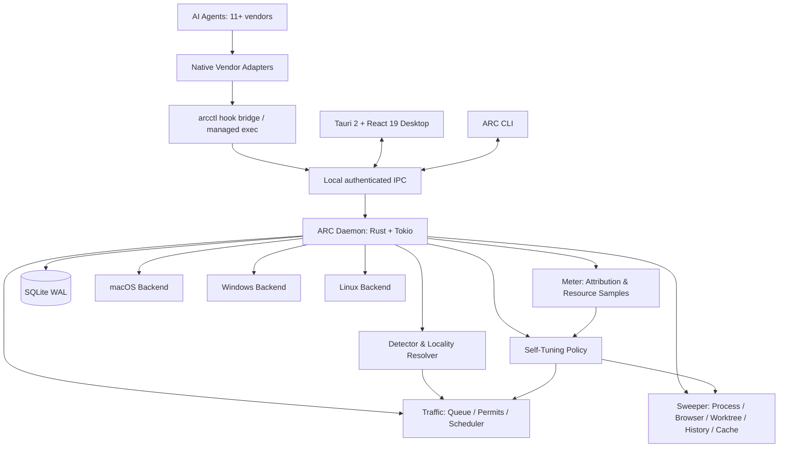
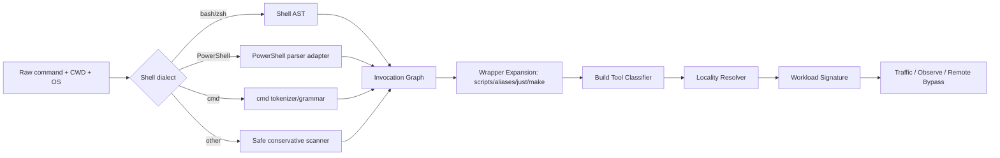
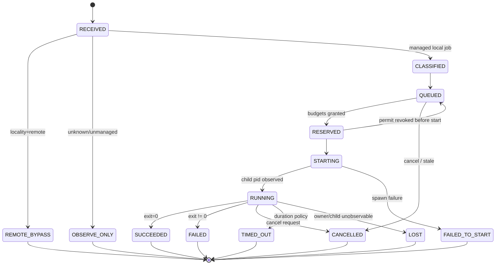
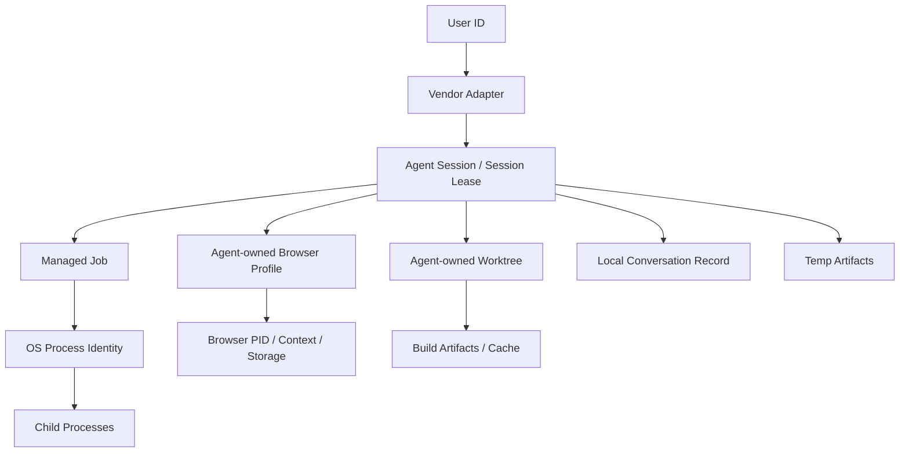
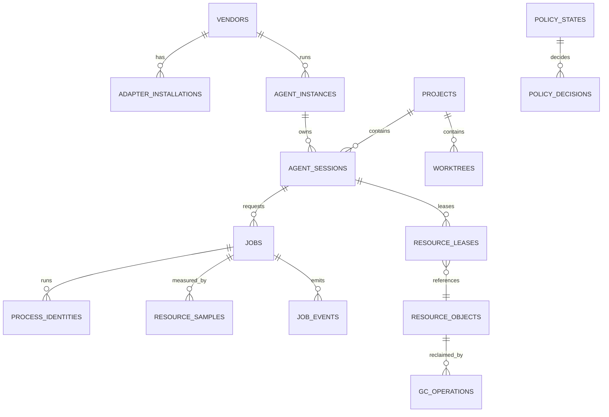

# Agent Resource Control (ARC)

## 제품 요구사항 분석서 · PRD / SRS / 상세 기술 설계서

> **Measure · Schedule · Sweep**  
> 여러 AI 코딩 에이전트가 로컬 머신을 망가뜨리지 않고 함께 일하도록 한다.

| 문서 항목 | 내용 |
|---|---|
| 프로젝트명 | **Agent Resource Control (ARC)** |
| 문서 버전 / 기준일 | **v1.0.0-draft · 2026-11-06 (Australia/Sydney)** |
| 문서 성격 | PRD + SRS + Architecture + API/DB 설계 + Acceptance Tests + Delivery Plan |
| 현재 단계 | **요구사항 및 구현 설계 확정안. 실제 구현 완료를 의미하지 않음** |
| 필수 OS | **macOS, Windows** |
| 추가 지원 | Linux (헤드리스 우선, GUI 환경별 지원) |
| 데몬/CLI | **Rust + Tokio 1.x LTS + SQLite WAL + clap** |
| Desktop | **Tauri 2 + React 19 + TypeScript 7 + Vite** |
| JS/TS Package Manager | **Bun (pnpm/npm/yarn으로 프로젝트 PM 변경 금지)** |
| UI/Style | **Tailwind CSS 4 + basecn(Base UI) + Phosphor Icons** |
| Lint/Format | **Biome** (Rust는 Clippy/rustfmt) |
| 제품 핵심 | **Meter / Traffic / Sweeper / Self-Tuning Policy Engine** |
| 상주 형태 | macOS 메뉴바, Windows 시스템 트레이 + 독립 실행 경량 User Daemon |
| 배포 | OS 설치 프로그램 + CLI + 벤더별 네이티브 플러그인/마켓 배포 |
| 실행 범위 | **로컬에서 실제 수행하는 작업만 제어, 원격 CI는 제외** |
| GC 철학 | **개발용 찌꺼기 삭제 우선. 소유권 확인 + 비활성 검증 후 영구 회수** |
| 설정 UX | **모든 일반 사용자 정책을 GUI 스위치로 ON/OFF** |
| 데이터 | 로컬 저장·로컬 학습, 계정/클라우드 불필요 |

> **문서 읽는 법.** `MUST`는 출시 필수, `SHOULD`는 우선 구현, `MAY`는 후속 확장이다. `P0/P1/P2`는 개발 우선순위다. **[확인된 외부 사실]**은 공식 자료로 근거를 제시하고, **[ARC 설계 결정]**은 이 프로젝트가 구현할 규칙이다. 기능 설명에 포함된 API·파일 위치·명령어 일부는 **제안 계약**이며 이미 출시된 기능이 아니다. 공식 자료는 [부록 A](#부록-a-공식-근거와-참고자료) 참조.

---

## 목차

1. [최종 제품 결정](#0-최종적으로-확정한-제품-결정)
2. [배경과 성공 기준](#1-배경-문제-정의-성공-기준)
3. [개념과 정책 모델](#2-개념-정의와-정책-모델)
4. [제품·OS·벤더 지원 범위](#3-범위와-지원-플랫폼)
5. [구현 아키텍처](#4-구현-아키텍처)
6. [11종 벤더별 플러그인 명세](#5-벤더-어댑터-기술-조사-및-구현-명세)
7. [OS별 플랫폼 백엔드](#6-os-platform-backend-벤더와-독립적으로-구현)
8. [설치·실행 생명주기](#7-설치와-런타임-생명주기)
9. [다중 언어 명령 감지 및 로컬·원격 구분](#8-arc-command-detector-여러-언어-빌드테스트-완전-포착-전략)
10. [ARC Traffic: 전역 스케줄러](#9-arc-traffic--전역-실행-윈도우와-자원-스케줄링)
11. [ARC Meter: 자원 사용량 측정](#10-arc-meter--사용량-측정과-귀속)
12. [Self-Tuning 학습 정책](#11-self-tuning-policy-engine)
13. [ARC Sweeper: 적극적 GC](#12-arc-sweeper--개발용-자원-적극적-garbage-collection)
14. [로컬 IPC 및 API](#13-로컬-ipc--api-프로토콜-명세)
15. [SQLite 데이터 모델](#14-sqlite-스키마-및-저장-정책)
16. [Desktop GUI·스위치·Credits](#15-desktop-ui--트레이-상세-요구사항)
17. [CLI 및 개발자 인터페이스](#16-cli--개발자-api)
18. [보안·개인정보·삭제 보호](#17-security--privacy-threat-model)
19. [비기능 요구사항](#18-성능운영비기능-요구사항-nfrslo)
20. [관측·진단·로그](#19-logging-diagnostics-troubleshooting)
21. [패키징·마켓 배포](#20-release-engineering--distribution--marketplace)
22. [Gherkin 수용 테스트와 품질 게이트](#21-테스트-전략-품질-게이트-수용-테스트)
23. [로드맵 및 Definition of Done](#22-구현-로드맵-및-단계별-definition-of-done)
24. [Repository 구조](#23-repository--source-tree-상세-설계)
25. [요구사항 추적성](#24-요구사항-추적성-traceability)
26. [기술 위험과 대응](#25-위험제약대응-책임)
27. [제품 거버넌스](#26-프로젝트-거버넌스와-제품-정책)
28. [최종 출시 체크리스트](#27-최종-출시-승인-체크리스트)
29. [부록 A: 공식 출처](#부록-a-공식-근거와-참고자료)
30. [부록 B: 명령 예시](#부록-b-초기-구동과-검증-명령-구현용-예시)
31. [부록 C: 제품 요약](#부록-c-최종-제품-요약)

---

# 0. 최종적으로 확정한 제품 결정

사용자에게 다시 선택하도록 돌려서는 안 되는 항목이다. 기술적 장애가 발견되면 **ARC 엔지니어링이 우회/대체 구현과 검증을 수행**한다.

| ID | 확정 결정 | 적용 방침 |
|---|---|---|
| DEC-001 | 제품명 Agent Resource Control | 표시 이름 `Agent Resource Control`, 약칭 `ARC` |
| DEC-002 | Vendor-neutral | 단일 공통 Core, 11종 초기 Vendor Adapter |
| DEC-003 | 반드시 공용 로컬 데몬 | 사용자별 단일 Rust 데몬, GUI/CLI와 독립 |
| DEC-004 | macOS 메뉴바 / Windows 트레이 | 창 닫기는 Hide, Daemon은 계속 동작 |
| DEC-005 | Rust/Tokio/SQLite | 자원 관리를 위해 별도 LLM이나 장기 상주 Node 프로세스 불필요 |
| DEC-006 | Frontend TS 7 / React 19 | 이전 TS 6·Svelte 제안 폐기 |
| DEC-007 | Bun | JS/TS 프로젝트의 패키지 매니저 확정 |
| DEC-008 | Tailwind 4 + basecn + Phosphor | Base UI 계열 컴포넌트, Lucide 혼용 지양 |
| DEC-009 | Biome | JS/TS 린트·포맷 단일화 |
| DEC-010 | Meter 핵심 기능 | 현재·누적 사용량, 벤더별 비용, 절약 추정치 구분 |
| DEC-011 | Build/Test/Lint 전체 탐지 | 언어가 아니라 **실행 도구와 실제 작업 종류** 중심으로 분류 |
| DEC-012 | 원격 CI 요청 제외 | 명령이 아닌 **실제 계산 수행 장소**를 기준으로 판정 |
| DEC-013 | 전역 실행 윈도우 | Semaphore + 자원 예약 + 공정성 + 실행 시작률 제어 |
| DEC-014 | Self-Tuning | LLM 없이 온라인 계측/통계/제약된 정책 학습 |
| DEC-015 | Aggressive Sweeper | 소유권 증명된 비활성 개발 자원은 삭제; 불필요한 아카이브 없음 |
| DEC-016 | 버려진 Agent Worktree | **확실한 폐기 가능 자원**이면 dirty/untracked 포함 제거 |
| DEC-017 | Agent-Owned Browser | 쿠키·LocalStorage·IndexedDB·캐시·trace를 **전용 프로필과 함께 삭제** |
| DEC-018 | Local conversation history | 비활성·기한 만료 이력은 **삭제**. 검색/이식/아카이브 제품 아님 |
| DEC-019 | Safety boundary | 활성 세션·개인 브라우저·소유권 불명 리소스는 삭제하지 않음 |
| DEC-020 | Switch-only 설정 | 사용자가 TTL/코어 수/GB 임계값/YAML 편집을 할 필요 없음 |
| DEC-021 | 마켓 검색/설치 | 벤더가 허용하는 공식 마켓·카탈로그 우선, 불가하면 native install 제공 |
| DEC-022 | Credit/About | GitHub/LinkedIn 아이콘 전용, `Try OMA` 표시 |
| DEC-023 | 사전 승인과 최소 권한 | OS 상주/종료/삭제에 필요한 승인 절차를 설치 시 명시 |
| DEC-024 | 개발자 책임 | 훅 차이·OS 차이·벤더 저장구조는 **어댑터로 흡수**; 사용자에게 수동 연구 요구 금지 |
| DEC-025 | User-Scoped Project Sweep | 사용자가 등록한 폴더 아래 Git 저장소의 **gitignore된 알려진 빌드 산출물(30일)·의존성 디렉터리(90일)**를 주기 스윕. 등록 행위가 소유권 증거 |
| DEC-026 | Local Docker Sweep | 로컬 Docker 엔진이 호환되면 미사용 이미지·정지 컨테이너·익명 볼륨을 주기 스윕. 원격 context·이름 있는 볼륨 제외 |
| DEC-027 | Anonymous Usage Statistics | 익명·집계 사용 통계를 외부로 전송. 기본 **ON**, 첫 실행 동의 화면에서 OFF 가능, 경로·argv·채팅 등 식별 정보 전송 금지 |

**제품 한 문장 정의:** ARC는 AI 코딩 에이전트들의 **로컬 자원 사용을 계량하고(Meter), 빌드·테스트·린트 교통을 제어하며(Traffic), 쓸모없는 개발용 상태를 적극적으로 죽이고 삭제하는(Sweeper) 자기 학습형 시스템 유틸리티**다.

---

# 1. 배경, 문제 정의, 성공 기준

## 1.1 왜 필요한가

현재 멀티 에이전트 개발 워크플로는 완료한 PR 수, 병렬 세션 수, 생성한 Worktree 수를 성과로 보여주는 경우가 많다. 반면 여러 에이전트가 한 컴퓨터에서 동일한 `cargo build`, `xcodebuild`, `gradle`, `pytest`, `vitest` 등을 수행할 때의 CPU core-hours, RAM 피크, 디스크 쓰기량, 스왑, Worktree·브라우저 잔재, 테스트 중복, 대기열 형평성은 충분히 관리되지 않는다.

발생하는 문제:

1. **작업 폭주:** 에이전트 A/B/C가 각각 독립적으로 무거운 검증 작업을 실행한다.
2. **기기 성능 저하:** 인터랙티브 에디터·브라우저·다른 개발 작업의 응답 지연이 커진다.
3. **중복 비용:** 동일한 코드·락파일·환경의 검증이 여러 에이전트에 의해 반복된다.
4. **디스크 팽창:** Worktree, `node_modules`, 가상환경, 빌드 산출물, 브라우저 프로필, 채팅 이력, Trace, 다운로드 등이 축적된다.
5. **고아 프로세스:** 업데이트된 CLI의 구버전 프로세스, orphan LSP/MCP server, 테스트 worker, 브라우저가 남는다.
6. **불투명한 비용:** 어떤 벤더·프로젝트가 얼마를 사용했는지 알기 어렵다.
7. **유지보수 비용:** 사용자가 직접 `ps`, Task Manager, Activity Monitor, `git worktree`, 디렉터리 스캔으로 정리한다.

## 1.2 제품 목표

| 목표 ID | 목표 | 측정 가능한 수용 기준 |
|---|---|---|
| G-01 | CPU/RAM/Disk 소비 귀속 | 벤더·세션·프로젝트·작업별 사용량 집계, 불확실한 값은 별도 표시 |
| G-02 | 로컬 실행만 교통 정리 | 100%의 공식 원격 CI 트리거 테스트가 로컬 슬롯 미점유 |
| G-03 | 여러 에이전트 공존 | 모든 지원 플러그인이 **사용자별 동일 데몬** 이용 |
| G-04 | 개발자의 기기 반응성 유지 | ARC ON/OFF A/B 성능 시험에 작업 완료율·응답 지연 함께 측정 |
| G-05 | 자동 고아 회수 | ARC 소유권 근거가 충족된 테스트 고아를 일관되게 종료/삭제 |
| G-06 | 잘못된 삭제 차단 | 활성 세션/개인 브라우저/주 Worktree 사고 0건 |
| G-07 | 자동 정책 최적화 | 누적 관측에 기반한 동시성 변화와 이유 추적 가능 |
| G-08 | 작은 자체 비용 | 유휴 데몬 메모리·CPU 및 Hook 지연 예산 준수 |
| G-09 | 쉬운 UX | 일반 사용자는 스위치 외 정책 값 입력 불필요 |
| G-10 | 마켓 가시성 | 가능한 마켓의 검색/설치 문서, 불가한 마켓의 대체 경로 제공 |

## 1.3 대상 사용자

- 다중 Claude Code/Codex/Cursor 등의 코딩 에이전트 사용자
- 개발 워크트리 여러 개를 사용하는 오픈소스 기여자
- Android/Gradle, iOS/Xcode, Rust, Python, JS/TS 등 빌드·테스트 비용이 큰 개발자
- 브라우저 자동화 에이전트 사용으로 로컬 저장 공간이 팽창하는 사용자
- 에이전트 팜/멀티 에이전트 오케스트레이터 사용자

## 1.4 명시적으로 하지 않는 것 (Non-goals)

- 에이전트에게 코딩 지시/PR 생성/자율 오케스트레이션을 수행하지 않음.
- 외부 CI/CD Runner 자체를 관리하지 않음; GitHub/GitLab 원격 실행 큐·원격 CPU는 제외.
- ChatGPT/Claude/Gemini 등 **서버에 저장된** 채팅 삭제를 시도하지 않음.
- 브라우저 세션 이식, 대화 포터빌리티, 원문 검색, 아카이브, RAG를 만들지 않음.
- 토큰 비용, LLM API 쿼터, 구독 관리 제품을 만들지 않음.
- 침입적 전역 프로세스 후킹/커널 확장 설치를 기본 요구하지 않음.
- 모든 벤더에서 동일 수준의 **강제 실행 제어를 보장한다고 광고하지 않음**. 지원 등급별 실제 검증은 필수.

## 1.5 가치 지표

`Accepted Tasks / CPU core-hour`, `Accepted Tasks / peak RAM`, `Successful Jobs / elapsed hour`, `P95 interactive latency`, `reclaimed allocated bytes`, `incorrect termination count=0`를 상위 수준에서 측정한다. PR 개수만 늘어난 결과는 성공으로 보지 않는다.

---

# 2. 개념 정의와 정책 모델

| 용어 | 정확한 의미 |
|---|---|
| Agent Vendor | Claude Code, Codex, Cursor 등의 제품 제공자/런타임 |
| Adapter | 벤더의 세션·툴·패키징 형식을 ARC 계약으로 변환하는 모듈 |
| Session | 에이전트의 대화 또는 연속 작업 생명주기 |
| Job | 단일로 관리 가능한 빌드/테스트/린트/타입체크 등의 실행 |
| Execution Window | 동시에 실행을 허가하는 전역/클래스별 자원 예산 |
| Permit | 특정 Job이 일정 자원을 예약하고 실행하도록 허용한 임대권 |
| Lease | ARC가 자원 소유자·생존 정보를 추적하는 시간 제한 기록 |
| Owner Evidence | 실제 자원 소유를 확정할 수 있는 생성 기록, OS 핸들, 벤더 세션 정보 등의 증거 |
| Locality | 로컬 호스트, 로컬 VM/컨테이너, 원격 CI, 원격 서버, 혼합, 불명 상태 |
| Agent-Owned Browser | 사용자 개인 브라우저와 별도의 에이전트 자동화 전용 실행/프로필 |
| Disposable Worktree | 에이전트가 만들었고 작업이 종료되어 버려졌음이 검증된 보조 Worktree |
| Process Reaper | 활성 소유자가 없는 에이전트 프로세스를 종료하는 모듈 |
| GC | 재사용 가치가 없고 회수 가능함이 판명된 자원을 삭제하는 절차 |
| Unattributed | 벤더/프로젝트/세션에 정확히 귀속할 수 없는 측정치 |
| Enforcement Level | 명령을 관리형으로 실행할지, Hook으로 수정할지, 관찰만 할지의 실제 지원 등급 |
| Fail-open | 데몬 장애 시 **새로운 비파괴적 실행 요청을 통과**시켜 개발 중단을 피함 |
| Fail-closed for deletion | 소유권·안전성 검증 실패 시 **삭제만 취소**함 |

**핵심 불변식:** `kill/delete`는 *추정*이 아니라 **근거와 현재 상태 재확인**을 필요로 한다. 반면 개발용 자원이라는 이유만으로 무조건 아카이브나 수동 승인을 요구하지 않는다. **검증된 orphan/disposable이면 곧바로 정리**한다.

---

# 3. 범위와 지원 플랫폼

## 3.1 범위 매트릭스

| 대상 | Meter | Traffic | Sweeper | 비고 |
|---|:---:|:---:|:---:|---|
| ARC로 실행한 로컬 빌드 | ◎ | ◎ | ◎ | 가장 강한 소유권/측정 |
| 벤더 훅을 거친 로컬 빌드 | ◎ | ◎/○ | ◎ | 벤더별 인수/변경 지원 차이 |
| 외부에서 실행 중인 로컬 프로세스 | ○ | △ | △ | 관찰은 가능, 임의 강제 제어 불가 |
| 로컬 Docker/BuildKit | ○ | ◎/○ | ○ | 실제 Builder가 로컬인지 검증 |
| 로컬 WSL | ○ | ◎/○ | ○ | Windows ↔ WSL 브리지 필요 |
| 원격 `gh workflow run` | 로컬 CLI 호출만 관찰 | **제외** | **제외** | 외부 Runner 계산은 범위 밖 |
| 원격 SSH·Docker context | 로컬 호출만 관찰 | **제외** | **제외** | 원격 실행 리소스 무관리 |
| 에이전트 소유 Chromium | ◎/○ | 브라우저 자원 예산 | ◎ | 전용 프로필만 |
| 개인 Chrome/Edge/Firefox | 호스트 총량에만 포함 | 제외 | **금지** | 사용자 데이터 보호 |
| 오래된 로컬 에이전트 채팅 | 디스크 크기만 | 제외 | ◎/○ | 벤더 삭제 API·소유권별 |
| 에이전트 소유 Worktree | 용량 | 빌드 컨텍스트 | ◎ | confirmed disposable dirty 포함 |

표기: ◎=직접 지원 목표, ○=플랫폼/벤더 제약, △=검증된 좁은 범위, —/제외=제품 범위 아님.

## 3.2 OS 지원

| OS | 우선도 | 핵심 프로세스 관리 | 상주 UI | 설치 모델 |
|---|---|---|---|---|
| macOS 13+ | P0 | launchd LaunchAgent + native process inspection | 메뉴바 | 서명 앱 + 사용자 승인된 로그인 서비스 |
| Windows 11 / 지원되는 Windows 10 | P0 | user background process + Job Objects | 시스템 트레이 | 서명 설치 프로그램 + 로그인 시작 등록 |
| Linux (systemd+cgroup v2) | P1 | systemd --user / cgroups v2 / procfs | 선택 트레이 | 바이너리·패키지·headless |

macOS 13+는 `SMAppService` 기반 LaunchAgent 사용을 위한 설계 최소 기준이다. Windows 세부 최소 버전과 CPU 아키텍처별 패키징은 배포 매트릭스에서 검증한다. GUI는 설치되어도 **데몬이 없거나 꺼져 있는 상태를 명확히 표시**한다.

## 3.3 지원 벤더 11종 (출시 목표)

1. Claude Code
2. Codex (CLI + Desktop; 지원되는 Hook 환경에서)
3. Google Antigravity (App, CLI, IDE의 로컬 런타임)
4. Cursor (로컬 Agent)
5. Grok Build
6. Kiro (CLI/IDE, 로컬 Hook 적용 범위)
7. Qwen Code
8. DeepSeek Harness
9. Pi Coding Agent
10. Command Code
11. OpenCode

마켓 등록은 **가능한 공식 공개 디렉터리까지 제출**, 다른 제품은 공식 지원되는 확장/패키지/사설 Marketplace까지 포함한다. **등록 심사 통과 여부는 ARC가 통제할 수 없으므로**, 릴리스 품질 게이트는 `스토어 제출 가능 패키지와 대체 설치 경로 검증`으로 정의하고, 실제 공개 등록 상태는 릴리스 노트에서 별도 공개한다.

---

# 4. 구현 아키텍처



## 4.1 실행 파일과 역할

| 바이너리 | 권한 | 역할 | 상주 여부 |
|---|---|---|---|
| `arc-daemon` | 사용자 권한 | 중앙 정책/계측/GC/스케줄링 | 상주 |
| `arcctl` | 사용자 권한 | CLI/Hook 브리지/관리형 실행 | 요청 시 |
| `arc-desktop` | 사용자 권한 | 메뉴바/트레이, 스위치 설정, 대시보드 | 로그인 시 상주, GUI WebView는 필요 시 |
| Adapter module | 벤더 권한 범위 | 벤더 이벤트→ARC 통일 계약 | 해당 에이전트 로드 시 |

**데몬 Single Instance:** 동일 사용자 계정은 하나의 데몬 인스턴스만 보유하며, OS lock/IPC endpoint/pid+birthtime 검증으로 중복 실행을 막는다. 다른 사용자 계정의 데몬과 자원/채팅/권한을 공유하지 않는다.

## 4.2 모듈 경계

- `arc-core`: ID, 타입, 상태기계, 공통 에러, 정책 불변식
- `arc-adapters`: 벤더 지원 능력, 설치·복구, 이벤트 매핑
- `arc-detector`: 셸 파싱, 실행 도구 탐색, 실행 위치 분류
- `arc-traffic`: 다중 큐, 자원 예약, Permit, Fairness, 재진입
- `arc-meter`: OS 샘플, 소유권 귀속, 샘플링, 집계
- `arc-policy`: 온라인 비용 예측, 정책 튜닝, 안전 범위
- `arc-sweeper`: ownership graph, candidate, validate, kill/delete
- `arc-platform`: macOS/Windows/Linux 실행·측정·종료 백엔드
- `arc-storage`: SQLite schema/migrations/retention
- `arc-ipc`: Unix sockets/Named Pipes, 인증, 버전 협상
- `arc-desktop`: React/Tauri 렌더·상태 관리·권한 기반 UI
- `arc-cli`: 설치 관리, 진단, 훅 브리지, 관리형 실행

## 4.3 내부 데이터 흐름

1. 벤더 플러그인이 `SessionOpen` 또는 `ToolPreExecute`를 전달한다.
2. `arc-detector`가 명령, 커스텀 runner/script, cwd, OS, remote/locality를 판정한다.
3. 원격 CI면 **즉시 bypass**; 로컬 검증 명령이면 `arc-traffic` admission에 보낸다.
4. 자원 예산이 있으면 Permit 발급, 없으면 지속 가능한 큐에 등록한다.
5. Managed Execution이 실제 프로세스를 실행하고 PID·시작 시각·자식·작업 디렉터리를 Lease에 등록한다.
6. Meter는 실측치와 attribution confidence를 기록한다.
7. 학습 엔진은 작업 비용과 압박을 축적하고 다음 윈도우를 조정한다.
8. Sweeper는 완료된 세션의 리소스 Lease를 이용해 고아/방치 자원을 제거한다.
9. GUI는 현황을 조회하고 스위치를 변경한다. WebView가 닫혀도 데몬은 계속 실행한다.

## 4.4 핵심 Architecture Decision Records

| ADR | 결정 |
|---|---|
| ADR-001 | OS·벤더 중립 Core + 벤더별 Native Adapter |
| ADR-002 | Rust 사용자별 데몬 + 별도 React/Tauri GUI |
| ADR-003 | SQLite WAL과 append-only event audit + 주기 집계 |
| ADR-004 | 정책 UI Switch-only, 임계값은 Self-Tuning 내부 결정 |
| ADR-005 | 명령 이름보다 **실제 실행 위치**가 Traffic 대상 결정 |
| ADR-006 | Hook 변경 불가면 Managed Launcher/Guard/Observe fallback |
| ADR-007 | GC: confirmed agent-owned disposable은 dirty 포함 삭제 |
| ADR-008 | Delete fail-closed / non-destructive tool fail-open |
| ADR-009 | 브라우저 개인 프로필·원격 데이터는 GC 대상 아님 |
| ADR-010 | LLM 호출 없이 온라인 학습 및 규칙·통계 구현 |
| ADR-011 | ARC GUI 코드 스택은 Bun, TS7, React19, Tailwind4, basecn, Phosphor, Biome |
| ADR-012 | OS 수준 hard resource limit은 플랫폼 별 지원될 때만 광고 |
| ADR-013 | 마켓용 플러그인과 설치 동의가 필요한 로컬 Hook 관리 분리 |
| ADR-014 | 재시도/중복 Hook 이벤트는 idempotent 키로 처리 |
| ADR-015 | 사용자 등록 폴더는 Ownership Evidence Graph의 `A/Declared` 증거로 취급; 삭제 대상은 gitignore ∩ 알려진 경로 카탈로그 교집합만 |
| ADR-016 | Docker 스윕은 로컬 엔진 전용, Docker CLI/Engine API 호환 검사 통과 시에만 활성, 이름 있는 볼륨은 자동 삭제 대상 아님 |
| ADR-017 | 외부 사용 통계는 Aptabase 이벤트 모델(이벤트명 + 집계 속성)로 데몬이 전송; WebView 직접 전송 금지, 오프라인 큐, 토글 OFF 시 즉시 중단·큐 폐기 |


---

# 5. 벤더 어댑터: 기술 조사 및 구현 명세

## 5.1 어댑터의 절대 원칙

벤더는 구현 세부 정보를 노출해도, ARC Core는 다음을 구분하지 않아야 한다.

- 벤더별 명령 JSON 필드 이름 (`updatedInput`, `updated_input`, `overwrite` 등)
- Hook 실행 제어 모델 (`allow`, `deny`, `block`, 이력 기록)
- 설치 위치와 패키지 매니페스트 형식
- Session/Project/Worktree 관련 ID 생성 방식
- 전용 브라우저 및 대화 기록 저장 디렉터리

이 차이는 각 Adapter가 버전별 테스트를 통해 흡수한다. **어댑터가 불가능한 강제 제어를 가능한 것처럼 표시하지 말아야 하며**, 벤더가 실행 전 Hook을 제공하지 않더라도 그 벤더의 자원 사용량 측정·GC 탐색 등 지원 가능한 기능을 제공한다.

## 5.2 지원 수준 정의

| 등급 | 이름 | 강제력 | 사용할 때 |
|---|---|---|---|
| E3 | `MANAGED` | ARC가 실제 명령을 spawn하고 lifetime/exit code/stdio 관리 | ARC wrapper로 실행한 작업 |
| E2 | `REWRITE` | 네이티브 Hook이 명령 인자를 `arcctl exec -- ...`로 변경 | 벤더가 변경을 지원하는 로컬 Shell tool |
| E1 | `GUARD` | 사전 허용/차단은 가능하나 안전한 명령 변경 불가 | Guard + ARC managed launcher 적용 가능할 때 |
| E0 | `OBSERVE` | 시작 전 차단 불가, Meter/GC/사후 이벤트 중심 | 기타 도구·한계 있는 Surface |
| EX | `EXCLUDED` | 로컬 대상 아님 | 원격 CI/원격 Agent |

`E3 > E2 > E1 > E0`는 **각 이벤트 경로별** 등급이지 벤더 전체에 붙이는 등급이 아니다. 예: Cursor 로컬 `Shell`의 `preToolUse`는 수정 가능하나 원격 HTTP MCP 호출은 수정할 수 없다. [SRC-CURSOR](https://prod.cursor.com/docs/hooks)

## 5.3 공식 조사 기반 구현 매트릭스 (2026-11-06)

| 벤더 | 확인된 연동 지점 | ARC 구체 구현 | 마켓/배포 주의사항 | 근거 |
|---|---|---|---|---|
| Claude Code | `PreToolUse`, `PostToolUse`, `SessionStart`, `updatedInput` | Bash/PowerShell 명령 전체 입력 보존 후 managed wrapper로 교체, 후처리 이벤트 및 session lease | Plugin Marketplace 및 자체 Marketplace 지원; Hook 신뢰·권한 모드 확인 | [SRC-CLAUDE-HOOK](https://code.claude.com/docs/en/hooks), [SRC-CLAUDE-MARKET](https://code.claude.com/docs/en/plugin-marketplaces) |
| Codex | `PreToolUse`의 `permissionDecision=allow` + `updatedInput` 지원 경로 | 로컬 Codex Hook이 가능할 때 명령 교체, CLI/desktop별 capability 검증 | **라이프사이클 Hook 포함 플러그인은 공개 플러그인 디렉터리 등록 대상이 아님**. 공개용 발견/문서 패키지와 **수동 신뢰·설치하는 로컬 통합** 분리 | [SRC-CODEX-HOOK](https://learn.chatgpt.com/docs/hooks), [SRC-CODEX-PACK](https://developers.openai.com/plugins/build/plugins) |
| Cursor | `preToolUse` + `updated_input` / `postToolUse` | 로컬 `Shell` 명령 rewrite; 결과 귀속 | HTTP MCP 경로는 `updated_input` 무시; Cloud Agent는 별도 실행 환경 | [SRC-CURSOR](https://prod.cursor.com/docs/hooks) |
| Antigravity | `PreToolUse` JSON `overwrite`, Post/Session hooks | App/CLI/IDE의 로컬 Hook 설치, `run_command` rewrite | 벤더가 실패한 Hook을 무시할 수 있으므로 fail-open 및 디버그 이벤트 | [SRC-ANTIGRAVITY](https://antigravity.google/docs/build-plugins/) |
| Grok Build | PreToolUse/updatedInput 및 여러 세션 Hook | 툴 인자 수정, 상태 이벤트, `arcctl exec` 연결 | Grok SDK Hook과 settings Hook의 기능 차이 분리 | [SRC-GROK](https://github.com/xai-org/grok-build/blob/main/crates/codegen/xai-grok-pager/docs/user-guide/10-hooks.md) |
| Kiro | `PreToolUse` 차단, Hook actions | CLI/IDE별 global/workspace Hook, guard + Managed Launcher; 지원 범위 밖은 E0 | 직접 교체 지원을 전제하지 않음; 트리거 목록·버전 테스트 | [SRC-KIRO](https://kiro.dev/docs/hooks/) |
| Qwen Code | `PreToolUse`의 `updatedInput` | 실행 입력 교체, permission/approval 흐름 재검증 | Qwen Extension / Agent Plugin 패키징 | [SRC-QWEN-HOOK](https://qwenlm.github.io/qwen-code-docs/en/users/features/hooks/), [SRC-QWEN-EXT](https://qwenlm.github.io/qwen-code-docs/en/users/extension/introduction/) |
| DeepSeek Harness | Cordis `tools/pre-execute`, `ctx.tools.guard()` | waterfall guard, `tools/execute` wrapper에서 실행 수명 관리 | Cordis 번들/프로필 플러그인에 등록; 실제 수정 가능 범위는 adapter 통합테스트 | [SRC-DEEPSEEK](https://github.com/deepseek-ai/deepseek-harness/blob/master/docs/cookbook/extension-cookbook.md) |
| Pi | TypeScript extension `tool_call`, mutable `event.input` | `bash` input.command mutation, `tool_execution_end`·`user_bash` 병행 | npm package (`pi-package` 키워드) 및 Pi Package Catalog | [SRC-PI-EXT](https://pi.dev/docs/latest/extensions), [SRC-PI-PKG](https://pi.dev/docs/latest/packages) |
| Command Code | `PreToolUse` allow/deny + `PostToolUse` | native hook guard + managed launcher, 감시 fallback | `updatedInput`와 같은 명령 교체 API는 공식 문서상 확정하지 않음 | [SRC-COMMAND](https://commandcode.ai/docs/hooks) |
| OpenCode | V2 Server Plugin, `shell.hook("create.before")`, `tool.hook("execute.before")` | Shell command/env/cwd 수정, 직접 Plugin 배포 | V1/V2 플러그인 API 구분, npm package 기반 로딩 | [SRC-OPENCODE](https://opencode.ai/v2/docs/build/plugins/) |

**외부 API가 존재한다는 사실과 ARC 구현 완료는 다르다.** 모든 어댑터는 `documented`, `contract-test`, `runtime-smoke`, `integration-pass`, `release-eligible` 상태를 구분해서 CI에 기록한다. 공식 문서 변경을 주기적으로 반영하는 일은 ARC 유지보수 책임이다.

## 5.4 공통 Adapter SDK 계약

```ts
// packages/plugin-sdk/src/adapter-contract.ts
export type EnforcementMode =
  | "managed"
  | "rewrite"
  | "guard"
  | "observe"
  | "excluded";

export type AdapterCapability =
  | "session.open"
  | "session.heartbeat"
  | "session.close"
  | "tool.pre"
  | "tool.post"
  | "command.rewrite"
  | "command.block"
  | "managed.exec"
  | "process.owner"
  | "browser.owner"
  | "worktree.owner"
  | "conversation.inventory"
  | "conversation.delete";

export interface AdapterDescriptor {
  vendorId: string;
  vendorSurface: "cli" | "desktop" | "ide" | "local-agent";
  adapterVersion: string;
  supportedHostVersionRange: string;
  capabilities: AdapterCapability[];
  enforcement: Record<string, EnforcementMode>;
  minimumProtocolVersion: number;
}

export interface ToolExecutionEnvelope {
  vendorId: string;
  instanceId: string;
  sessionId?: string;
  toolCallId: string;
  eventId: string;
  workingDirectory?: string;
  originalArgv?: string[];
  originalShellCommand?: string;
  executionSurface: string;
  timestamp: string;
  // 원문 비밀정보는 데몬 저장 전 별도 필터링.
}

export type AdapterPreExecutionResult =
  | { kind: "replace"; replacement: string; passthroughFields: object }
  | { kind: "allow" }
  | { kind: "block"; reason: string }
  | { kind: "observe"; reason: string };
```

TypeScript SDK는 Adapter 개발 편의를 위한 공통 계약이고, **실제 데몬 API의 진실의 원천은 Rust 프로토콜 스키마**다. Rust 코드에서 생성한 타입·JSON Schema와 TypeScript 타입의 구조 일치 여부를 CI가 검사한다.

## 5.5 벤더 어댑터별 개발 절차

**각 11개 어댑터 모두** 다음 단계를 수행한다.

1. OS/벤더 실행 파일·버전 탐지 (전역, 사용자, 프로젝트 설치 분리).
2. 벤더 Native Plugin 형식 및 Hook 이벤트 계약을 버전별로 파악한다.
3. 기본 설정을 무손실 백업하고 ARC 관련 키만 변경한다. 사용자 기존 Hook 순서는 보존한다.
4. Permission, approval, auto mode, plan mode, shell mode 등 동작 차이를 테스트한다.
5. `arcctl` 데몬 연결·프로토콜 협상·설치 상태 탐지를 확인한다.
6. `session.start`와 `tool.pre/post`를 실제 로컬 실행으로 테스트한다.
7. Wrapper 사용 시 exit code, stdout, stderr, signals, PTY, working directory, env 전달을 검증한다.
8. 플러그인 제거 시 ARC 소유 설정만 되돌리고 사용자 설정은 보존한다.
9. 벤더 업데이트 뒤 버전 호환성 스모크 테스트를 수행한다.
10. 공개 마켓 규정과 로컬 기능 설치 경로를 각각 문서화한다.

## 5.6 Plugin Install/Update/Uninstall 요구사항

| ID | Pri | 설명 | 수용 기준 |
|---|---|---|---|
| VND-001 | P0 | 11종 자동 탐지 | 미설치와 설치된 버전을 구별 |
| VND-002 | P0 | 각 벤더의 User/Workspace 범위 분리 | 설정 파일 임의 손상 없음 |
| VND-003 | P0 | 네이티브 확장 패키징 | 수동 편집 없이 설치 가능한 경로 존재 |
| VND-004 | P0 | Capability Declaration | 지원하지 않는 Hook은 `unsupported`로 명시 |
| VND-005 | P0 | 이전 Hook 설정 무손실 보존 | 추가 후 제거 시 무관 설정 동일 |
| VND-006 | P0 | 단일 데몬 연결 | 3개 플러그인 설치해도 데몬 하나 |
| VND-007 | P0 | Disabled 시 완전 우회 | 명령 정상 통과, ARC side-effect 없음 |
| VND-008 | P0 | 설치 권한·후크 실행 위험 고지 | 동의 없는 system-level 등록 금지 |
| VND-009 | P0 | Session / Tool call 연결 | 중복 이벤트도 하나의 작업에 귀속 |
| VND-010 | P1 | 업데이트·Rollback | 부정합 시 이전 설정 복구 |
| VND-011 | P1 | 마켓 카탈로그 정보 | 이름/요약/지원 OS/권한 설명/CTA 완비 |
| VND-012 | P1 | Health check | 실제 명령 관찰/실행 경로 통과 확인 |
| VND-013 | P1 | Runtime compatibility | 최신 벤더 버전에서 호환성 테스트 |
| VND-014 | P1 | 플러그인 개별 Switch | OFF 후 해당 벤더 이벤트 수신 제외 |
| VND-015 | P1 | 상이한 Hook priority 보존 | 다른 Hook이 ARC 변경을 덮으면 사용자에게 경고 |
| VND-016 | P2 | 서명·체크섬 패키지 검증 | 악의적 업데이트 차단 |
| VND-017 | P2 | 커뮤니티 플러그인 SDK | 공식 어댑터와 동일 계약 테스트 |

## 5.7 마켓플레이스 전략: 구현 책임으로 확정

- **Claude Code:** 플러그인 구조와 `.claude-plugin/marketplace.json` 카탈로그, 공식 디렉터리 제출 패키지를 모두 제공한다. 운영사 심사는 독립 단계다.
- **Codex:** 공개 디렉터리용 패키지는 공식 허용 스키마로 제공한다. `PreToolUse` Hook 기반 로컬 제어는 **사용자가 신뢰를 승인한 별도 로컬 통합**으로 제공한다. 공개 마켓 패키지에 Hook을 몰래 포함하거나 정책을 우회하지 않는다.
- **Cursor/Antigravity/Grok:** 공식 플러그인 및 Hook 규격을 사용한다. 원격 Cloud Agent의 실행 환경에는 로컬 Governor를 이식했다고 주장하지 않는다.
- **Kiro/Qwen:** Powers/Extensions/Plugin 및 Hook의 설치 경로를 통합 설치기에서 관리한다.
- **DeepSeek Harness:** Cordis 설치/등록 인터페이스와 profile 단위 호환성을 검증한다.
- **Pi:** npm 패키지에 `pi-package` 키워드를 포함하고 공식 Pi Package Catalog 발견 경로를 검증한다.
- **Command Code:** 공식 Hook 지원 범위와 수동 신뢰 설치를 활용한다. 공개 마켓이 확인되지 않으면 **존재한다고 주장하지 않는다**.
- **OpenCode:** `@opencode/plugin` 기반 V2 패키지로 개발하고 기존 V1 호환은 별도 어댑터를 제공한다.

설치 UX는 벤더가 어디든 `Install ARC Plugin` → `Local Daemon 연결/설치 승인` → `Permission/Capability Test` → `Meter/Traffic/Sweeper 연동 완료`가 동일해야 한다.

## 5.8 어댑터 자체 테스트 픽스처

각 벤더 테스트 최소 세트:

- Bash/Powershell 명령 1개를 정확히 rewrite 할 것.
- `cmd`/Shell input의 누락 필드를 만들거나 기존 필드를 삭제하지 않을 것.
- Hook에서 1ms, 100ms, timeout, crash가 각각 발생하는 시나리오 검증.
- user approval 및 plan mode를 ARC가 우회하지 않을 것.
- 명령이 실행되지 않은 경우 Job은 `NOT_EXECUTED`로 마킹.
- 명령을 직접 실행할 수 없을 때 `OBSERVE`로 정직하게 fallback 할 것.
- 벤더별 시작/종료/재개 세션 이벤트를 최소 두 버전에서 회귀 테스트할 것.
- 한 명령의 `PreToolUse`가 2회 전달되어도 실행 중복이 없을 것.
- ARC 업데이트/플러그인 삭제 후 원본 환경이 정상 동작할 것.

---

# 6. OS Platform Backend: 벤더와 독립적으로 구현

## 6.1 공통 Rust 계약

```rust
// Architecture reference: 실제 crate 경로·오류 타입은 구현 시 고정
pub struct ProcessIdentity {
    pub pid: u32,
    pub start_time_ns: u128,
    pub executable_identity: String,
    pub owner_user_id: String,
}

pub enum Locality {
    HostLocal,
    LocalContainer,
    LocalVm,
    RemoteCi,
    RemoteCompute,
    Mixed,
    Unknown,
}

pub trait PlatformBackend: Send + Sync {
    fn host_snapshot(&self) -> Result<ResourceSnapshot, PlatformError>;
    fn process_snapshot(&self, id: &ProcessIdentity)
        -> Result<ProcessSnapshot, PlatformError>;
    fn process_tree(&self, id: &ProcessIdentity)
        -> Result<Vec<ProcessIdentity>, PlatformError>;
    fn current_identity(&self, pid: u32)
        -> Result<Option<ProcessIdentity>, PlatformError>;
    fn spawn_managed(&self, spec: &ManagedCommand)
        -> Result<ManagedProcess, PlatformError>;
    fn request_graceful_termination(&self, id: &ProcessIdentity)
        -> Result<(), PlatformError>;
    fn force_terminate_verified(&self, id: &ProcessIdentity)
        -> Result<(), PlatformError>;
    fn memory_pressure(&self) -> Result<PressureLevel, PlatformError>;
    fn disk_stats(&self, path: &std::path::Path)
        -> Result<DiskStats, PlatformError>;
}
```

추가 기능은 `PlatformCapabilities` 비트필드로 선언한다. 예: `JOB_OBJECTS`, `CGROUPS_V2`, `HARD_MEMORY_LIMIT`, `PROCESS_IO_COUNTERS`, `MEMORY_PRESSURE`, `FILE_IDENTITY`, `TRAY_ICON`, `SERVICE_REGISTRATION`. 강제 리소스 제한 API가 없는 OS에서도 Admission Control은 동작한다.

## 6.2 macOS

- `SMAppService`와 LaunchAgent로 사용자별 서비스 등록, 로그인 시 시작. [SRC-APPLE](https://developer.apple.com/documentation/servicemanagement/smappservice)
- `libproc`/Mach 계열의 프로세스 메타데이터·자원 정보, `sysinfo` 공통 계측으로 보완.
- Process identity는 PID + 프로세스 생성 시각 + 실행 파일·UID로 묶는다.
- Managed Spawn 시 OS process group 설정, 가능한 범위의 QoS/우선순위로 CPU 경쟁 완화.
- **macOS 일반 사용자 앱에서 Linux cgroup과 같은 하드 메모리 한도를 보장하지 않는다.** 작업 시작 전 예약·큐 기반 제어, 메모리 압박 모니터링을 우선한다.
- GUI는 메뉴바; 대시보드는 클릭 시 생성, 닫기는 Hide, 메뉴바 종료도 데몬 수명과 분리.
- 앱 샌드박싱/공증/서명·권한 가용성 때문에 자동 삭제 범위를 실제 소유 경로에 한정한다.

## 6.3 Windows

- 사용자별 Agent 서비스 또는 로그인 시 백그라운드 프로그램. 일반 사용자가 OS 관리자 권한 없이 쓸 수 있도록 기본 구성.
- **Windows Job Objects**를 ARC managed job의 프로세스 그룹·리소스 집계·제한에 사용한다. 자식의 breakaway 동작과 이미 다른 Job 안에 있는 프로세스는 제약을 따로 처리한다. [SRC-WINJOB](https://learn.microsoft.com/en-us/windows/win32/procthread/job-objects)
- Named Pipe는 사용자 SID 기반 ACL 설정; 같은 머신 타 계정의 요청 차단.
- Process 시작 시 핸들 유지, 종료 전 생성 시각 재검증. 작업 종료 시 descendants 추적.
- PowerShell AST는 `System.Management.Automation` 사용 가능성 및 외부 파서 배포 비용을 비교하고, 안정적인 powershell parser adapter를 구현한다. `cmd.exe /c`는 별도 문법 규칙으로 처리한다.
- WSL 실행과 Windows-native Docker Engine은 **실제 호스트 자원**을 공유하므로 가능한 범위의 Usage 측정/Traffic 포함.
- GUI는 Windows 시스템 트레이; 종료 시 메인창만 Hide.

## 6.4 Linux

- systemd `--user` 서비스와 DBus 또는 Unix Domain Socket 기반 런타임 관리를 사용한다.
- cgroup v2 `cpu.max`, `memory.high`, `memory.max` 및 작업 그룹 통계를 지원 가능한 범위에서 활용한다. [SRC-CGROUP](https://docs.kernel.org/admin-guide/cgroup-v2.html)
- `memory.max`는 OOM 위험이 있으므로 기본적으로 즉시 hard cap을 걸지 않고 `memory.high` + Admission Control 우선.
- UID/PID/Starttime/procfs/namespace/cgroup 식별을 통해 프로세스 소유권을 검증한다.
- cgroup delegation을 사용할 수 없거나 systemd user service가 없으면 관찰+큐 모드로 기능을 낮춘다.
- Linux GUI는 트레이 지원 데스크톱 환경에 한정, 데스크톱이 없는 환경에서는 CLI가 완전 동작해야 한다.

## 6.5 OS별 Capability / Mode 매트릭스

| 기능 | macOS | Windows | Linux |
|---|---|---|---|
| 로컬 작업 실행 허가 | Native hook/managed | Native hook/managed | Native hook/managed |
| 단일 사용자 서비스 | LaunchAgent | user background | systemd --user |
| CPU/RAM 측정 | API 기반 | API 기반 | proc/cgroups |
| 강한 프로세스 그룹 제한 | 부분 지원 | Job Object | cgroup v2 |
| Hard RAM Limit | 기본 미지원 | Job 제한 가능한 경우 | cgroup 제한 가능한 경우 |
| 프로세스 트리 종료 | identity 재검증 + OS 신호 | Job/Terminate | signal/cgroup |
| File ownership / symlink 체크 | inode/file ID | file ID / reparse point | inode/mount ID |
| Script / command parser | zsh/bash | PowerShell/cmd | bash/zsh/fish 등 |
| 자동 시작 UI | 시스템 승인 | 로그온 시작 | user service |
| 전용 브라우저 프로필 GC | 가능 | 가능 | 가능 |
| Dirty agent worktree GC | 소유권 확정 시 | 소유권 확정 시 | 소유권 확정 시 |

**검증 계획:** 각 OS에서 `spawn → child → grandchild → parent crash → PID reuse → termination` 시나리오와 사용자 소유 파일 보호 테스트를 자동 실행한다.

---

# 7. 설치와 런타임 생명주기

## 7.1 첫 설치

1. OS 설치 프로그램이 서명과 시스템 요구사항을 확인한다.
2. 사용자에게 ARC의 **로컬 리소스 계측, 플러그인 Hook, 자동 정리 가능성**을 알린다.
3. `arc-daemon`, `arcctl`, `arc-desktop`을 사용자 범위로 설치한다.
4. LaunchAgent / Windows 로그인 시작 / systemd user service를 사용자 승인 경로로 등록한다.
5. ARC 초기 DB와 프로토콜 버전을 생성한다.
6. 주요 벤더를 탐지하고, 각 벤더 어댑터를 설치할지 GUI 스위치로 제어한다.
7. 벤더별 Hook의 허용/신뢰 프롬프트는 벤더의 공식 흐름에 맡긴다.
8. 자원 사용량 측정을 즉시 시작하고 Scheduler는 초기 보수 정책에서 시작한다.
9. GC는 확인된 agent-owned 자원에 대한 초기 inventory를 생성한다.
10. 시작 상태는 `ARC Active`; 원격 CI 제외 불변조건은 항상 활성화한다.

## 7.2 로그인·잠자기·재부팅

- 로그인: 데몬 자동 시작, 플러그인과 프로토콜 handshake, 미완료 Queue lease 복구.
- Sleep: monotonic clock 기반 TTL을 구분하고 불필요한 GC 금지; resume 시 PID 재검증.
- 재부팅: 과거 `RUNNING`은 자동 재실행하지 않고 `INTERRUPTED`로 전이. 외부에서 이미 실행 중일 가능성은 재조사.
- GUI 미실행: 데몬은 계속 정책·측정·GC 수행.
- 컴퓨터 로그아웃: OS가 종료시키는 범위에서 안전한 상태 기록.

## 7.3 Governor OFF 스위치

- 새 Build/Test/Lint 요청에 대한 admission/queue 제어를 중단한다.
- 이미 실행 중인 관리 작업은 종료하지 않는다.
- 새로운 destructive GC는 중단한다(사용자가 별도 Sweeper 스위치를 켠 경우에도 global governor OFF가 우선).
- 플러그인은 전달 기능을 최소화하고 원래 명령을 통과한다.
- GUI에서 상태를 `Paused`로 표시한다.

## 7.4 제거

- 사용자 승인하에 Login Service, ARC IPC, ARC-only hooks, ARC 파일을 제거한다.
- 사용자가 만든 일반 프로젝트/브라우저/채팅을 ARC 제거 과정에서 정리하지 않는다.
- ARC가 관리 중인 실행 작업을 강제 종료하지 않는다.
- 다른 제품의 플러그인 설정을 건드리지 않는다.
- uninstall diagnostic는 ARC 내역만 남기고 개인 정보를 수집하지 않는다.

---

# 8. ARC Command Detector: 여러 언어 빌드·테스트 완전 포착 전략

## 8.1 잡 클래스

| 클래스 | 정의 | 예약 전략 |
|---|---|---|
| `BUILD` | 컴파일·번들·패키지·assemble | 메모리/I/O 높은 비용 모델 |
| `TEST` | unit/integration/e2e 테스트 | CPU/메모리/포트/테스트 워커 |
| `LINT` | 정적 검사·formatter check | 보통 중간/경량, 언어별 분리 |
| `TYPECHECK` | tsc/mypy/pyright 등 | 메모리 집중 가능 |
| `INSTALL` | dependency install / restore | 디스크·네트워크/파일 잠금 고려 |
| `DEV_SERVER` | 장기 실행 서버 | 일반 Job 슬롯 영구 점유 방지, 별도 lease |
| `WATCH` | watch mode, incremental compile | 장기 lease 및 burst limiter |
| `BROWSER_AUTOMATION` | 로컬 Headless Browser | Browser Budget/GC Owner 연결 |
| `REMOTE_CI` | 원격 CI enqueue/조회 | Traffic bypass |
| `REMOTE_EXEC` | 원격 호스트 연산 | Traffic bypass |
| `MIXED` | 한 명령에 원격/로컬 단계 혼합 | 가능한 단계별 분해, 나머지는 관찰 |
| `UNKNOWN` | 정보 불충분 | 블로킹하지 않고 관찰 |

## 8.2 파서 아키텍처



**반드시 처리해야 할 문법:** 따옴표, 환경 변수 할당, 파이프, `&&`, `||`, `;`, subshell, command substitution, 상대/절대 경로, `env`, `timeout`, `nice`, `sh -c`, `bash -lc`, `powershell -Command`, `pwsh -File`, `cmd /c`, Windows Drive/UNC path, Unicode 경로, `cd ... && build`, `sudo`(지원 범위 별도), `xargs`, wrapper scripts, Make/Just/Task target, nested package scripts.

**중요:** 임의 셸 프로그램의 실제 실행을 정적 분석만으로 100% 예측할 수는 없다. ARC는 Hook과 managed process subtree의 런타임 관찰을 결합하여 커버리지를 높이되, 모든 가능한 자식 프로세스를 사전에 가로챘다고 주장하지 않는다.

## 8.3 언어·도구 감지 카탈로그

| 생태계 | Build | Test | Lint/Typecheck | 관련 메타파일 |
|---|---|---|---|---|
| JS/TS | `bun run build`, `npm run build`, `pnpm build`, `yarn build`, `vite build`, `webpack`, `esbuild`, `tsup` | `bun test`, `vitest`, `jest`, `playwright test`, `cypress run` | `biome check`, `eslint`, `tsc --noEmit`, `oxlint` | `package.json`, `bun.lock`, lockfile, workspace config |
| Python | `python -m build`, `uv build`, `poetry build`, `hatch build` | `pytest`, `python -m unittest`, `tox`, `nox` | `ruff`, `mypy`, `pyright`, `pylint` | `pyproject.toml`, `tox.ini`, `noxfile.py` |
| Rust | `cargo build`, `cargo check`, `cargo doc`, `cargo package` | `cargo test`, `cargo nextest` | `cargo clippy`, `cargo fmt --check` | `Cargo.toml`, `Cargo.lock`, toolchain |
| Go | `go build`, `go install` | `go test`, `gotestsum` | `go vet`, `golangci-lint`, `staticcheck` | `go.mod`, `go.work` |
| Java | `gradle build`, `mvn package`, `mvn compile` | `gradle test`, `mvn test` | Checkstyle, SpotBugs, Error Prone | `settings.gradle*`, `pom.xml` |
| Kotlin/Android | `./gradlew assemble*`, `bundle*`, `compileKotlin` | `./gradlew test*`, connectedAndroidTest | `detekt`, `ktlint`, Android Lint | Gradle/AGP config |
| Swift/iOS | `xcodebuild build`, `swift build` | `xcodebuild test`, `swift test` | `swiftlint`, SwiftFormat lint | `.xcodeproj`, `Package.swift` |
| C/C++ | `cmake --build`, `ninja`, `make`, `meson compile`, `clang`, `gcc` | `ctest`, `make test`, GoogleTest | `clang-tidy`, `cppcheck` | `CMakeLists.txt`, Makefile |
| .NET/C# | `dotnet build`, `msbuild`, `dotnet publish` | `dotnet test` | `dotnet format --verify-no-changes`, analyzers | `.sln`, `.csproj` |
| Dart/Flutter | `flutter build`, `dart compile` | `flutter test`, `dart test` | `dart analyze` | `pubspec.yaml` |
| Ruby | `bundle exec rake build` | `rspec`, `rake test` | `rubocop` | `Gemfile`, `Rakefile` |
| PHP | `composer run build` | `phpunit`, `pest` | `phpstan`, `psalm` | `composer.json` |
| Elixir | `mix compile` | `mix test` | `mix credo` | `mix.exs` |
| Bazel/Buck2 | `bazel build`, `buck2 build` | `bazel test`, `buck2 test` | tool-specific | WORKSPACE/MODULE.bazel, BUCK |
| Cross-language | `just build`, `task build`, `make all` | `just test`, `task test`, `make check` | repo-specific | Justfile, Taskfile, Makefile |

위 표는 초기 인식 카탈로그이며, 탐지기는 언어별로 하드코딩된 단일 목록이 아니라 **플러그인 가능한 detector registry**로 구현한다. 예: `npm run verify` 안에 `eslint && vitest`가 있으면 각각 LINT와 TEST 단계로 분리할 수 있다.

## 8.4 간접 명령 해석

- `package.json`의 script 키와 실제 command 문자열을 추적한다. lifecycle script (`pretest`, `posttest`) 포함.
- `bun run`, `npm run`, `pnpm -r`, `yarn workspaces`에서 workspace fan-out 가능성을 감지한다.
- Gradle tasks를 실행 전에 임의 실행하여 프로젝트 초기화 부작용을 유발하지 않는다. 파일 메타 및 알려진 task명에 우선 의존.
- Makefile/Just/Task는 안전한 정적 그래프 추적부터 시작하고, 동적 shell expansion은 관찰로 보완한다.
- 명령 분류에 불필요한 전체 프로젝트 소스 스캔을 하지 않는다(성능 및 개인정보 보호).
- 반복적인 동일 설정 파일은 mtime, inode/file ID, content digest로 캐시한다.
- 분류 오류의 경우 추가 시스템 부하를 발생시키지 않고 `unknown`으로 반환한다.

## 8.5 Locality 판정—네트워크 요청과 로컬 컴퓨팅의 분리

| 실제 명령 | 기대 분류 | 이유 |
|---|---|---|
| `gh workflow run build.yml` | `REMOTE_CI` | remote workflow dispatch |
| `gh run watch`, `gh run view` | `REMOTE_CI`(관측/조회) | 원격 상태 조회 |
| `git push`로 원격 pipeline 발생 | `REMOTE_CI` side effect | 원격 Runner 제어 없음 |
| `gitlab pipeline run` | `REMOTE_CI` | 원격 Runner 요청 |
| `ssh build01 'make test'` | `REMOTE_EXEC` | 빌드는 원격 서버 |
| `docker --context prod build .` | `REMOTE_EXEC` | 실제 builder endpoint 원격인지 확인 |
| `docker buildx build` | Context/Builder 검사 후 결정 | BuildKit Builder가 로컬·원격·혼합 가능 |
| `docker build .` | local engine면 `HOST_LOCAL/LOCAL_CONTAINER` | 실제 계산이 로컬 머신 |
| `act -j build` | `HOST_LOCAL/LOCAL_CONTAINER` | 로컬 GitHub Actions runner |
| `wsl.exe -- cargo build` | `LOCAL_VM` | 로컬 PC에서 계산 |
| `make test && gh workflow run ci.yml` | `MIXED` | 로컬 test는 조율, CI 요청은 통과 |
| `pnpm run deploy` | 스크립트 해석 후 결정 | 빌드+원격 배포 혼합 가능 |
| `ssh -L...` 포트포워딩 | `UNKNOWN/OBSERVE` | 단순 네트워크 트래픽 |
| `kubectl exec remote-pod -- make` | `REMOTE_EXEC` | 원격 컨테이너에서 계산 |
| GitHub self-hosted Runner **동일 로컬 PC** | `HOST_LOCAL` | 이름은 CI여도 계산 위치가 로컬 |

**우선순위 판정:** 실제 실행 endpoint > 셸 명령 문자열 > script 명칭 > 호출한 벤더의 설명. `REMOTE_CI` 분류를 정확히 하기 위해 Docker Context, Buildx builder, WSL endpoint, SSH destination, CI trigger API를 검사한다. 원격 여부가 불명확하면 일단 `UNKNOWN/OBSERVE`를 사용한다.

## 8.6 WorkloadSignature

ARC는 원문 명령 문자열만 키로 쓰지 않는다.

```text
WorkloadSignature = H(
  normalized_executable,
  normalized_arguments_without_secrets,
  job_class,
  project_identity,
  worktree_identity,
  relevant_tool_version,
  os_arch,
  environment_shape,
  package_manager_lock_digest,
  locality
)
```

- **비용 예측용 signature:** 매 실행마다 소스 내용 전체 해시를 계산하지 않는다. Tool/version/project/class 기반으로 집계.
- **결과 중복 제거용 signature:** 소스 스냅샷·환경·락파일·부작용 동등성을 더 엄격하게 검증.
- 환경변수 원문·비밀 토큰은 저장 금지; 필요한 경우 민감 항목을 제외한 환경의 구조적 특성만 사용.

## 8.7 Detector 요구사항

| ID | Pri | 수용 조건 |
|---|---|---|
| DET-001 | P0 | Bash/zsh에서 직접 명령·파이프·복합문 인식 |
| DET-002 | P0 | PowerShell/Windows cmd의 명령·인용 처리 |
| DET-003 | P0 | JS/TS/Python/Rust/Go/Gradle/Swift/.NET/C++ 인식 |
| DET-004 | P0 | Build/Test/Lint/Typecheck 구분 |
| DET-005 | P0 | 원격 CI·원격 SSH 제외 |
| DET-006 | P0 | `gh workflow run` 슬롯 미점유 |
| DET-007 | P0 | 검증 불가 명령 자동 차단 금지 |
| DET-008 | P0 | 명령 분석 과정에서 실제 빌드를 실행하지 않음 |
| DET-009 | P1 | Package script 중첩·workspace 분석 |
| DET-010 | P1 | Make/Just/Task/Bazel 확장 |
| DET-011 | P1 | 로컬 Docker/WSL 감지 |
| DET-012 | P1 | Managed child runtime process 연계 |
| DET-013 | P1 | Detector Plugin Registry |
| DET-014 | P1 | 프로젝트 단위 분석 캐시 |
| DET-015 | P2 | 오분류율 계측·회귀 테스트 |
| DET-016 | P2 | 혼합 로컬/원격 단계별 허가 |


---

# 9. ARC Traffic — 전역 실행 윈도우와 자원 스케줄링

## 9.1 제품 범위

ARC Traffic은 다른 벤더·프로젝트·언어에서 요청한 **로컬** 개발 작업을 단일 실행 대기열 관리 정책 아래에 넣는다. 단순 명령별 직렬화가 아니라 **작업 종류, 자원 예약량, 머신 압박, 사용자 인터랙티브 작업, 실행 시작 빈도**를 함께 고려한다.

ARC는 OS CPU 스케줄러를 대체하지 않는다. OS는 실행 중인 스레드를 스케줄링하지만 ARC는 **무거운 개발 작업을 언제 시작할지**, **몇 개를 병렬 실행할지**, **어떤 완료 작업의 자원을 회수할지**를 결정한다.

## 9.2 Queue/Permit 상태 모델



### Permit 불변식

- 동일 `job_id`에 동시에 활성 Permit은 하나만 존재한다.
- `QUEUED -> RESERVED -> RUNNING`은 원자적 트랜잭션으로 처리한다.
- 작업 종료/취소/프로세스 크래시 후 Permit은 한 번만 회수한다.
- 동일 이벤트를 두 번 수신해도 상태/자원 예약이 중복 적용되지 않는다.
- Daemon 재시작 후 `RUNNING` Job을 **자동 재실행하지 않는다**. PID+start_time을 확인하고 reconciling한다.
- Queue에 등록한 프로세스를 Hook이 단순히 기다리는 것과, 실제 OS에서 실행 중인 것의 상태를 혼동하지 않는다.
- ARC가 Permit을 발급했어도 다른 벤더 Hook이 나중에 실행을 막을 수 있다. `STARTING` timeout과 실제 process attach를 확인하여 예약을 반환한다.

## 9.3 4단계 스케줄러

### Stage A: Class & Locality

`BUILD`, `TEST`, `LINT`, `TYPECHECK` 등과 `HOST_LOCAL`, `REMOTE_CI`, `UNKNOWN`을 분류한다. Remote/Unknown은 차단하지 않는다.

### Stage B: Resource Prediction

해당 프로젝트+도구+작업 시그니처의 실행 이력에서 `CPU core-seconds`, `peak working set`, `disk write`, `duration`의 **P75/P95 또는 보수적 대체값**을 추정한다. 샘플이 적으면 클래스별 기본 프로파일을 사용한다.

### Stage C: Admission

다음의 모두를 충족하는지 확인한다.

1. 클래스별 허용 Job window.
2. Global 허용 무거운 작업 수.
3. 예약 메모리 합계가 **동적으로 계산한 예산**을 넘지 않음.
4. 현재 CPU/Memory/Disk I/O pressure가 위험하지 않음.
5. 해당 Job과 충돌하는 독점 자원(포트, 테스트 DB, emulator 등)이 없는지 확인 가능한 범위.
6. 사용자 foreground 반응성을 해칠 가능성이 낮음.
7. 데몬 자체의 샘플링/관리 오버헤드가 허용 범위.

### Stage D: Running Feedback

실행 중 관찰값이 예상보다 크면 **신규 작업 admission을 축소**한다. 정상 작업을 무조건 Kill해서는 안 된다. 새 작업 제한과 실행 중 작업 보호가 기본이다. 극단적인 시스템 압박에서도 개발용 프로세스의 강제 종료는 명확한 소유권·정책·사용자 실행 보호를 검증한 별도의 선택적 기능에서만 수행한다.

## 9.4 동시성 및 실행 시작률의 차이

| 개념 | 작동 | 예시 |
|---|---|---|
| Semaphore / Window | 동시에 실행 중인 작업 수 제한 | Build 최대 1개 |
| Global Budget | 클래스 전체에서 공유하는 자원 예약 | Build 1 + Test 1이면 총 2 |
| Token Bucket | 일정 시간 동안의 시작 빈도 제한, burst 허용 | 분당 테스트 시작 빈도 제한 |
| Leaky Bucket | 일정 속도로 대기열을 배출 | lint의 초당 개시 속도 고정 |
| Weighted Fair Queue | 벤더/프로젝트별 형평성 | 하나의 프로젝트가 전체 슬롯 독점 방지 |
| Aging | 오래 대기한 작업의 우선순위 상승 | starved job 구제 |

`Leaky Bucket`만 쓰면 **실행 중 자원 점유를 반영하지 못한다**. 따라서 ARC는 **핵심 Semaphore/Resource Reservation + 필요 시 Token/Leaky Bucket로 시작률 제어**를 조합한다.

## 9.5 Scheduler Decision API (논리 계약)

```rust
pub enum AdmissionDecision {
    RunNow { permit_id: String, reservation: Reservation },
    Queued { job_id: String, queue_position: Option<u64> },
    Bypass { reason: BypassReason },
    Observe { reason: String },
}

pub struct Reservation {
    pub predicted_memory_bytes: u64,
    pub predicted_cpu_cores: f64,
    pub disk_io_weight: f32,
    pub job_class: JobClass,
    pub exclusive_resources: Vec<String>,
}

pub struct AdmissionContext {
    pub system_pressure: PressureSnapshot,
    pub active_reservations: Vec<Reservation>,
    pub candidate: JobDescriptor,
    pub policy: EffectivePolicy,
}
```

여기서 반환되는 `queue_position`은 다른 우선순위 작업의 진입으로 바뀔 수 있으므로 *정확한 실행 시간 약속*으로 표시하지 않는다.

## 9.6 공정성 정책

- **분리된 Queue가 아닌 하나의 Coordinator**가 전체 프로젝트의 시스템 예산을 알고 있어야 한다.
- 개발자 직접 실행(`interactive`)은 Agent background 검증보다 일반적으로 우선한다.
- 하나의 벤더가 100개 작업을 넣어도 다른 벤더 1개 작업을 무기한 굶기지 않는다.
- 간단한 lint는 짧은 작업 우대(SJF 기반 bounded preference)를 적용할 수 있지만 긴 빌드의 기아 방지를 위해 Aging을 적용한다.
- 낮은 우선순위 작업도 일정 시간 안에 시도 기회를 가진다.
- 실행 가능한 경량 작업이 앞의 과도한 RAM 요청 작업 때문에 무조건 정지하지 않도록 **bounded backfilling**을 허용한다.
- 서로 다른 클래스별 window는 global resource budget 안에서 같이 관리한다.
- 각 프로젝트의 weight는 자동으로 조정하되 사용자 입력 없이도 공정해야 한다.

## 9.7 중첩 작업과 이중 Permit 방지

실제 명령은 다음처럼 중첩될 수 있다.

```text
arcctl exec -- bun run test
  └─ bun run test
      └─ vitest
          ├─ test-worker-1
          └─ test-worker-2
```

Managed Process에서 하위 프로세스가 또 ARC Hook을 트리거하면 새로운 Permit을 기다리느라 **자기 자신이 보유한 자원을 기다리는 교착 상태**가 발생할 수 있다.

해결:

- Signed/opaque `ARC_JOB_CONTEXT`를 자식에게 전달한다. 임의 사용자가 환경변수만 설정해서 권한 우회를 할 수 없도록 데몬은 Job ID와 OS process ancestry를 확인한다.
- 이미 예약된 같은 실행 트리의 하위 검증 작업은 동일 Permit의 `subtask`로 귀속한다.
- 작업 내부에서 외부 독립 빌드를 시작하면 `nested_resource_request`로 예약 확장 여부 판단; 확장이 불가하면 관찰/대기 전략을 사용한다.
- 직접 호출된 `arcctl exec -- arcctl exec ...`는 재진입을 감지해 바깥 실행기로 합친다.
- parent/child CPU time을 두 번 합산하지 않도록 lineage 기준 계측한다.

## 9.8 Hook timeout과 비동기 큐 문제

벤더 Hook은 임의로 장시간 blocking할 수 없거나 timeout 설정이 존재한다. Hook 안에서 30분 동안 큐 대기하는 방식을 표준으로 채택하지 않는다.

- `REWRITE` 가능: 원본 Shell 명령을 `arcctl exec -- <preserved command>`로 치환. 원래 Shell tool은 wrapper를 실행하고 wrapper가 Queue에서 기다린 후 실행한다.
- `GUARD` 가능/Rewrite 불가: ARC의 공식 Managed Launcher 경로를 별도로 제공. 벤더가 신뢰성 있게 연기/재시도할 수 있는지 계약 테스트를 수행한다.
- Hook blocking 불완전: `OBSERVE`로 fallback. 데몬이 이미 실행 중인 임의 프로세스를 추정으로 suspend/kill하지 않는다.
- PreHook은 빠르게 admission/bridge 결정을 반환하고, Queue 대기는 관리형 실행 프로세스가 수행한다.
- `stdout`은 사용자 명령 그대로 중계; ARC의 진단 메시지는 별도 stderr/log channel로 보낸다.
- Unix signal/Windows cancellation/PTY/exit code/working directory/env를 손실 없이 전달한다.

## 9.9 Job Lifecycle 정확성

| 상황 | 기대 동작 |
|---|---|
| 사용자 터미널에서 Ctrl-C | wrapper가 자식 프로세스에 신호 전달, 예약 회수 |
| UI에서 Governor OFF | 실행 중 Job 유지, 신규 admission 우회 |
| 데몬 충돌 | 기존 Managed Job은 가능한 한 계속 동작; 새 Hook은 fail-open |
| Wrapper 충돌 | 실행 중 OS 자식이 남으면 owner lease로 추적, 새 실행 금지 아님 |
| 벤더 Hook 중복 실행 | 동일 event ID로 idempotent 처리 |
| 작업 취소 후 완료 이벤트 도착 | 완료 이벤트는 관측 기록만; Permit 이중 반환 금지 |
| 오래된 Queue Job | 해당 Worktree SHA/상태 변경 여부 검증 후 stale 정책 |
| 시스템 수면/복귀 | expired timer 일괄 Kill 금지; 재검증 후 재계산 |
| 로컬 작업 중 Remote CI 요청 | local stage만 queue, remote stage bypass |
| daemon 업그레이드 | active Permit/Job 상태 마이그레이션, 정상 작업 보호 |

## 9.10 Deduplication (P2; 안전한 경우만)

중복 실행을 단순히 명령어 텍스트로 판단하지 않는다. 결과 공유 조건:

- 동일 코드/워크트리 스냅샷
- 동일 lockfile/toolchain/env/OS architecture
- 테스트 선택 범위 동일
- 동일 외부 서비스/테스트 DB 영향 없음
- 테스트가 deterministic/read-only 또는 결과 공유 가능으로 검증됨
- 같은 시점에 실행 중인 동일 Job에 추가된 새로운 요청자에게 exit code와 로그를 올바르게 fan-out

미충족 시 중복 제거는 하지 않는다. Dedup은 기본 OFF이고, 학습기는 성공 실패를 임의로 동등하게 취급하지 않는다.

## 9.11 Traffic 기능 요구사항

| ID | Pri | 기능 / 수용 기준 |
|---|---|---|
| TRF-001 | P0 | 프로젝트·벤더 구분 없는 전역 큐 |
| TRF-002 | P0 | Build/Test/Lint/Typecheck window 각각 관리 |
| TRF-003 | P0 | 글로벌 CPU·메모리 예산과 클래스별 예약 연결 |
| TRF-004 | P0 | Permit DB 트랜잭션·중복 방지 |
| TRF-005 | P0 | Managed Job stdout/stderr/exit code 보존 |
| TRF-006 | P0 | 원격 CI Bypass |
| TRF-007 | P0 | 데몬 충돌 시 fail-open 및 active job 보호 |
| TRF-008 | P0 | Wrapper/child 재진입 중복 예약 금지 |
| TRF-009 | P0 | Queue/Job 재시작 reconciliation |
| TRF-010 | P0 | 사용자 foreground 작업 우선 |
| TRF-011 | P1 | 가용 메모리/압박에 따른 동적 window |
| TRF-012 | P1 | 디스크 I/O 압박 기반 새 job 대기 |
| TRF-013 | P1 | starvation 제한과 fair queuing |
| TRF-014 | P1 | 시작률 제한과 버스트 처리 |
| TRF-015 | P1 | Job 일정/실행 이력 및 결정 이유 |
| TRF-016 | P1 | 실행 중 자원 과소 예측 시 신규 job 차단 |
| TRF-017 | P1 | 포트/테스트 DB/에뮬레이터 충돌 감지 |
| TRF-018 | P1 | 손실 없는 cancellation, interactive signals |
| TRF-019 | P1 | Watch/Dev Server 별도 장기 lease |
| TRF-020 | P2 | 안전한 동일 Job coalescing |
| TRF-021 | P2 | 코드 변경으로 무효화된 대기 검증 취소 |
| TRF-022 | P2 | 작업별 예상 완료시간에 따른 backfill |

---

# 10. ARC Meter — 사용량 측정과 귀속

## 10.1 반드시 계측할 것

ARC는 작업을 제한하기 위한 CPU 현재 부하 외에도 **누적 소비량**을 기록해야 한다. 숫자만 제시하지 말고 무엇을 기준으로 계측했고 어느 정도 정확한지 설명한다.

### 측정 레벨

1. 머신 전체(Host): CPU%, memory pressure, available RAM, free disk, total I/O.
2. 사용자 세션(User): 사용자 계정의 ARC 관측 범위.
3. Vendor: Claude Code/Codex/Cursor 등 실행 주체.
4. Agent Instance/Session: 하나의 실행 프로세스·대화/작업 수명.
5. Project/Repository/Worktree: 해당 프로젝트와 보조 워크트리별 비용.
6. Job: 빌드·테스트·린트 단위 실행 비용.
7. Process: PID + 시작 시각 기반 실제 프로세스.
8. GC Operation: 무엇을 얼마나 제거했는지.

## 10.2 측정 지표 정의

| Metric ID | Metric Name | Unit | 데이터 수집 / 주의 |
|---|---|---|---|
| MET-001 | `host.cpu.utilization` | % | host 전체 평균, 샘플 간 시간 |
| MET-002 | `proc.cpu.utilization` | core-% | 멀티코어에서 100% 초과 가능 |
| MET-003 | `job.cpu.core_seconds` | core·s | 사용자/시스템 누적 CPU 시간 차이 |
| MET-004 | `proc.memory.rss_bytes` | bytes | RSS 합계는 공유 메모리 중복 가능 |
| MET-005 | `job.memory.peak_bytes` | bytes | Job Object/cgroup 등 그룹 계측 우선 |
| MET-006 | `host.memory.available_bytes` | bytes | OS 정보 기준 |
| MET-007 | `host.memory.pressure` | enum/score | OS별 PSI/memory pressure |
| MET-008 | `host.swap.used_bytes` | bytes | 하드 스왑 압박 지표 |
| MET-009 | `proc.io.read_bytes` | bytes | OS 제공 가능할 때 |
| MET-010 | `proc.io.write_bytes` | bytes | 파일 쓰기와 page cache 의미를 명시 |
| MET-011 | `worktree.disk.footprint_bytes` | bytes | 파일 실제 점유량 / 크기 구분 |
| MET-012 | `browser.profile.footprint_bytes` | bytes | agent-owned profile만 |
| MET-013 | `job.duration_ms` | ms | 실제 실행 경과 시간 |
| MET-014 | `job.queue_wait_ms` | ms | QUEUED → RESERVED |
| MET-015 | `job.count` | count | 클래스/성공/실패별 |
| MET-016 | `traffic.permits.active` | count | 허용된 실행 작업 수 |
| MET-017 | `traffic.queue.depth` | count | 큐에 있는 실행 요청 |
| MET-018 | `gc.candidates.count` | count | 후보 수 |
| MET-019 | `gc.reclaimed.allocated_bytes` | bytes | 전후 실측/재검증 |
| MET-020 | `gc.process.terminated` | count | 확인된 고아 종료 수 |
| MET-021 | `gc.worktree.removed` | count | Git Worktree 회수 수 |
| MET-022 | `gc.browser.removed` | count | 전용 브라우저·프로필 수 |
| MET-023 | `gc.conversation.removed` | count | 로컬 채팅 기록 삭제 수 |
| MET-024 | `arc.daemon.cpu.core_seconds` | core·s | 자기 비용 측정 |
| MET-025 | `arc.daemon.memory.peak_bytes` | bytes | 자기 비용 측정 |
| MET-026 | `arc.hook.overhead_ms` | ms | Hook 성능 |
| MET-027 | `attribution.unattributed_ratio` | % | 귀속 정확성 투명하게 공개 |
| MET-028 | `policy.prediction.error` | %/bytes | 실제/예상 비용 차이 |
| MET-029 | `interactive.response.latency_ms` | ms | 검증 가능한 proxy workload로 측정 |
| MET-030 | `gc.skipped.protected` | count | 잘못된 삭제 방지 관찰 |

## 10.3 CPU accounting

- CPU core-seconds = 같은 Job 그룹 프로세스의 `user_cpu_time + system_cpu_time` 누적 차이 합계 (해당 OS가 제공할 때).
- `CPU utilization`는 샘플 기간 동안 사용한 CPU 시간/elapsed time으로 계산한다.
- 코어 수로 정규화하지 않은 단일 프로세스 CPU%는 100%를 초과할 수 있다.
- 자식 프로세스 종료 후 자원 사용량이 누락되지 않도록 managed group/cgroup/Job Object 계측 우선.
- 샘플을 단순 합산할 때 중복 프로세스 및 재사용 PID 여부 확인.

## 10.4 RAM accounting

- 순간 RSS와 그룹 memory usage, 최대값/압박 정도를 분리한다.
- Shared libraries/file cache가 다른 세션에서 중복 RSS 집계될 수 있음을 UI에 명시한다.
- 사용자에게는 `현재 사용량`, `Peak`, `System Pressure`를 별도 표시한다.
- 메모리 압박으로 인한 swap/thrashing은 scheduling policy 입력으로 사용한다.

## 10.5 Disk accounting

**누적 디스크 쓰기량과 현재 점유량은 서로 다르다.** 예를 들어 빌드가 50GB를 썼다가 삭제해도 `bytes written`은 50GB 수준이고 현재 점유는 0이 될 수 있다.

- `logical_bytes`(파일 논리 크기), `allocated_bytes`(실제 할당 크기), `write_io_bytes`, `free_space_delta`를 구분한다.
- Hardlink, dedup, shared file store, sparse file, snapshots, APFS clones는 중복/할당 크기 차이를 유발한다.
- 디스크 전체 스캔은 I/O를 소모하므로 incremental FS event + 저빈도 재조사 조합.
- GC reclaim은 *파일의 논리 크기 합산*이 아니라 OS free-space 증가치 또는 안전하게 계산한 allocated bytes로 기록하며, 다른 프로세스의 동시 쓰기 때문에 인과 추정 오차가 있음을 표시한다.
- Worktree별 build cache와 전역 package manager cache를 구분한다.

## 10.6 Attribution confidence

| 신뢰도 | 근거 | 가능한 사용 |
|---|---|---|
| A/Proven | ARC Managed Spawn + OS process handle + lease | 정확한 Job 귀속, 자동 GC 소유권 증거 |
| B/Strong | 벤더 event ID + PID/start time + session lease | 대체로 정확한 귀속, 추가 검증 뒤 GC |
| C/Probable | 프로세스 계보/cwd/argv 등 간접 정보 | Meter 통계 추정, **삭제 권한으로 단독 사용 금지** |
| D/Unknown | PID/경로 유사성만 있음 | `Unattributed`, 삭제 금지 |

사용량 측정이 `A/B`가 아니라면 UI는 해당 수치를 `Estimated`로 표시한다. **자원 계측 신뢰도와 파괴적 삭제 허가 신뢰도는 다른 판단**이며, 측정 귀속 신뢰도가 높더라도 삭제 직전 안전 검증은 별도 수행한다.

## 10.7 Adaptive Sampling

- 유휴 상태: 시스템 전체 자원 샘플 간격 느리게; 예: 10~30초 수준의 초기 정책.
- 활성 Job 존재: process/group 샘플 간격 촘촘히; 예: 1~3초 수준.
- Memory Pressure 상승: 이벤트 기반 또는 단기 샘플 빈도 증가.
- GUI 닫힘: 차트 render/IPC push 빈도 낮춤.
- SQLite 저장: 원시 샘플을 무한히 축적하지 않고 `minute/hour/day` 집계 후 원시 데이터 삭제.
- `sysinfo`와 OS별 API는 샘플 간 시간 차이를 반영하며 수치가 없는 OS 기능은 `unavailable`로 표시.

수치는 초기 설계 출발점이지 자동으로 최적 수치라는 의미가 아니다. 데몬 자체 오버헤드 테스트로 조정한다.

## 10.8 Usage Dashboard 요구 사항

**Overview**: CPU current, RAM current/pressure, Disk free, Active Agents, Running/Queued, Reclaimed Today.

**By Vendor**: Agent별 CPU core-hours, RAM peak, Disk written, Jobs, Active Session count, Attributed vs Estimated.

**By Project**: Repo별 Worktree footprint, build/test runtime, latest activity, cleaned artifacts.

**By Job**: command class, project, PID/group, queue wait, elapsed, resource peak, finish status.

**By GC**: entity type, deleted count, allocated size, safety decision, blocked/skip reasons.

**Savings**: 실측된 reclaim과 모델 기반 추정 성능 개선을 구분하고 `Measured` / `Estimated` 라벨을 붙인다. 가상 절약 시간을 실제 절약이라고 단정하지 않는다.

## 10.9 Meter 기능 요구사항

| ID | Pri | 기능 / 완료 조건 |
|---|---|---|
| MTR-001 | P0 | Host CPU/RAM/Disk pressure 실시간 계측 |
| MTR-002 | P0 | Managed Job의 PID/group 귀속 |
| MTR-003 | P0 | Job별 CPU time·duration·exit status |
| MTR-004 | P0 | 벤더/프로젝트별 집계 |
| MTR-005 | P0 | Queue wait / running time 분리 |
| MTR-006 | P0 | 데몬 자체 오버헤드 계측 |
| MTR-007 | P0 | Unattributed 별도 집계 |
| MTR-008 | P0 | 원격 Runner 자원 사용량 배제 |
| MTR-009 | P1 | Process I/O 및 디스크 쓰기량 |
| MTR-010 | P1 | Worktree/Browser Profile footprint |
| MTR-011 | P1 | Hour/Day/Week/Month 그래프 |
| MTR-012 | P1 | GC 회수 공간 실측 |
| MTR-013 | P1 | 정책 판단·측정 근거 UI 표시 |
| MTR-014 | P1 | 샘플 압축·rollup/retention |
| MTR-015 | P1 | Accuracy quality flags |
| MTR-016 | P2 | 모델 기반 성능 절약 추정 |
| MTR-017 | P2 | CPU core-hours 당 완료 작업 수 |
| MTR-018 | P2 | API/CLI로 JSON 요약 제공 |

---

# 11. Self-Tuning Policy Engine

## 11.1 학습의 역할과 경계

목표는 사용자가 **CPU 60%, RAM 70%, Build 슬롯 1** 같은 값을 직접 넣지 않아도, 로컬 컴퓨터의 실제 데이터에 맞는 동적 정책을 생성하는 것이다.

학습 모델이 수행하는 일:

- 빌드/테스트/린트의 자원 비용 추정
- 동적 실행 동시성 Window 조정
- 메모리·디스크 압박 및 사용자 foreground 영향 예측
- 대기 작업 순서와 클래스별 자원 예산 조절
- 재생성 가능한 캐시의 재사용 가능성/삭제 우선순위 추정
- GC 실행의 적절한 부하 시간대 선택

학습 모델이 **하지 않는 일**:

- 대화 내용을 읽어 코드를 생성하거나 분석
- 모델이 단독으로 프로세스 소유권 판단
- 오래되었다는 이유만으로 활성 작업 종료
- 사용자 개인 브라우저 삭제
- 클라우드에 데이터 전송

## 11.2 4단계 학습 전략

| 단계 | 방식 | 출시 범위 |
|---|---|---|
| L0 | 플랫폼별 보수적 Initial Budget + rules | P0 |
| L1 | EWMA/분위수/비용 히스토그램 | P0 |
| L2 | Lightweight Online Regression / Resource Cost Model | P1 |
| L3 | Constrained Contextual Bandit | P2 |

**LLM, GPU, Python ML 서비스, 무거운 모델 런타임은 데몬의 필수 의존성이 아니다.** 가벼운 Rust 알고리즘과 SQLite 집계만으로 구현한다.

## 11.3 Policy Feature Vector

```text
x_t = [
  job_class,
  build_tool_family,
  project_signature,
  os_arch,
  available_ram,
  memory_pressure,
  swap_growth,
  cpu_utilization,
  disk_io_pressure,
  active_cpu_reservation,
  active_memory_reservation,
  queue_depth,
  foreground_activity,
  recent_failure_rate,
  prediction_uncertainty
]
```

학습은 벤더명보다는 **실행 Workload Signature**를 중심으로 공유한다. Codex와 Claude가 같은 repo에서 같은 Cargo 검증을 실행하면 비용 특성이 유사할 수 있고, 같은 `bun test`라도 대규모 프로젝트와 작은 프로젝트는 다르기 때문이다.

## 11.4 온라인 비용 예측

작업 유형별로 `CPU core-seconds`, `peak RSS/group memory`, `disk IO`, `duration`의 경험 분포를 축적한다.

EWMA 예시:

```text
estimated_cost_next = α * observed_cost_now
                    + (1 - α) * estimated_cost_previous
```

단순 평균보다 **P95 tail**을 메모리 예약에 사용하여 OOM 위험을 줄인다. 샘플 수가 부족하거나 프로젝트 종류가 바뀌면 불확실성 패널티를 적용한다.

## 11.5 정책 최적화 목적식

개념적인 목적 함수:

```text
Utility = throughput_weight * completed_useful_jobs
        - latency_weight * interactive_latency
        - pressure_weight * memory_and_io_pressure
        - failure_weight * failed_or_retried_jobs
        - overhead_weight * governor_overhead
```

이 식은 바로 수치화된 객관식 지표가 아니라 **스케줄러 설계 목적**이다. 모델을 실제 도입할 때 로그에서 산출 가능한 지표와 reward shaping 편향을 검증한다.

## 11.6 Safety Envelope

정책 엔진이 제안한 숫자/동작은 다음 조건을 통과해야 한다.

- 시스템 UI/foreground의 최소 반응성 예산 침해 금지.
- `memory_pressure=critical`일 때 신규 메모리 집약 Job 승인 금지.
- `locality != local`인 Job은 local window를 차지하지 않음.
- GC 권한은 **Owner/Disposable Validator**만 발급.
- 시간에 따라 실행 Window가 급격하게 1→10으로 진동하지 않도록 변화율 제한.
- 예측 신뢰도가 낮을 때 aggressive concurrency 증가 금지.
- 최근 실패율/스왑 증가 시 자동으로 안전 초기 정책으로 복귀.

## 11.7 학습 정책의 단계적 활성화

1. 시작은 `L0` 보수 정책.
2. 일정 샘플 이후 `L1` 통계 예측 시작.
3. 회귀 검증을 통과하면 `L2` admission 후보 정책 활성화.
4. `L3` bandit은 명시된 안전 영역 안에서만 탐색.
5. 학습 엔진 OFF 스위치가 꺼지면 최근 안전한 정적 정책 사용.
6. 이상치 감지 시 `fallback_reason` 기록 후 즉시 정적 정책 복귀.

## 11.8 정책 성능 실험

- A/B baseline은 동일 프로젝트·워크로드·OS 상태에서 ARC OFF/ON 비교.
- 결과 지표는 wall-clock 완료 시간, 처리량, CPU core-seconds, peak RAM, swap, UI latency, disk write.
- 프로그램이 동작하지 않거나 Job exit code가 달라지면 **성능 개선 실험 실패**로 기록.
- 단순 CPU 절감만으로 성공하지 않는다. 완료율과 작업 품질을 함께 본다.

## 11.9 Self-Tuning 기능 요구사항

| ID | Pri | 기능 / 완료 조건 |
|---|---|---|
| POL-001 | P0 | 보수적 초기 정책 |
| POL-002 | P0 | 비용 통계·분위수 모델 |
| POL-003 | P0 | OS pressure 기반 admission |
| POL-004 | P0 | policy decision audit |
| POL-005 | P1 | 동적 window 증감과 히스테리시스 |
| POL-006 | P1 | CPU/RAM 예상 비용 모델 |
| POL-007 | P1 | 정책 regression guard |
| POL-008 | P1 | foreground priority 학습 |
| POL-009 | P1 | GC 재사용 비용 예측 |
| POL-010 | P1 | 학습 OFF 시 정적 정책 복귀 |
| POL-011 | P2 | constrained bandit |
| POL-012 | P2 | 탐색 예산·정책 버전 롤백 |
| POL-013 | P2 | 학습 전후 개선 Dashboard |
| POL-014 | P2 | 여러 기기 아키텍처 특징 고려 (데이터 업로드 없음) |


---

# 12. ARC Sweeper — 개발용 자원 적극적 Garbage Collection

## 12.1 제품 철학: **죽이고 지우는 도구**

이 모듈의 목적은 세션 이식, 영구 보관, 검색, 컨텍스트 재사용이 아니다. **버려진 개발용 자원이 RAM·CPU·디스크를 계속 차지하면 회수한다.** 브라우저 쿠키/LocalStorage가 보관할 가치가 있다는 이유로 불필요한 아카이브를 만들지 않는다. 사용자가 Sweeper를 ON한 경우, **확실하게 확인된 Agent-Owned 비활성 폐기물은 일일이 확인받지 않고 삭제**한다.

단, 다음 3가지 경계는 강화한다.

1. **소유권**이 확인되지 않으면 건드리지 않는다.
2. **현재 실제 사용 중**이거나 다른 세션이 참조 중이면 죽이지 않는다.
3. **사용자 개인 브라우저·주 Worktree·일반 프로젝트 루트·개인 파일**은 GC하지 않는다.

사용자가 원했던 “dirty Worktree도 버리기”는 **ARC/벤더가 생성한 disposable supplemental Worktree임이 입증되었고, 해당 작업이 종료되었다고 검증한 경우** 적용한다. `git status --porcelain`이 dirty라는 이유로 무조건 유지하지 않는다.

## 12.2 GC 기본 운영 정책 (ARC 설계 결정)

이는 GUI에서 숫자로 설정하는 값이 아닌 **내부 초기 프로파일**이다. 학습형 정책은 일정 범위에서 조건을 조정할 수 있다.

| 대상 | 초기 후보 기준 | 실제 동작 | 초기 Auto 스위치 |
|---|---|---|---|
| 종료된 세션의 확인된 고아 프로세스 | 종료 후 10분 또는 grace 만료 | 정상 종료→재확인→강제 종료 | **ON** |
| Agent-owned Ephemeral Browser | Lease 종료 + 잠금 해제 + 10분 | 프로세스/프로필/쿠키/캐시 삭제 | **ON** |
| Agent-owned Persistent Browser | 마지막 활동 24시간 이상 + 소유 세션 종료 | 전체 프로필·artifacts 삭제 | **ON** |
| Agent-owned 대화 이력 | 14일간 미사용 + 세션 비활성 | 로컬 기록 삭제 | **ON** |
| Agent-owned disposable Worktree | 7일간 비활성 + Owner proven + 참조 없음 | **dirty/untracked 포함** 강제 Worktree 제거 | **ON** |
| ARC-owned 임시 로그·Trace·screenshots | 작업 종료 후 24시간 | 직접 삭제 | **ON** |
| 확인된 재생성 가능한 build/test cache | Disk pressure 또는 재사용 가능성 저하 | 비용 대비 회수 우선순위 정해 삭제 | **ON** |
| 공유 package cache | 사용 중 아님 + 정확한 범위 검증 | 제한적으로 회수 | **OFF** (오탐 방지) |
| 소유권 불명 폴더/프로세스 | 어떠한 시간 경과도 충분하지 않음 | **삭제 금지** | 항상 보호 |

초기 기준은 출시 시 안전/성능 테스트와 함께 고정·버전 관리한다. 위험한 삭제 대상에 대해서는 마지막 활동 시각 외 **Owner Evidence, active ref, 경로 검증, 벤더 지원 계약**이 필수다. `14d`는 원문 채팅을 보존하기 위한 영구 아카이브 정책이 아니라 오래된 로컬 이력을 폐기할 기준이다.

**첫 실행 경험:** 권한/정리 범위를 설명하고 사용자가 Sweeper ON에 동의하면 위 기본 정책을 활성화한다. 이후 개별 정리 시 매번 확인 대화상자를 표시하지 않는다. 사용자는 언제든 Sweeper 스위치 OFF, `Scan Only` 스위치 ON으로 전환하거나 Activity에서 어떤 자원을 지웠는지 볼 수 있다. `Scan Only`가 ON이면 파괴적 작업을 하지 않는다.

## 12.3 Ownership Evidence Graph

소유권/생존 정보를 분산된 휴리스틱으로 판단하지 않는다.



- ARC managed birth record를 **최강 근거**로 사용한다.
- 벤더가 발급한 **stable session ID**와 `process identity`, `cwd`, `createdAt`, exact profile path`를 연결한다.
- 파일 경로에 `.claude`/`playwright`가 포함됐다는 사실만으로 소유권을 판정하지 않는다.
- 다른 세션이 동일 자원을 사용하면 reference count/active leases를 유지한다.
- 재시작으로 프로세스 계보가 끊어졌으면 등록된 OS handle/creation time을 재조회한다.
- 사용자가 만든 일반 작업을 ARC가 생성한 것처럼 위장하는 외부 이벤트는 권한 검사와 프로세스 일치 검증으로 거부한다.

## 12.4 Ownership & Disposability 판정

```text
DeleteEligible(resource) =
  ProvenAgentOwned(resource)
  AND CurrentlyInactive(resource)
  AND NoLiveReferences(resource)
  AND IsWithinAuthorizedRoot(resource)
  AND NotProtectedUserResource(resource)
  AND ProductPolicyAllows(resource.kind)
  AND JustBeforeDeletionRevalidationPasses(resource)
```

`Disposability`는 자원별로 정의한다. Agent-owned auxiliary worktree, ephemeral browser profile, generated trace 등은 disposable이 될 수 있다. 사용자가 만든 주 프로젝트 root, 개인 Chrome profile, 계정 저장 대화의 원격 사본은 이 범주에 들어오지 않는다.

### 소유권 등급과 행동

| Ownership | 증거 | GC 동작 |
|---|---|---|
| `PROVEN` | ARC 생성/관찰 시점에 OS identity 및 경로 등록 | 안전 재검증 뒤 자동 회수 |
| `ATTESTED` | 공식 벤더 이벤트와 파일/프로세스 identity 결합 | 프로파일별 추가 검증 후 자동 회수 가능 |
| `INFERRED` | 이름, 경로, 유사한 시각 | **삭제 불가**, inventory만 |
| `UNKNOWN` | 불명 | 대상에서 제외 |

`ATTESTED`에는 서로 독립된 신뢰 근거가 필요하다. 경로 문자열 하나와 프로세스 이름 하나는 동일한 부정확성의 중복일 수 있으므로 충분하지 않다.

## 12.5 GC Pipeline

```mermaid
flowchart LR
  A[Inventory] --> B[Candidate]
  B --> C[Ownership Proof]
  C --> D[Activity/Lease Check]
  D --> E[Path/Process Safety Check]
  E --> F[Policy Decision]
  F --> G[Pre-delete Revalidate]
  G --> H[Terminate/Remove]
  H --> I[Verify / Reclaim Meter]
  I --> J[Audit / Retry if needed]
```



모든 단계에서 `BLOCKED`, `SKIPPED`, `RETRY_LATER`, `RECLAIMED`, `PARTIAL_FAILURE` 상태를 기록한다. 정리 후보가 증가해도 ARC가 시스템 I/O를 과도하게 소비하지 않도록 GC 자체를 **낮은 우선순위 스케줄러**에 넣는다.

## 12.6 Process Reaper

### 관리 대상

- 종료된 Agent의 오래된 CLI 프로세스
- 구버전 Claude Code 등의 **활성 작업 없는** 고아 인스턴스
- agent child process (compiler, test runner, linter, script worker)
- agent-owned MCP server, language server, dev server
- 남은 web automation / Chromium processes
- `subagent`, `worker`, `test harness` orphan descendants

### 명확한 Kill 규칙

1. 프로세스의 PID + birth time + executable + UID를 확인한다.
2. 소유 Agent Session이 종료되었고, 활성 lease/ref가 없음을 확인한다.
3. 현재 foreground 사용자 터미널이나 개발 서버에 직접 연결됐는지 추가 확인한다.
4. OS process-group/Job/cgroup에 속해 있다면 해당 **확인된 소유 범위**를 종료 대상으로 삼는다.
5. 정상 종료 신호(SIGTERM/WM_CLOSE/CTRL_BREAK 등 유효한 방식)를 먼저 보낸다.
6. 짧은 grace 뒤 동일 프로세스임을 **다시 확인**한다.
7. 남아 있으면 정책상 허용된 범위에서 SIGKILL/TerminateJobObject 등을 사용한다.
8. 자식 프로세스가 남지 않았는지 확인하고 기록한다.

### Claude Code 버전 판정

오래된 binary의 버전은 **고아 후보 ranking signal**로 사용한다. 다음과 같은 OR 조건은 금지한다: `version < installed_version ⇒ kill`. 반드시 `orphan AND inactive AND owned`가 충족되어야 한다. 정상 실행 중인 구버전 세션은 보호한다.

### PID Race & Escape Handling

- PID reuse: PID만으로 종료 금지.
- Parent exited / orphan adopted: OS start time과 executable identity를 확인해 원래 자식인지 검증.
- Child broke from process group: 별도 owner evidence가 없으면 강제 kill 금지.
- 이미 다른 사용자 계정에서 실행 중인 프로세스: 제외.
- OS 권한 부족: 실패 상태를 표시하고 보안을 약화시키지 않음.
- 동일 named process가 여러 개: 이름 일치만으로 kill 금지.
- macOS/Windows/Linux의 signal semantics는 각각 다르게 구현.

## 12.7 Agent-Owned Browser Reaper

### 범위

- Playwright / Playwright MCP가 별도 생성한 `userDataDir`
- Puppeteer / browser-use / 에이전트 번들 브라우저가 만든 별도 프로필
- Agent-owned Chromium/Chrome/Edge/Firefox process/context
- 자동화의 쿠키, LocalStorage, IndexedDB, Cache Storage, Service Worker, sessions
- 동작 중 생성한 Trace/HAR/스크린샷/비디오/다운로드

Playwright는 persistent context의 `userDataDir`에 쿠키와 LocalStorage를 저장하며, Playwright MCP는 워크스페이스별 persistent profile을 사용한다. 이 프로필은 **다른 브라우저 프로필과 동일시하지 않는다**. [SRC-PLAYWRIGHT](https://playwright.dev/docs/api/class-browsertype), [SRC-PLAYWRIGHT-MCP](https://playwright.dev/mcp/configuration/user-profile)

### 소유권 획득 방법

1. Browser 생성 명령/툴 Hook에서 `--user-data-dir` / `launchPersistentContext` 인자를 캡처.
2. 프로필 폴더 canonical identity, inode/file ID, birth timestamp, owned agent/session 기록.
3. Browser PID 및 `lock`을 세션 lease에 연결.
4. Native API/Tool SDK가 context 식별자를 제공하면 연결.
5. ARC가 직접 생성한 임시 프로필은 `ARC_OWNER_MARKER`와 manifest를 생성하되 **marker만으로 삭제하지 않고 OS identity를 확인**.

### 삭제 순서

```text
Session Exit/Lease Lost
  → Is this dedicated agent profile? (yes)
  → Any active browser instance using it? (no)
  → Shared owners or locks? (no)
  → Process gracefully close / hard terminate if orphan
  → Recheck profile path identity (same directory)
  → Delete entire dedicated profile + cookies/localstorage/IndexedDB/cache
  → Delete associated traces/videos/HAR/temp downloads
  → Verify disappearance and reclaimed bytes
```

### 개인 브라우저 보호

- 시스템 기본 Chrome/Edge/Firefox 프로필, 유저의 로그인 브라우저 프로필은 blacklist/known personal roots 보호.
- PID 명령줄에 `--user-data-dir`가 없다면 **공유 개인 프로필 가능성**을 인정하고 삭제하지 않음.
- 자동화 브라우저와 개인 브라우저가 같은 바이너리를 사용하므로 실행 파일 이름만으로 구별 금지.
- 개인 브라우저에 단순 연결하는 extension 형태는 ARC Sweeper 대상 아님.
- ARC-owned profile에서 특정 웹 서비스 Chat 화면을 사용했더라도 **서버 계정의 대화 삭제는 수행하지 않음**.

### Browser Pooling (P2)

브라우저 프로세스 여러 개를 줄이는 개선 기능으로, 에이전트 간 데이터 분리 원칙 하에서 공유 브라우저 프로세스와 독립 context를 사용할 수 있는 경우에만 적용한다. 쿠키·인증·storage isolation이 보장되지 않으면 pooling 하지 않는다. 각 context의 소유 lease가 끝나면 별도 정리한다.

## 12.8 Conversation GC (삭제 목적 전용)

### 지원할 자원

로컬에 실제 존재하는 코딩 에이전트의 session transcript, checkpoint/turn log, chat history file, session metadata, 오래된 tool-call 로그, 임시 subagent conversation. 구체 경로/포맷은 벤더 Adapter가 **버전별 규칙**으로 제공하고 동작 시험을 통과한 경우에만 삭제한다.

### 조건

- `ownerVendor`, `sessionId`, `recordPath` 매핑이 확정되어야 함.
- 활성/재개된 세션이 없고, 관련 에이전트 프로세스가 없음.
- 마지막 활동 시간이 기본 TTL을 초과함.
- 벤더가 해당 파일/레코드 삭제를 허용하는지 확인된 경로를 사용.
- SQLite/LevelDB 등 실행 중 열린 데이터베이스를 임의로 파일 단위로 삭제하지 않음.
- 보관 용도의 summary/portability/export 생성은 하지 않음.

### 삭제 전략

1. **공식 제공 API/CLI로 기록 삭제**가 가능하면 우선 이용.
2. 벤더 포맷이 안정적이고 inactive standalone session file임이 검증된 경우 native 파일 삭제.
3. 실행 중 SQLite/LevelDB의 특정 row 삭제가 필요한 제품은 공식 API 또는 버전별 스키마+무결성 검사 후 transaction 사용.
4. 미지원·알 수 없는 세션 저장소는 inventory만 하고 사용자에게 'Protected/Unsupported' 표시.
5. 삭제는 로컬 기록에만 적용. 서비스 계정 측 서버 기록은 대상 아님.

### 요구사항

- ARC는 원문 대화를 학습 모델에 보내지 않는다. 기록은 마지막 접근 시간/크기/세션 연결 상태 등 **메타데이터 기반**으로 결정한다.
- 대화 이력은 **삭제 대상**이지 인덱싱·장기 보관 대상이 아니다.
- Active 상태가 재개되는 race를 방지하기 위해 삭제 직전 프로세스/열린 파일/벤더 세션 확인을 다시 한다.
- 사용자가 Conversation GC를 OFF하면 이후 새로운 삭제는 전면 중단된다.

## 12.9 Worktree Janitor: dirty라도 버리기

### Scope

- **주 Worktree는 무조건 보호**.
- ARC 또는 벤더 에이전트가 생성한 **보조 disposable Worktree**를 GC 대상에 포함.
- Dirty/untracked 상태만으로 자동 보존하지 않는다. 단, 폐기 가능성과 비활성 상태가 **증명된 경우**에 한함.
- 일반 사용자가 직접 `git worktree add`로 만든 Worktree는 ARC가 임의 삭제하지 않는다.

### 필수 검사

1. `git worktree list --porcelain -z` 등 구조화된 결과로 목록 획득.
2. Main Worktree 여부 판정.
3. Worktree metadata와 실제 디렉터리 canonical identity 대조.
4. Owner session/agent creation trace/lease 확인.
5. 작업 디렉터리 하위에서 실행 중인 프로세스/열린 파일 여부 조회.
6. 다른 세션의 lease/reference 여부 확인.
7. Repository/worktree lock 상태 확인.
8. Dirty/untracked 확인·**삭제 영향 추적용 메타데이터**만 기록(원문 비밀 내용 기록 안 함).
9. 분리된 외부 파일·볼륨·symlink traversal 방지.
10. GC 직전 재검증.
11. `git worktree remove --force <path>` 사용. Git의 lock/force semantics를 확인하며 잠긴 Worktree를 무조건 2회 강제로 풀지 않는다.
12. 성공/실패·회수 용량 기록.

Git 문서상 dirty Worktree 제거에 `--force`가 필요하며, lock된 Worktree는 별도 정책이 요구된다. ARC는 **확실한 disposable dirty Worktree는 정리하되 lock된 작업은 활성 의도를 나타낼 수 있으므로 재검증 후 처리**한다. [SRC-GIT-WORKTREE](https://git-scm.com/docs/git-worktree)

### 삭제 가능 사례

```
Worktree B:
  creation_source = Claude Code ephemeral parallel task
  owner_session = ended 9 days ago
  active_processes = none
  shared_ref_count = 0
  user_pin = false
  worktree_kind = auxiliary_disposable
  git_dirty = true
  git_untracked_files = true

→ ELIGIBLE → git worktree remove --force → RECORD RECLAIMED
```

### 삭제 불가 사례

```
Worktree C:
  creation_source = unknown (possibly user-created)
  owner_session = unknown
  last_access = 120 days ago
  git_dirty = false

→ NOT ELIGIBLE (ownership unclear); only inventory
```

## 12.10 Cache / Artifact GC

| 생태계 | 대표 후보 | 삭제 규칙 |
|---|---|---|
| Rust | `target/` 빌드 산출물, incremental cache | 소유 repo·최근 활동/빌드 여부 확인 |
| JS/TS | `.next`, `.turbo`, `dist`, Vite cache, Vitest cache | 생성 가능 여부 및 프로젝트 실제 root 확인 |
| Python | `.pytest_cache`, `__pycache__`, coverage | repo 내 generated files임 확인 |
| Java/Android | project `build/`, Gradle daemon/derived caches | build active 상태·shared cache 구분 |
| Swift/Xcode | 프로젝트별 DerivedData, SwiftPM build | active xcodebuild/xcodebuild service 보호 |
| Go | 프로젝트 build artifacts, test cache | 공유 cache에 대한 별도 위험 평가 |
| C/C++ | CMake build tree, Ninja output | out-of-source build root 확인 |
| Browser | trace, HAR, video, screenshot, temp download | agent-owned artifact manifest 사용 |
| Logs | agent-owned temporary logs | 전용 디렉터리·TTL 기준 |

`node_modules`, `.venv`, 전역 Cargo registry, global Gradle/Maven package cache 등은 **프로젝트가 재사용할 수 있는 공유 의존성 저장소**이므로 삭제 시 재설치 비용이 크고 예기치 않은 다른 작업에 영향이 있다. 이들은 **소유권과 휴면 상태가 명확한 경우**에만 별도 정책으로 정리한다. 심한 디스크 압박에서는 비용 대비 회수량을 기준으로 후보를 올리되 활성 프로젝트 전체 의존성은 무조건 삭제하지 않는다.

`Disk Pressure`에 따라 Cache GC가 후보 목록을 정렬한다. 수집된 사용 빈도와 재생성 비용을 고려하여 가벼운 테스트 캐시, trace, 고아 전용 브라우저, abandoned worktree, 공유 의존성 cache 순으로 조정할 수 있다.

## 12.11 GC 동시성과 실패 회복

- GC도 ARC Traffic 내 **저우선순위 시스템 작업**으로 계측한다.
- 같은 자원에 여러 delete 요청이 와도 하나만 실행한다 (`resource_identity` 유니크 lock).
- `DISCOVERED -> ELIGIBLE -> CLAIMED -> REVALIDATED -> DELETING -> VERIFIED/FAILED` 상태를 영속 기록한다.
- delete 중 크래시가 발생하면 `DELETING`을 복구 스캔하여 실제 상태를 확인하고 안전한 경우만 계속한다.
- 파일 삭제가 일부만 성공해도 회수량/남은 파일/실패 원인을 표시한다.
- 오류가 난 리소스는 무한 재시도하지 않고 exponential backoff와 retry cap 적용.
- `permission denied`, `path changed`, `active lease observed`는 즉시 중단하고 보호 상태로 이동.

## 12.12 삭제에 대한 접근성/진단

자동 삭제는 매번 팝업하지 않는다. 그러나 Activity 화면에는 다음 내용을 보여준다.

- 대상 유형과 경로의 **안전하게 마스킹된 표시**
- 작업/벤더/프로젝트 귀속
- 삭제 사유 (`orphan process`, `stale agent browser`, `expired disposable worktree` 등)
- 실제 종료/삭제한 파일 개수·공간 회수량
- 실패/보호 사유
- 마지막 활동 및 소유권 증거 종류

파괴적 작업을 되돌릴 수 있다고 표시하지 않는다. **기본은 영구 삭제**이며, Trash/아카이브로 우회하지 않는다. 따라서 GC 정책이 ON된 상태와 해당 데이터가 버려질 수 있음을 GUI에서 명확히 설명한다.

## 12.13 Sweeper 요구사항

| ID | Pri | 기능 / 수용 기준 |
|---|---|---|
| SWP-001 | P0 | Agent resource inventory |
| SWP-002 | P0 | Ownership graph / Lease 연결 |
| SWP-003 | P0 | 사용 중 세션·프로세스 보호 |
| SWP-004 | P0 | 소유권 불명 자원 삭제 금지 |
| SWP-005 | P0 | orphan process 정상 종료→강제 종료 |
| SWP-006 | P0 | PID reuse 방지 |
| SWP-007 | P0 | Agent-owned browser process/profile GC |
| SWP-008 | P0 | 사용자 개인 브라우저 보호 |
| SWP-009 | P0 | Agent auxiliary Worktree GC |
| SWP-010 | P0 | Proven disposable dirty Worktree 제거 |
| SWP-011 | P0 | Main Worktree 삭제 금지 |
| SWP-012 | P0 | 삭제 직전 경로/identity 재검증 |
| SWP-013 | P0 | 모든 삭제 Operation audit |
| SWP-014 | P1 | 로컬 오래된 conversation GC |
| SWP-015 | P1 | 재생성 가능한 cache/artifact GC |
| SWP-016 | P1 | Disk-pressure priority GC |
| SWP-017 | P1 | Automatic / Scan-only 스위치 |
| SWP-018 | P1 | 삭제 중 crash reconciliation |
| SWP-019 | P1 | 백그라운드 GC 부하 조절 |
| SWP-020 | P1 | 회수 용량 실측/추정 구분 |
| SWP-021 | P1 | 브라우저 프로필 lock 검사 |
| SWP-022 | P1 | 공유 참조·파일 열림 검사 |
| SWP-023 | P2 | 사용 빈도/재생성 비용 기반 후보 정렬 |
| SWP-024 | P2 | 다중 벤더 동일 자원 owner 병합 |
| SWP-025 | P2 | Container/VM ephemeral artifact cleanup |
| SWP-026 | P1 | 사용자 등록 Project Root 복수 관리(추가/삭제/일시정지), 등록 시 범위·영구 삭제 안내 |
| SWP-027 | P1 | 등록 루트 하위 Git 저장소 주기 스캔(기본 24h, 저우선순위), 비-Git 폴더는 inventory만 |
| SWP-028 | P1 | gitignore된 **알려진 빌드 산출물 경로**가 30일 비활성이면 삭제 (`sweeper.build_artifacts`) |
| SWP-029 | P1 | gitignore된 **알려진 의존성 디렉터리**가 90일 비활성이면 삭제 (`sweeper.dependency_dirs`, 기본 OFF) |
| SWP-030 | P1 | 비활성 판정은 트리 내 최신 mtime + 저장소 마지막 Git 활동 + 열린 파일/활성 프로세스 부재를 모두 요구; atime 단독 사용 금지 |
| SWP-031 | P1 | 카탈로그 밖의 gitignore 파일(`.env`, 로컬 DB, 수정된 가상환경 등) 삭제 금지; monorepo hoisted 의존성은 루트 단위 판정 |
| SWP-032 | P1 | 로컬 Docker 호환 검사(`docker version`·`system df` 성공, 로컬 엔드포인트)로 `sweeper.docker` 활성/비활성 결정 |
| SWP-033 | P1 | 30일 미사용 이미지(dangling 및 어떤 컨테이너도 참조하지 않는 태그 이미지)·30일 이상 정지 컨테이너 삭제 |
| SWP-034 | P1 | 90일 미연결 **익명** 볼륨 삭제; 이름 있는 볼륨은 `sweeper.docker_named_volumes`(기본 OFF)에서만 |
| SWP-035 | P1 | Docker 사용 시각은 컨테이너 생성 이력과 ARC Job 기록으로 추정하며 **추정값**으로 표시(SWP-020) |

## 12.14 User-Scoped Project Sweep (사용자 등록 폴더)

사용자가 Settings에서 폴더를 등록하면(복수 가능) ARC는 그 아래의 Git 저장소를 주기적으로 스캔해 **gitignore된 알려진 생성물**만 회수한다. 등록 행위 자체가 §12.3의 소유권 증거(`A/Declared`)이므로 SWP-004의 "소유권 불명 삭제 금지"에 걸리지 않는다. 등록하지 않은 경로는 이 기능의 대상이 아니다.

**스캔:** 저우선순위 시스템 작업으로 기본 24시간마다. 등록 루트 하위를 깊이 우선으로 걷되 `.git`을 가진 디렉터리만 저장소로 인정하고, 저장소 내부의 중첩 저장소·submodule·worktree는 각각 별도 저장소로 본다. 비-Git 폴더는 inventory에만 기록한다. 스캔은 `git check-ignore --stdin`과 알려진 경로 카탈로그로 후보를 만들고 파일 내용을 읽지 않는다.

**카탈로그(초기):**

| 분류 | 경로 | 기본 기준 |
|---|---|---|
| 빌드 산출물 | `target/`, `dist/`, `build/`, `out/`, `.next/`, `.nuxt/`, `.svelte-kit/`, `.turbo/`, `.cache/`, `.parcel-cache/`, `coverage/`, `.pytest_cache/`, `__pycache__/`, `.mypy_cache/`, `.gradle/`, `app/build/`, `DerivedData/`, `.build/`(SwiftPM), `cmake-build-*/`, `bin/`+`obj/`(.NET) | 30일 비활성 |
| 의존성 디렉터리 | `node_modules/`, `.venv/`, `venv/`, `.tox/`, `vendor/`(Go/PHP, lockfile 존재 시), `Pods/`, `.dart_tool/` | 90일 비활성, `sweeper.dependency_dirs` ON일 때만 |

카탈로그는 버전 관리되는 내부 데이터이며 사용자가 편집하지 않는다(DEC-020). 카탈로그에 없는 gitignore 파일은 어떤 조건에서도 삭제하지 않는다(SWP-031).

**비활성 판정(모두 충족):**
1. 후보 트리 내 최신 mtime이 기준일 이전.
2. 해당 저장소의 마지막 Git 활동(`HEAD` reflog, index mtime)이 기준일 이전이거나, 활동이 있어도 후보 트리가 그 이후 갱신되지 않음.
3. 후보 트리 안의 파일을 연 프로세스가 없고, cwd가 후보 트리 안인 프로세스가 없음.
4. 후보가 등록 루트와 같은 파일시스템 안에 있고 symlink가 아니며 삭제 직전 canonical identity가 스캔 시점과 같음(SWP-012).
5. `atime`은 판정에 쓰지 않는다(noatime/relatime 환경에서 신뢰 불가).

**monorepo:** 루트 `node_modules/`와 패키지별 `node_modules/`는 루트 lockfile 기준으로 하나의 후보로 묶어 판정한다. 일부만 삭제해 설치 상태를 깨뜨리지 않는다.

**실행:** §12.5 GC Pipeline과 §12.11 동시성 규칙을 그대로 따른다. `sweeper.scan_only`가 ON이면 후보와 예상 회수량만 기록한다. Activity에는 저장소 경로(마스킹), 카탈로그 분류, 마지막 활동 근거, 실제 회수 용량을 보인다.

## 12.15 Local Docker Sweep

**활성 조건:** 데몬 시작 시와 24시간마다 `docker version`과 `docker system df`를 실행해 성공하고, 현재 context의 엔드포인트가 로컬(unix socket, npipe, 로컬 WSL/Desktop VM)일 때만 `sweeper.docker`를 켤 수 있다. 원격 context(ssh/tcp)·Podman 비호환·권한 부족이면 스위치를 비활성 상태로 표시하고 이유를 보인다(DET-011, §4 원격 제외 원칙).

**대상과 기준:**

| 대상 | 조건 | 기본 |
|---|---|---|
| 이미지 | dangling, 또는 어떤 컨테이너(정지 포함)도 참조하지 않고 30일 이상 미사용 | ON |
| 컨테이너 | `exited`/`created`/`dead` 상태로 30일 이상 | ON |
| 익명 볼륨 | 어떤 컨테이너에도 연결되지 않은 채 90일 이상 | ON |
| 이름 있는 볼륨 | 미연결 90일 이상 | **OFF** (`sweeper.docker_named_volumes`) |
| 빌드 캐시 | BuildKit 캐시 30일 미사용 | ON (`docker builder prune --filter until=`) |

**사용 시각 추정:** Docker는 이미지·볼륨의 마지막 사용 시각을 직접 제공하지 않는다. ARC는 컨테이너 생성/종료 이력, ARC Job 기록(`docker build`/`run` 분류 결과), 볼륨 mount 이력으로 추정하며 Activity에 **추정**으로 표시한다(SWP-020, SWP-035). 추정 근거가 전혀 없는 자원은 ARC가 처음 관측한 시각을 기준으로 센다.

**보호:** `arc.protect=true` 라벨, Compose 프로젝트 중 하나라도 실행 중인 서비스의 이미지·볼륨, 실행 중 컨테이너가 참조하는 모든 자원은 제외한다. 삭제는 Docker CLI의 개별 `rm`/`rmi`/`volume rm`으로 수행하고 `system prune -a`는 사용하지 않는다. 각 삭제는 §12.11 상태 기계와 audit를 따른다.

---

# 13. 로컬 IPC / API 프로토콜 명세

## 13.1 통신 모델

- macOS/Linux: owner-only Unix Domain Socket, 기본 경로는 OS runtime directory 하위 `arc.sock`.
- Windows: 사용자 SID로 액세스가 제한된 Named Pipe (`\\.\pipe\arc-<user-specific-id>`와 유사한 이름).
- 외부 네트워크 리스닝 포트 기본 **없음**.
- JSON 메시지 + length prefix framing + 명시적 protocol version.
- 요청/응답은 `request_id`, 이벤트는 `event_id`, 작업은 `job_id`로 추적.
- 모든 destructive operation에는 **호출자 권한과 자원 소유권 재검증** 필수.
- GUI의 Tauri IPC와 ARC Daemon IPC는 다른 경계다. WebView가 직접 daemon socket에 임의 메시지를 보내지 않고 **허용된 Tauri Rust command**만 사용하도록 한다.

## 13.2 프로토콜 메시지

```json
{
  "protocol_version": 1,
  "request_id": "01JARC...",
  "client": {
    "type": "vendor-adapter",
    "id": "claude-code",
    "version": "0.1.0"
  },
  "operation": "job.admit",
  "payload": {
    "agent_session_id": "s_...",
    "tool_call_id": "t_...",
    "project_id": "p_...",
    "working_directory": "/workspace/example",
    "shell_kind": "bash",
    "command": "bun test",
    "declared_locality": "unknown"
  }
}
```

```json
{
  "protocol_version": 1,
  "request_id": "01JARC...",
  "status": "ok",
  "result": {
    "job_id": "j_...",
    "classification": "TEST",
    "locality": "HOST_LOCAL",
    "decision": "QUEUE",
    "execution_mode": "MANAGED",
    "permit_id": null
  }
}
```

위 JSON은 **ARC가 정의할 계약 예시**이며 특정 벤더가 직접 사용하는 스키마가 아니다. 문자열 속 원문 명령은 IPC로 지나갈 수 있지만, 장기 저장 전에 민감값 필터링·서명·redaction을 수행한다.

## 13.3 API Operation 목록

| Namespace | Method | 요청자 | 의미 |
|---|---|---|---|
| `daemon` | `hello` | 모든 클라이언트 | 버전·기능 협상 |
| `daemon` | `health` | CLI/GUI/Adapter | 현재 상태·업데이트 상태 |
| `daemon` | `pause`, `resume` | 신뢰된 GUI/CLI | Governor ON/OFF |
| `adapter` | `register` | 벤더 Adapter | capability/host version 등록 |
| `adapter` | `heartbeat` | 벤더 Adapter | 연결 및 세션 건강 상태 |
| `adapter` | `unregister` | 벤더 Adapter | 정상 해제 |
| `session` | `open`, `touch`, `close` | 벤더 Adapter | 세션 lease |
| `job` | `classify` | Adapter/CLI | 명령+locality 조회 |
| `job` | `admit` | Adapter/CLI | 실행 Permit·Queue 요청 |
| `job` | `start`, `complete`, `cancel` | Managed Wrapper | 실제 실행 상태 |
| `job` | `status`, `list` | GUI/CLI | 작업 및 대기열 상태 |
| `process` | `attach`, `detach` | Managed Wrapper/Adapter | OS identity 연결 |
| `browser` | `register`, `release`, `list` | Adapter/GUI | Agent browser ownership |
| `worktree` | `register`, `release`, `list` | Adapter/GUI | Worktree ownership |
| `meter` | `snapshot`, `summary`, `history` | GUI/CLI | 계측치·집계치 |
| `policy` | `get`, `set_switch`, `effective` | GUI/CLI | 스위치 및 내부 정책 결과 |
| `gc` | `inventory`, `scan`, `run`, `status` | GUI/CLI/Daemon | GC 실행·조회 |
| `gc` | `cancel` | GUI/CLI | 취소 가능한 stage의 GC 중단 |
| `event` | `subscribe`, `list` | GUI/CLI | 상태 스트림·Audit |
| `plugins` | `detect`, `install`, `disable`, `remove`, `health` | GUI/CLI | Vendor integration |
| `diagnostics` | `doctor`, `export_redacted` | GUI/CLI | 자체 상태 점검 |

## 13.4 서버가 보장할 것

- **호환성:** protocol major가 다르면 안전하게 거부, 사용 가능한 downgrade mode 명시.
- **인증:** IPC endpoint가 같은 사용자 계정이라도 `gc.run` 등은 신뢰된 GUI/CLI 또는 내부 daemon 서비스에서만 실행 가능.
- **자원 범위:** 어댑터는 자기 세션에 대한 metadata를 보낼 수 있어도 다른 vendor의 gc delete를 직접 승인할 수 없음.
- **Idempotency:** `(adapter_id, session_id, tool_call_id, event_phase)`를 키로 중복 이벤트 처리.
- **Timeout:** Hook bridge는 빠르게 실패하고 fail-open 규칙 적용. GC 실행은 timeout 시 안전 중단.
- **Backpressure:** event consumer가 느리면 UI event 샘플을 병합하되 audit 중요한 이벤트는 DB에 유지.
- **Rate Limit:** 악의적인 플러그인이 IPC 요청 10만 개로 daemon을 과부하시키지 못하도록 per-adapter limit.
- **Input Size:** 셸 명령/메타데이터 크기 상한. 초과 시 `OBSERVE` 또는 오류.
- **Path Validation:** 모든 경로는 canonicalization/ownership check; symlink/reparse point 공격 방지.

## 13.5 표준 Error Code

| Code | 의미 | 처리 |
|---|---|---|
| `DAEMON_UNAVAILABLE` | 데몬 접근 불가 | Hook은 non-destructive fail-open |
| `PROTOCOL_INCOMPATIBLE` | 버전 불일치 | Adapter disable/upgrade 안내 |
| `UNSUPPORTED_CAPABILITY` | 벤더 훅 지원 안 함 | Observe 또는 Managed Mode 제안 |
| `UNTRUSTED_ADAPTER` | 플러그인 인증/서명 실패 | 요청 거절 |
| `INVALID_COMMAND` | shell parser 오류 | Unknown observe |
| `LOCALITY_UNKNOWN` | 로컬/원격 불명 | 강제 차단 안 함 |
| `JOB_DUPLICATE` | 중복 event/key | 기존 job 상태 반환 |
| `JOB_STALE` | worktree/source changed | 실행 전 재분류 |
| `JOB_OWNER_LOST` | 세션 종료 또는 PID 불명 | 상태 reconciling |
| `PERMIT_INVALID` | 잘못된 Permit | 실행 금지/재시도 가능 여부 결정 |
| `RESOURCE_PRESSURE` | 자원 예산 부족 | Queue 유지 |
| `GC_OWNERSHIP_UNVERIFIED` | GC 소유권 부족 | **삭제 취소** |
| `GC_RESOURCE_ACTIVE` | 활성 프로세스/참조 발견 | **삭제 취소** |
| `GC_PATH_CHANGED` | 검사 후 경로 identity 변경 | **삭제 취소** |
| `GC_PROTECTED_RESOURCE` | 개인 브라우저/주 Worktree 등 | **삭제 금지** |
| `GC_PERMISSION_DENIED` | OS 권한 없음 | 비권한 우회 금지 |
| `GC_PARTIAL_FAILURE` | 일부만 회수 | 남은 후보 기록·재검증 재시도 |
| `DB_BUSY`, `DB_CORRUPT` | 스토리지 이슈 | Retry/복구/강제 삭제 중지 |

## 13.6 Event Stream

```json
{
  "event_id": "evt_...",
  "timestamp": "2026-11-06T00:00:00Z",
  "type": "gc.resource.reclaimed",
  "resource_type": "agent_browser_profile",
  "vendor_id": "claude-code",
  "session_id": "s_...",
  "resource_id": "r_...",
  "reclaimed_allocated_bytes": 734003200,
  "ownership_level": "PROVEN",
  "status": "RECLAIMED"
}
```

대화 원문과 쿠키·파일 내용은 이 이벤트에 들어가지 않는다.

---

# 14. SQLite 스키마 및 저장 정책

## 14.1 기술 선택

SQLite WAL은 로컬에서 read와 write를 함께 수행하기 적합하지만 **동시에 writer는 하나**라는 제약이 있다. WAL은 네트워크 파일시스템의 기본 저장 모드가 아니므로 DB 위치는 **사용자 로컬 디스크**로 제한한다. [SRC-SQLITE](https://sqlite.org/wal.html)

- `rusqlite` 사용.
- DB schema는 `PRAGMA user_version` 또는 migration table로 관리.
- 단일 writer worker/transaction queue로 lock contention 최소화.
- busy timeout, checkpoint, VACUUM/compaction 정책 별도 관리.
- 트랜잭션 경계 안에서 Permit reservation과 상태 변경을 함께 기록.
- 암호·인증 토큰·원문 대화·쿠키는 DB에 저장하지 않는다.
- SQLite DB도 자체 점유량을 측정하고 오래된 샘플을 압축한다.

## 14.2 엔터티 관계



## 14.3 핵심 DDL 예시

> 구현 시 Migration과 Rust 타입에서 최종 고정. 아래는 **핵심 제약을 표현한 논리 DDL 초안**이다.

```sql
PRAGMA foreign_keys = ON;
PRAGMA journal_mode = WAL;

CREATE TABLE vendors (
  id TEXT PRIMARY KEY,
  display_name TEXT NOT NULL,
  adapter_version TEXT,
  discovered_at INTEGER NOT NULL
);

CREATE TABLE agent_instances (
  id TEXT PRIMARY KEY,
  vendor_id TEXT NOT NULL REFERENCES vendors(id),
  executable_path_hash TEXT,
  os_process_id INTEGER,
  process_start_ns TEXT,
  state TEXT NOT NULL,
  created_at INTEGER NOT NULL,
  last_seen_at INTEGER
);

CREATE TABLE projects (
  id TEXT PRIMARY KEY,
  root_path TEXT NOT NULL,
  canonical_file_identity TEXT,
  repo_identity TEXT,
  created_at INTEGER NOT NULL
);

CREATE TABLE agent_sessions (
  id TEXT PRIMARY KEY,
  instance_id TEXT NOT NULL REFERENCES agent_instances(id),
  project_id TEXT REFERENCES projects(id),
  vendor_session_id TEXT,
  started_at INTEGER NOT NULL,
  last_seen_at INTEGER,
  ended_at INTEGER,
  state TEXT NOT NULL,
  owner_verified INTEGER NOT NULL DEFAULT 0
);

CREATE TABLE jobs (
  id TEXT PRIMARY KEY,
  session_id TEXT REFERENCES agent_sessions(id),
  project_id TEXT REFERENCES projects(id),
  worktree_id TEXT,
  workload_signature TEXT,
  job_class TEXT NOT NULL,
  locality TEXT NOT NULL,
  enforcement TEXT NOT NULL,
  state TEXT NOT NULL,
  queue_at INTEGER,
  reserved_at INTEGER,
  started_at INTEGER,
  finished_at INTEGER,
  exit_code INTEGER,
  created_at INTEGER NOT NULL
);
CREATE INDEX idx_jobs_state_class ON jobs(state, job_class);
CREATE INDEX idx_jobs_project_time ON jobs(project_id, created_at DESC);

CREATE TABLE permits (
  id TEXT PRIMARY KEY,
  job_id TEXT NOT NULL UNIQUE REFERENCES jobs(id),
  state TEXT NOT NULL,
  cpu_cores_est REAL,
  memory_bytes_est INTEGER,
  reserved_at INTEGER NOT NULL,
  released_at INTEGER
);

CREATE TABLE resource_objects (
  id TEXT PRIMARY KEY,
  resource_type TEXT NOT NULL,
  resource_identity TEXT NOT NULL,
  canonical_path TEXT,
  canonical_file_identity TEXT,
  owner_vendor_id TEXT,
  owner_session_id TEXT,
  ownership_level TEXT NOT NULL,
  created_at INTEGER,
  last_active_at INTEGER,
  protected INTEGER NOT NULL DEFAULT 0,
  state TEXT NOT NULL
);
CREATE UNIQUE INDEX idx_resource_identity
  ON resource_objects(resource_type, resource_identity);

CREATE TABLE resource_leases (
  id TEXT PRIMARY KEY,
  resource_id TEXT NOT NULL REFERENCES resource_objects(id),
  session_id TEXT REFERENCES agent_sessions(id),
  process_identity TEXT,
  acquired_at INTEGER NOT NULL,
  last_heartbeat_at INTEGER,
  expires_at INTEGER,
  state TEXT NOT NULL
);
CREATE INDEX idx_lease_resource_state ON resource_leases(resource_id, state);

CREATE TABLE gc_operations (
  id TEXT PRIMARY KEY,
  resource_id TEXT NOT NULL REFERENCES resource_objects(id),
  gc_reason TEXT NOT NULL,
  ownership_evidence TEXT NOT NULL,
  state TEXT NOT NULL,
  started_at INTEGER,
  ended_at INTEGER,
  reclaimed_allocated_bytes INTEGER,
  error_code TEXT
);
CREATE INDEX idx_gc_state ON gc_operations(state);

CREATE TABLE resource_samples (
  id INTEGER PRIMARY KEY,
  timestamp_ns TEXT NOT NULL,
  job_id TEXT REFERENCES jobs(id),
  agent_session_id TEXT REFERENCES agent_sessions(id),
  process_identity TEXT,
  cpu_time_ns TEXT,
  rss_bytes INTEGER,
  disk_read_bytes INTEGER,
  disk_write_bytes INTEGER,
  attribution_confidence TEXT NOT NULL
);

CREATE TABLE policy_states (
  key TEXT PRIMARY KEY,
  enabled INTEGER NOT NULL,
  policy_revision INTEGER NOT NULL,
  updated_at INTEGER NOT NULL
);

CREATE TABLE policy_decisions (
  id TEXT PRIMARY KEY,
  job_id TEXT REFERENCES jobs(id),
  policy_version TEXT NOT NULL,
  decision TEXT NOT NULL,
  reason_code TEXT NOT NULL,
  prediction_confidence REAL,
  created_at INTEGER NOT NULL
);

CREATE TABLE audit_events (
  id TEXT PRIMARY KEY,
  severity TEXT NOT NULL,
  event_type TEXT NOT NULL,
  entity_id TEXT,
  payload_redacted_json TEXT,
  created_at INTEGER NOT NULL
);
```

## 14.4 추가 DB 항목

- `adapter_installations`: 벤더/표면(IDE·CLI)/버전/소스/설치 시각/신뢰 상태/롤백 포인트.
- `worktrees`: repository/root/canonical path/main flag/locked flag/creation source/dirty flag/last activity.
- `browser_profiles`: user_data_dir/owner session/browser PID/lock state/stale threshold.
- `conversation_records`: session key/record fingerprint/size/last activity/vendor format version; **원문은 저장하지 않음**.
- `artifact_records`: created_by/size/reproducible/protection state/file identity.
- `resource_rollups`: per-minute/hour/day CPU core-s, peak memory, writes, reclaim, jobs.
- `command_patterns`: detector ID, version, job class, matcher source, side effect policy.
- `schema_migrations`: migration ID, applied_at, checksum.

## 14.5 영속 기록과 압축 정책

| 데이터 | 내부 기본 보존 정책 | 목적 |
|---|---|---|
| 고빈도 Resource Samples | 72시간 | 최근 실시간 그래프·디버그 |
| 분 단위 집계 | 30일 | 주간 사용량 및 학습 |
| 시간·일 단위 집계 | 1년 | 장기 비용 추이 |
| Job 실행 metadata | 90일 | 실패/자원 분석 |
| GC Audits | 180일 (내용 redacted) | 삭제 책임 추적 |
| Adapter 설치/설정 | 현재 + 최근 변경 이력 | 안전한 복원 |
| 원문 채팅 메시지 | **DB에 저장하지 않음** | 개인정보 보호 |
| 쿠키·인증 토큰 | **저장하지 않음** | 보안 |

위 기간은 내부 유지관리 기본값이고 UI에 TTL 입력을 노출하지 않는다. 데이터베이스의 디스크 점유가 일정 수준을 초과하면 더 오래된 샘플을 우선 집계·삭제한다. `GC operation`와 `process identity` 연결은 재시작·보안 테스트에 필요한 최소 범위까지 유지한다.

## 14.6 데이터 일관성과 장애 복구

- 데몬 충돌 시 SQLite가 거래를 rollback/replay한 뒤 job/permit/lease를 reconciling.
- `RUNNING` 상태와 OS process handle의 실존을 다시 연결. 재연결 안 된 작업은 `LOST`로 표시하되 임의 kill하지 않음.
- `DELETING` GC는 파일 identity 확인 후 남은 단계만 계속.
- `VACUUM`이나 checkpoint는 자원 압박 낮을 때 수행.
- 마이그레이션 실패 시 이전 schema 버전 실행 가능 여부를 확인하고 **파괴적 GC 금지**.
- 이상 데이터(중복 Event ID, 잘못된 parent) 감지 시 오류로 기록, 원문 데이터 외부 송신 금지.

---

# 15. Desktop UI / 트레이 상세 요구사항

## 15.1 확정 스택

- **Tauri 2**: Desktop window, native tray, OS integration.
- **React 19 + TypeScript 7**: UI/application logic.
- **Bun**: install, scripts, lockfile (`bun.lock`).
- **Vite**: 프런트엔드 번들러.
- **Tailwind CSS 4**: styling.
- **basecn / Base UI**: `Switch`, `Card`, `Tabs`, `Dialog`, `Popover`, `Tooltip`, `Dropdown`, `Separator`.
- **Phosphor Icons**: 모든 제품 UI와 Credits 아이콘.
- **Biome**: formatting/lint; TypeScript typecheck는 TS CLI 별도로.
- **Rust Tauri Layer**: GUI에 필요한 제한된 IPC bridge만.

패키지 매니저를 사용자 승인 없이 pnpm/npm/yarn으로 교체하지 않는다. TypeScript 7과 React/Vite/Tauri 도구체인의 조합은 **compatibility smoke test**를 통과해야 릴리스한다.

## 15.2 UX 원칙

1. GUI 설정은 **ON/OFF 스위치만**으로 가능하다.
2. 사용자는 `CPU=70%`, `max_parallel=2`, `TTL=7d` 같은 값을 직접 입력하지 않는다.
3. 학습형 정책이 현재 머신에 맞는 값을 자동 결정하며, 결과는 **읽기 전용**으로 표시한다.
4. 삭제는 활성화 후 자동으로 수행한다. 매번 확인 팝업을 띄우지 않는다.
5. 개인 브라우저·주 Worktree·소유권 불명 자원 보호는 OFF할 수 없는 안전 불변식.
6. 설정을 변경하면 데몬에 즉시 전달하고 ack를 받은 뒤 스위치 UI가 확정된다. 실패하면 이전 상태로 롤백.
7. 화면은 desktop utility처럼 컴팩트하고 정보 밀도가 높되 접근성이 좋아야 한다.
8. WebView가 닫힌 상태에서도 tray와 daemon은 가볍게 동작한다.
9. 사용자 명령/채팅 원문은 Dashboard에 표시하지 않는 것을 기본으로 한다.

## 15.3 탭/화면 IA

```text
ARC
├─ Dashboard
│  ├─ System Status / Daemon Health
│  ├─ CPU / Memory / Disk
│  ├─ Active Agents / Running / Queued
│  ├─ Usage Today
│  └─ Reclaimed Today
├─ Meter
│  ├─ Overview
│  ├─ By Vendor
│  ├─ By Project
│  ├─ By Job
│  └─ Usage Trends
├─ Traffic
│  ├─ Active Execution Windows
│  ├─ Running / Waiting Queue
│  ├─ Local vs Remote Bypass
│  └─ Recent Scheduling Decisions
├─ Sweeper
│  ├─ GC Summary
│  ├─ Process Reaper
│  ├─ Browser Reaper
│  ├─ Worktree Janitor
│  ├─ Conversation GC
│  ├─ Cache / Artifact GC
│  └─ Activity Log
├─ Plugins
│  ├─ Discovered Vendors
│  ├─ Installed / Uninstalled
│  ├─ Health & Capabilities
│  └─ Marketplace Links
├─ Settings
│  ├─ Global Switches
│  ├─ Adaptive Scheduling Switches
│  ├─ Automatic Cleanup Switches
│  ├─ Startup/Notification Switches
│  ├─ Privacy Switches
│  └─ Diagnostics
└─ About & Credits
   ├─ Application Info / Version / License
   ├─ GitHub icon-only
   ├─ LinkedIn icon-only
   └─ Try OMA
```

## 15.4 Status/Tray 동작

| 사용자 행동 | 기대 동작 |
|---|---|
| macOS 메뉴바 아이콘 클릭 | Compact ARC Popover 또는 Dashboard 표시 |
| Windows 트레이 아이콘 클릭 | Mini status 또는 메인창 표시 |
| `Open Dashboard` | React WebView 표시/활성화 |
| 창 우측 X 닫기 | 기본적으로 Hide, 데몬/트레이 유지 |
| `Quit Desktop` | UI와 트레이만 종료, 데몬 계속 |
| `Pause Governor` 스위치 OFF | 새 Job scheduling 및 GC 중단; 기존 Job 유지 |
| OS Login | 설정된 LaunchAgent/트레이 앱 시작 |
| Daemon lost | 상태 `Disconnected`, 실행 훅 fail-open, 삭제 중단 |
| Adapter unhealthy | 해당 벤더 아이콘 경고·지원 레벨 하향 |
| GC 성공 | 조용히 Counter 업데이트; 알림 ON인 경우 요약 표시 |

## 15.5 전역 스위치 카탈로그 및 초기값

| Toggle ID | UI Label | Default | Daemon 의미 |
|---|---|---|---|
| `governor.enabled` | Agent Resource Control | **ON** | 모든 제어 및 자동 정리의 master enable |
| `meter.enabled` | Measure Agent Usage | **ON** | usage 계측/집계 |
| `traffic.enabled` | Control Build & Test Traffic | **ON** | local job admission/queue |
| `traffic.detect_build` | Detect Builds | **ON** | Build 분류 |
| `traffic.detect_test` | Detect Tests | **ON** | Test 분류 |
| `traffic.detect_lint` | Detect Lint & Typecheck | **ON** | lint/typecheck 분류 |
| `traffic.adaptive` | Adaptive Execution Windows | **ON** | 동적 동시성 |
| `traffic.foreground_priority` | Prioritize Foreground Work | **ON** | 인터랙티브 작업 우선 |
| `traffic.start_rate_control` | Smooth Job Bursts | **ON** | burst/rate 제한 |
| `learning.enabled` | Learn Local Workloads | **ON** | 온라인 비용 모델 갱신 |
| `sweeper.enabled` | Auto Sweep Development Junk | **ON** | 자동 GC Master |
| `sweeper.processes` | Kill Orphan Agent Processes | **ON** | 고아 프로세스 종료 |
| `sweeper.browsers` | Remove Orphan Agent Browsers | **ON** | 전용 브라우저·storage 삭제 |
| `sweeper.conversations` | Delete Old Agent Chat Histories | **ON** | inactive local conversation 삭제 |
| `sweeper.worktrees` | Delete Abandoned Worktrees | **ON** | proven disposable dirty 포함 제거 |
| `sweeper.cache` | Clean Rebuildable Caches | **ON** | 재생성 가능한 cache 제거 |
| `sweeper.shared_cache` | Clean Shared Dependency Caches | **OFF** | 공유 캐시의 검증된 범위만 |
| `sweeper.disk_pressure` | Sweep More on Low Disk | **ON** | 디스크 압박 시 우선 회수 |
| `sweeper.scan_only` | Scan Only (No Deletion) | **OFF** | ON이면 파괴적 실행 금지 |
| `sweeper.project_roots` | Sweep My Project Folders | **OFF** (루트 0개) | 사용자 등록 폴더 목록; 등록 시 ON, 모두 제거 시 OFF |
| `sweeper.build_artifacts` | Delete Stale Build Output (30 days) | **ON** | 등록 루트 내 gitignore된 알려진 빌드 산출물 |
| `sweeper.dependency_dirs` | Delete Unused Dependencies (90 days) | **OFF** | 등록 루트 내 gitignore된 `node_modules`/`.venv`류 |
| `sweeper.docker` | Sweep Unused Docker Resources | **ON** (호환 시) | 미사용 이미지·정지 컨테이너·익명 볼륨; 비호환이면 비활성 표시 |
| `sweeper.docker_named_volumes` | Also Delete Named Volumes | **OFF** | 이름 있는 볼륨 포함 |
| `telemetry.enabled` | Share Anonymous Usage Statistics | **ON** | 익명 집계 이벤트 외부 전송; OFF 시 즉시 중단 |
| `startup.daemon` | Start Governor at Login | **ON** | 사용자 서비스 시작 |
| `startup.desktop` | Show ARC in Menu Bar / Tray | **ON** | UI 자동 시작 |
| `notifications.cleanup` | Cleanup Summary Notifications | **ON** | 디스크 회수 요약 |
| `notifications.critical_pressure` | Resource Pressure Alerts | **ON** | 위험 상황 알림 |
| `diagnostics.local` | Keep Local Diagnostics | **ON** | redacted local audit |

**삭제 스위치가 ON이어도 안전 경계는 유지한다.** `remote CI 제외`, `active session 보호`, `personal browser 보호`, `owner proof`, `main worktree 보호`는 설정 스위치가 아니라 **잠긴 정책**으로 표시한다.

`Auto Sweep` ON은 데이터 삭제라는 파괴성을 수반하므로 최초 설정 시 한 번 제품 수준의 범위/영구 삭제 안내와 동의가 필요하다. 이후 별도 승인 팝업을 반복하지 않는다. 같은 첫 실행 화면에서 `telemetry.enabled`의 수집 항목과 OFF 방법을 함께 보여준다. `sweeper.project_roots`는 폴더를 등록하는 순간 해당 폴더 범위의 영구 삭제 안내를 한 번 표시한다.

## 15.6 UI 컴포넌트 사양

| 구성 | UI Component | 표현 |
|---|---|---|
| Master Status | basecn Switch / Badge | Running, Paused, Disconnected |
| Current CPU | Metric Card / SVG chart | host / agents-attributed 구분 |
| RAM | Card + Pressure indicator | current, peak, system pressure |
| Disk | Card + trend | used/free/write/reclaimed 구분 |
| Execution Queue | Compact Table/List | Agent, Project, Class, Waiting/Running |
| GC Activity | Table + Status Icon | `Reclaimed`, `Protected`, `Skipped`, `Error` |
| Plugin Inventory | Vendor row + Switch + Capability | Installed, Healthy, Observe/Rewrite/Managed |
| Policy Settings | Base UI Switch | toggle-only, optimistic update 후 ACK 확인 |
| Error / Permissions | Alert/Dialog | OS 권한 안내, 정확한 실패 사유 |
| About | icon links + CTA | GithubLogo, LinkedinLogo, Try OMA |

UI chart는 window hidden일 때 불필요한 frame update를 수행하지 않는다. Meter 화면이 열려 있어도 초당 60번 차트를 다시 그리는 구조를 피하고 sampling에 맞춘 적정 갱신 빈도를 사용한다.

## 15.7 GUI 상태와 실시간 통신

- 초기 로딩: `daemon.health` → `meter.snapshot` → `policy.get` → plugin list.
- 실시간: `event.subscribe`의 `resource.sample`, `job.state`, `gc.state`, `daemon.health`.
- 연결 단절: 경고 Badge, 최종 업데이트 시점 표시, 재연결 exponential backoff.
- UI가 종료된 사이 기록된 데이터는 `meter.history`, `event.list`로 복구.
- 사용자 스위치 변경: `policy.set_switch`, ack 성공 후 committed state; 실패 시 원래 스위치 복구.
- 파괴적 정책의 첫 ON: 안내 후 확인. 이후 개별 삭제 확인 없음.
- 한 화면에서 처리 중인 요청은 탭 전환해도 UI 상태를 잃지 않음.

## 15.8 화면별 상세 수용 기준

### Dashboard

- 현재 시스템 상태, 데몬 상태, 연결된 에이전트 수, Running/Queued 작업, 회수한 공간이 1화면에 보인다.
- `CPU 120%` 등의 프로세스 기준 수치가 host%로 잘못 해석되지 않도록 표시한다.
- `Disk Written`와 `Storage Reclaimed`는 다른 카드다.
- 알 수 없는 숫자는 `Unknown`/`Not supported`로 표시하며 0으로 속이지 않는다.

### Meter

- Vendor/Project/Session/Job 축에서 시간 범위를 바꾸어 볼 수 있다.
- 시간 범위 선택은 데이터 탐색이며 **정책 설정이 아니므로** 일반 탭/세그먼트 선택을 허용한다.
- 불확실한 귀속에는 `Estimated`, 집계 불가에는 `Unattributed` 표시.
- 측정값의 마지막 갱신 시간과 데이터 품질 표시.

### Traffic

- 현재 `BUILD`, `TEST`, `LINT`, `TYPECHECK`의 Running/Queued 수량 표시.
- Remote CI 요청은 `Bypassed`로 따로 표시; 실행 슬롯 사용량에 포함하지 않는다.
- Job이 대기 중인 이유를 `Memory pressure`, `Another heavy build`, `Fairness` 등 명확한 용어로 표시.
- 학습형 윈도우의 *결과 숫자*는 읽기 전용이며 수동 입력 UI 없음.

### Sweeper

- Process/Browser/Worktree/Conversation/Cache별 최근 삭제 건수와 회수 용량 표시.
- 삭제 후보/보호/실패 분류를 보여준다.
- `Scan Only` 스위치가 ON인 경우 명확히 `No deletion`으로 표시.
- 실제 삭제된 작업은 `Permanent removal`로 정직하게 표시하고 Undo를 가짜로 제공하지 않는다.

### Plugins

- 11개 벤더를 발견/미발견으로 분리한다.
- 각 벤더 `Enabled`, `Connected`, `Local Hook Supported`, `Marketplace Link`, `Adapter Version`, `Policy Coverage` 표시.
- 설치는 단일 클릭 진입을 제공하되 벤더 자체 승인 UI는 건너뛰지 않는다.

## 15.9 About / Credits — 반드시 포함

- UI Label: `Agent Resource Control`
- Creator Credit: `Created by Eunkwang Shin`
- Personal GitHub: **https://github.com/gracefullight** — **Phosphor `GithubLogo` 아이콘만** 표시.
- LinkedIn: **https://www.linkedin.com/in/gracefullight** — **Phosphor `LinkedinLogo` 아이콘만** 표시.
- CTA Text: **`Try OMA`** — https://github.com/first-fluke/oh-my-agent
- 제품 버전, build commit (수집 가능한 경우), OS architecture, License, Open-source notices.
- GitHub/LinkedIn은 아이콘 전용이지만 `aria-label`, Tooltip, keyboard focus를 지원한다.
- 외부 링크는 Tauri opener 등을 통해 기본 브라우저에서 안전하게 연다.
- 개인 GitHub `gracefullight`와 OMA 저장소의 `first-fluke`는 혼동하지 않는다.

## 15.10 Tray Context Menu 제안

```text
Agent Resource Control      ● Running
--------------------------------------
CPU: 42%     RAM: 8.4 GB
Jobs: 2 running / 3 queued
Reclaimed Today: 1.8 GB
--------------------------------------
Open Dashboard
Governor: ON              [Switch]
Auto Sweep: ON            [Switch]
--------------------------------------
About / Credits
Quit Desktop  (Daemon continues)
```

Tray 메뉴의 On/Off는 Tauri 네이티브 메뉴 item 체크 상태로 표현할 수 있으며, 실제 앱의 switch-only 설계 원칙을 유지한다. GUI의 메인 설정 화면은 basecn Switch를 사용한다.


---

# 16. CLI / 개발자 API

GUI는 기본 사용자 경로이고, CLI는 설치 자동화·진단·벤더 Hook Bridge·테스트를 위한 선택 인터페이스다. **GUI로 설정할 수 없는 사용자 정책을 CLI에만 제공하지 않는다.**

## 16.1 CLI 바이너리

- 외부 사용자용 CLI 표기는 `arcctl`로 통일한다. 프로젝트 정식 이름 `Agent Resource Control`은 유지한다.
- 데몬 파일 이름은 `arc-daemon`으로 통일한다.
- `arc`와 `arcctl` 등의 기존 프로그램명 충돌 가능성은 설치 패키지 검사에서 검증하고 별칭은 충돌 시 제공하지 않는다.

## 16.2 CLI 사용 예시 (구현 목표 명령)

```bash
# Status / usage
arcctl status
arcctl meter summary
arcctl meter by-vendor
arcctl meter by-project
arcctl traffic status
arcctl traffic queue

# Detect and integrate
arcctl agents detect
arcctl plugins list
arcctl plugins install claude-code
arcctl plugins install codex
arcctl plugins install --detected
arcctl plugins health

# Sweeper
arcctl sweep scan
arcctl sweep run --scan-only
arcctl sweep history

# Diagnostics
arcctl doctor
arcctl daemon status
arcctl events tail

# Exact managed command semantics: CLI wrapper (not a shell alias)
arcctl exec -- cargo test
arcctl exec -- bun run lint
```

위는 아직 출시되지 않은 ARC CLI의 **예정 인터페이스**다. `arcctl exec --` 뒤 인자/표준입출력/working directory/exit code/signal은 원본 실행 의미를 보존한다. 벤더 Hook에서 명령 문자열을 `arcctl exec --`로 치환할 때 **셸 인용/escaping을 안전하게 수행**한다.

## 16.3 `doctor` 결과

- Daemon 상태/버전/프로토콜
- 트레이 연결 여부
- 설치된 Vendor 11종 중 발견된 벤더
- 각 Adapter Health/실행 제어 레벨
- 명령 분류 정상 동작 여부
- Locality Resolver 필수 API 상태
- SQLite integrity/마이그레이션 상태
- OS 권한 및 IPC ACL
- 최근 GC skip 이유
- Hook corruption/중복 Hook 감지
- 불필요한 비밀정보 없는 redacted diagnostic bundle

## 16.4 CLI 보안

- `arcctl sweep run`은 실제 삭제를 수행하는 명령이므로 해당 사용자의 **명시적으로 활성화된 정책**이 필요하다.
- `--force-everything`, 임의 경로 `rm -rf`, 타 사용자 세션 kill 등 **안전 경계를 우회하는 옵션을 제품에 두지 않는다**.
- 기계적 테스트를 위한 destructive fixture는 프로덕션 바이너리가 아닌 별도 test utility에만 둔다.
- GUI 스위치와 CLI가 같은 daemon policy state를 사용한다.

---

# 17. Security & Privacy Threat Model

## 17.1 공격 표면

| Surface | 위협 | 완화 |
|---|---|---|
| Vendor plugin | 공격자가 위장 플러그인으로 arbitrary kill 요청 | 등록된 Adapter identity/allowed operations 검증 |
| IPC | 다른 사용자나 악성 local app이 daemon에 명령 | Socket permission/Named Pipe ACL, privileged operation 인증 |
| Shell Hook | 인수 주입·셸 명령 Injection | 인수 배열 우선, escaping/validation, safe wrapper |
| Process Reaper | PID 재사용으로 다른 프로세스 종료 | 시작 시각+OS handle+executable identity 확인 |
| Browser GC | 개인 Chrome profile 삭제 | dedicated profile provenance, known personal root deny |
| Worktree GC | symlink/reparse path traversal | file identity/reparse point/mount boundary 검증 |
| Conversation GC | 활성 DB/대화 삭제로 데이터 손상 | vendor API/schema 버전 확인 + inactivity 검증 |
| Cache GC | 공유 캐시 삭제로 다른 프로젝트 장애 | shared dependency ref/active process 확인 |
| Resource Meter | 명령 인자에서 token/password 유출 | command redaction, secret classification, 원문 미저장 |
| Policy Learner | 데이터를 오염시켜 실행/삭제 오판 | 안전 validator, confidence bound, rollback |
| Updates | 공급망 공격·바이너리 교체 | 코드 서명/서명 검증/Lockfile/SBOM |
| GUI Tauri Bridge | WebView가 시스템 명령 임의 호출 | Tauri capabilities 최소화, allowlist command |
| CLI Installer | 벤더 기존 Hook/설정 훼손 | 구조화 편집, 백업, 변경 범위 제한, rollback |
| Diagnostic Export | 개인정보·API Key 노출 | local redaction, 내용을 미리 볼 수 있는 경로 |

## 17.2 권한 모델

- ARC Daemon은 **현재 사용자 권한**으로 실행한다.
- OS 관리자/root 권한이 필요한 기능은 MVP 기본 경로에서 제외한다.
- 설치 프로그램은 서비스 등록에 필요한 동의만 받는다.
- 실시간 감시를 위해 전체 시스템의 개인 파일을 무제한 읽지 않는다.
- Vendor Adapter는 자기 세션 데이터만 daemon에 등록할 수 있으며, 다른 벤더의 자원을 삭제하라는 **직접 권한을 가지지 않는다**.
- GC 권한은 Daemon 내부 `OwnerValidator → SafetyValidator → ReaperExecutor` 경로에서만 생성한다.

## 17.3 파일 삭제 안전 규칙

**Safety Invariants — 어떤 GUI 스위치로도 해제 불가**

| ID | 불변식 |
|---|---|
| SAFE-001 | 소유권 불명 프로세스 자동 종료 불가 |
| SAFE-002 | 활성 Agent/Tool/Browser session 자동 종료 불가 |
| SAFE-003 | 사용자 개인 브라우저/프로필 삭제 불가 |
| SAFE-004 | Git Main Worktree 삭제 불가 |
| SAFE-005 | ARC/벤더 소유가 검증되지 않은 사용자 Worktree 삭제 불가 |
| SAFE-006 | 경로 identity 변동/심볼릭 링크 이탈 시 삭제 중단 |
| SAFE-007 | 다른 사용자 계정 소유 파일·프로세스 접근 금지 |
| SAFE-008 | Remote CI/remote compute를 로컬 강제 스케줄링하지 않음 |
| SAFE-009 | 대화/쿠키/토큰의 원문 텔레메트리 전송 금지 |
| SAFE-010 | GC validator 실패면 삭제 실패로 끝냄 (fail-closed) |
| SAFE-011 | 데몬 장애로 정상 개발 명령을 무작정 차단하지 않음 |
| SAFE-012 | GC 재시도 시 안전 검사 결과를 재사용하지 않고 현재 상태 재검증 |
| SAFE-013 | 사용자가 ARC 전체 OFF하면 신규 destructive GC 시작하지 않음 |
| SAFE-014 | 실행 중 프로세스의 stale version 정보만으로 Kill 금지 |
| SAFE-015 | 아카이빙/복구가 없는 영구 삭제를 Undo 가능하다고 표시하지 않음 |

## 17.4 명령 인자와 비밀정보

에이전트는 셸 명령에 API Key, OAuth Token, DB Password, private URL을 전달할 수 있다. ARC는 명령 원문을 IPC에서 일시적으로 받아야 할 수 있으나 **DB에는 가능한 한 normalized workload signature 및 redacted metadata만 저장한다**.

- Known secret switches (`--token`, `--password`, `--api-key` 등) 마스킹.
- 고엔트로피 문자열/환경 변수는 원문 저장 금지.
- Shell command 그대로 Activity에 표시하는 기능은 기본 미제공.
- Internal logging의 Debug/Trace 모드에서도 민감값 제한.
- 사용자가 연동한 외부 서비스 계정은 ARC가 접근하거나 동기화하지 않는다.

## 17.5 개인정보 처리 방침 초안

- 계정 생성 없음.
- 원격 Backend 필요 없음.
- 사용량·정책 학습 데이터는 현재 사용자 기기에만 보관.
- 채팅 원문 수집·복제·학습 금지.
- 자동 정리 프로필은 **소유권 확인된 전용 개발용 브라우저만**.
- 외부 링크(About/Credits/Try OMA)는 사용자 클릭 시에만 기본 브라우저로 열림.
- 익명 사용 통계(`telemetry.enabled`)는 **기본 ON**이며 첫 실행 동의 화면에서 수집 항목을 보여주고 즉시 OFF할 수 있다. OFF 시 전송을 중단하고 미전송 큐를 폐기한다.
- 전송 항목은 **집계·익명 값만**: 앱/데몬 버전, OS 종류·아키텍처, 스위치 상태, 스윕 횟수와 회수 용량(구간값), 명령 분류 결과 카운트, 오류 코드, 세션당 무작위 설치 ID(재설치 시 재생성). 경로, 파일명, argv, 프로젝트명, 사용자명, PID, 채팅, 환경 변수, IP 저장은 **금지**한다.
- 수신 서비스는 Aptabase(또는 호환 셀프호스트)이며 데몬이 TLS로 전송한다. WebView는 직접 전송하지 않는다. 계정 생성이나 로그인은 여전히 없다.

## 17.6 수명주기 Race Conditions

아래 조건은 GC의 핵심 보안 버그가 되기 쉬우므로 의도적으로 테스트한다.

- Inventory 시에는 orphan이었으나 삭제 직전에 새 세션이 브라우저를 재사용함.
- PID가 종료된 뒤 OS가 같은 PID를 새 프로세스에 할당함.
- Git Worktree path가 다른 위치로 바뀌거나 Symlink로 교체됨.
- 같은 profile을 다른 에이전트가 Reference 했는데 하나가 종료됨.
- Windows Named Pipe에 현재 사용자 외 세션이 연결 시도.
- 디렉터리 크기를 측정하는 동안 사용자가 중요한 파일을 생성함.
- 데몬 재시작 중 SQLite transaction과 실제 파일 삭제 사이가 불일치함.
- Plugin 업데이트가 Hook 이벤트 스키마를 변경함.
- 같은 shell command가 `preToolUse`에서 두 번 재시도됨.

**실행 원칙:** GC를 위한 file handle/open directory handle과 OS identity를 가능한 범위에서 활용하고, 시간이 많이 지난 이전 scan 결과를 실행 판단에 재사용하지 않는다.

---

# 18. 성능·운영·비기능 요구사항 (NFR/SLO)

> 아래 수치는 **개발 목표**이며 실제 측정으로 검증되기 전에는 이미 달성한 성능이 아니다. 모니터링 정확도·OS API 가용성에 따라 적용 범위를 명시한다.

| ID | 항목 | 초기 목표 / 수용 기준 |
|---|---|---|
| NFR-001 | Daemon idle CPU | 일반 워크로드에서 장기 평균 **0.5% 미만 목표** |
| NFR-002 | Daemon idle RSS | **50 MB 미만 목표** (플랫폼별 측정) |
| NFR-003 | Hook 추가 지연 | 단순 bypass 명령 P95 **50ms 이내 목표** |
| NFR-004 | IPC 왕복 | 로컬 작은 메시지 P95 **20ms 이내 목표** |
| NFR-005 | Job Classifier 지연 | 캐시된 일반 명령 P95 **50ms 이내 목표** |
| NFR-006 | UI interactive update | 실제 샘플 수신 후 사용자 체감 지연 최소화 |
| NFR-007 | 원격 CI 제외 정확도 | 공식 트리거/remote fixtures의 **false local classification 0** |
| NFR-008 | GC 잘못된 삭제 | 개인 브라우저/활성 세션/주 Worktree 사고 **0** |
| NFR-009 | Permit 일관성 | 중복/유실 permit **0** (무작위 장애 테스트) |
| NFR-010 | 데이터 일관성 | 강제 종료 이후 DB integrity check 통과 |
| NFR-011 | Desktop 리소스 | 창 닫힌 상태에서 WebView/렌더링 작업 최소화 |
| NFR-012 | Process Attribution | Proven/Estimated/Unattributed를 분리 표시 |
| NFR-013 | Privacy | 대화·쿠키·토큰의 서버 전송 **0** |
| NFR-014 | Fault tolerance | Daemon 장애 시 신규 non-destructive Job fail-open |
| NFR-015 | GC failure | 소유권 불확실하면 실패/보호 처리, 삭제하지 않음 |
| NFR-016 | Install/Uninstall | 사용자 설정/다른 Vendor Hook 손상 **0** |
| NFR-017 | Cross-platform | macOS·Windows의 핵심 UI/Daemon/GC E2E 통과 |
| NFR-018 | CLI Headless | GUI 없이 Meter/Traffic/Sweeper 주요 동작 |
| NFR-019 | Accessibility | keyboard navigation, screen-reader label, contrast 검증 |
| NFR-020 | Localization | UI 문자열 외부화, 영어 기본/한국어 지원 설계 |
| NFR-021 | Crash recovery | Job/Lease/GC state reconciliation 테스트 통과 |
| NFR-022 | Startup | 로그인 후 daemon health, tray health 체크 자동 통과 |
| NFR-023 | Data retention | Raw metric sampling이 DB를 무한 팽창시키지 않음 |
| NFR-024 | Packaging | 코드 서명/공증/체크섬 검증(채널별 요구) |
| NFR-025 | Observability | 모든 destructive event에 reason/identity/audit ID |
| NFR-026 | Determinism | 동일 정책/상태면 Safety Validator 결과 재현 가능 |
| NFR-027 | Backpressure | GUI subscriber 느려도 daemon scheduler 정지하지 않음 |
| NFR-028 | Power/thermal | 배터리/발열 상태를 지원 OS에서 학습 입력으로 이용 가능 |

## 18.1 성능 지표가 제품 목표와 연결되는 방식

**ARC OFF vs ON**에 대해 동일한 fixture를 반복한다.

- `total_wall_time` 개선/악화
- `CPU core-hours` 감소량
- `Peak RAM` 및 swap 발생
- UI foreground latency의 P50/P95
- `Disk written` 및 `allocated bytes reclaimed`
- 작업 exit code / 테스트 통과 여부 동일성
- 유휴 상태 ARC 자체 소비량

성능을 위해 테스트 실패를 숨기거나 작업을 아예 실행하지 않는 식으로 숫자를 개선하는 것은 금지한다.

## 18.2 OS별 소프트 제한과 하드 제한을 구분

- macOS의 User-level Daemon은 기본적으로 admission/priority 조절만으로 실질적 보호를 제공한다.
- Windows Job Object 또는 Linux cgroup에서 hard cap이 가능하더라도 **그 cap으로 인한 OOM/작업 실패**를 유도하지 않도록 보수적으로 사용한다.
- `resource monitor`가 없는 OS 항목은 `unsupported`로 표시한다. 0%로 표시하지 않는다.

---

# 19. Logging, Diagnostics, Troubleshooting

## 19.1 구조화된 로그 이벤트

| Event | 필드(예시) | 중요도 |
|---|---|---|
| `daemon.started` | version, protocol, os | info |
| `daemon.stopped` | reason | info |
| `adapter.detected` | vendor, version, capability | info |
| `adapter.unhealthy` | vendor, error code | warn |
| `session.opened` | vendor, session ID hash | debug |
| `session.closed` | duration | debug |
| `job.classified` | class, locality, confidence | debug |
| `job.queued` | reason, queue_class | info |
| `job.admitted` | permit, predicted costs | info |
| `job.completed` | runtime, exit_code, resource totals | info |
| `job.failed` | error_code, phase | warn |
| `resource.pressure` | pressure level, OS | warn |
| `policy.changed` | before/after window, reason | info |
| `gc.candidate.found` | resource type, ownership_level | debug |
| `gc.candidate.protected` | protection reason | info |
| `gc.delete.started` | gc id, resource id | info |
| `gc.delete.completed` | reclaimed bytes, gc id | info |
| `gc.delete.failed` | reason, gc id | warn/error |
| `security.denied` | operation, caller class | warn |

## 19.2 진단 번들

`arcctl doctor` / Settings → Diagnostics에서 로컬 진단을 생성한다. 포함:

- OS/arch/프로세스 권한
- 데몬/CLI/UI 버전과 프로토콜
- Vendor Adapter 버전/건강 상태
- IPC 연결/SQLite integrity 상태
- 최근 Job/Queue 및 GC 문제의 **redacted** event
- 프로세스 원문 커맨드가 아닌 hashed signature
- 현재 활성화된 스위치와 effective policy summary

사용자의 원문 파일·채팅·브라우저 스토리지·쿠키·API 키는 포함되지 않는다.

## 19.3 사용자 오류 메시지 규칙

- `ARC cannot verify that this browser belongs to an agent. Nothing was deleted.`
- `Local Gradle build queued to protect memory. Running when resources recover.`
- `Remote GitHub Actions request bypassed; it does not consume a local build slot.`
- `Codex integration is in observe-only mode until its local hook is trusted.`
- `This worktree was kept because an active process is still using it.`
- `Agent-owned temporary browser profile removed. 728 MB reclaimed.`

영어/한국어 리소스 키로 관리하며 기술 스택이 영어여도 UI는 현지화 가능해야 한다.

---

# 20. Release Engineering / Distribution / Marketplace

## 20.1 릴리스 산출물

- macOS 서명·공증된 ARC Desktop/App 및 LaunchAgent helper
- Windows 서명 Installer/MSIX 또는 적합한 설치 패키지 + user background helper
- Linux binary 및 패키지, headless daemon/CLI
- `arcctl` / `arc-daemon` OS별 바이너리
- Claude, Codex, Cursor, Antigravity, Grok Build, Kiro, Qwen, DeepSeek, Pi, Command Code, OpenCode Native Adapter
- 각 마켓/카탈로그 배포 메타데이터와 아이콘/스크린샷
- SBOM, checksum, changelog, license 및 설치·해제 가이드
- 아키텍처·보안·벤더별 Compatibility Matrix

## 20.2 마켓 등록 품질 게이트

| Check | 기대 조건 |
|---|---|
| Manifest/schema | 벤더 공식 schema validation 성공 |
| Install | 신규 사용자 프로필에서 성공 |
| Local Daemon | 한 번만 설치/실행 |
| Permission | Hook 신뢰·서비스 시작 동의 정상 표시 |
| Capabilities | 지원/비지원 경로 정확히 문서화 |
| Uninstall | ARC 소유 config만 복구/제거 |
| Security | 원격 코드 실행/시스템 권한 요구를 숨기지 않음 |
| Marketplace review | 공개 디렉터리 심사 규정 위반 없음 |
| Offline Behavior | 네트워크 없이 이미 설치된 ARC 정상 사용 |
| Failure | Hook/Daemon unavailable 시 명령이 필요 이상 차단되지 않음 |

마켓 정책 변경으로 후크 포함 플러그인이 공개 등록 불가능한 경우에도 **공개용 발견 패키지 + 신뢰받은 로컬 Hook 설치** 경로를 제공한다. 등록 승인은 운영사에게 달려 있으므로 출시 시 `submitted`, `approved`, `available`, `local-install-only` 상태를 각각 표시한다.

## 20.3 Dependency Governance / LTS 정책

- **Rust:** stable channel 사용, 정확한 toolchain 버전 고정. Rust Stable 자체를 무조건 LTS라고 부르지 않는다.
- **Tokio:** 지원되는 Tokio 1.x LTS 브랜치 사용.
- **SQLite:** 검증된 안정 릴리스와 OS 지원 조건에 따라 버전 pin.
- **Tauri 2:** stable 2.x 계열 고정, preview major로 자동 업데이트 금지.
- **React 19 / TypeScript 7 / Tailwind CSS 4 / Biome / Bun:** 사용자가 확정한 major를 유지하며 lockfile/빌드 호환성 검증. 각 라이브러리가 **공식 LTS를 제공하는지는 별개**.
- **Node.js:** ARC Daemon의 필수 런타임이 아니다. 일부 third-party build tooling이 Node를 필요로 할 수 있으며 개발/CI에만 명시적으로 관리.
- **Bun:** JS/TS 패키지 설치/스크립트 실행의 단일 기본 패키지 매니저. `bun.lock` commit.
- **Cargo:** Rust workspace 전용 빌드 매니저. `Cargo.lock` commit.
- Auto updater의 install/rollback은 active jobs과 플러그인 버전 호환성을 보존.

## 20.4 Release CI Matrix

| Runner | Test | 최소 요구 |
|---|---|---|
| macOS ARM64 | Rust, Tauri, Apple LaunchAgent, CLI | P0 |
| macOS x86_64 | Rust, CLI, signed packaging | P1 |
| Windows x64 | Rust, Tauri, Job Objects, Named Pipe | P0 |
| Windows ARM64 | Cross-compile/runtime smoke | P2 |
| Linux x64 | Rust/CLI, systemd user, cgroup v2 | P1 |
| Linux ARM64 | Binary tests | P2 |

UI tests는 headless render/DOM tests뿐 아니라 실제 tray/Window lifecycle E2E를 포함해야 한다.

## 20.5 Supply Chain

- CI는 crate/npm/Bun dependency audit과 lockfile diff 검증.
- 배포 바이너리에 서명과 checksum 제공.
- Adapter가 외부 command를 실행하는 Hook이므로 vendor marketplace 요구사항에 맞는 permission disclosure.
- Artifact provenance/빌드 재현성 검증.
- npm/Bun package publish와 Cargo Release를 동일 release tag/버전 계약에 연결.
- 업데이트 시 `arc-daemon`↔`arcctl`↔Adapter의 protocol major 호환성 확인.


---

# 21. 테스트 전략, 품질 게이트, 수용 테스트

## 21.1 테스트 계층

| 계층 | 목적 | 도구/기법 |
|---|---|---|
| Unit | 파서, 정책 수식, 상태기계, 소유권 증거, 집계 | Rust `cargo test`, TS `bun test`/호환 테스트 |
| Property-based | Permit 보존, 경로 무결성, 동일 이벤트 idempotency | `proptest` 계열 검토 |
| Contract | 벤더 이벤트 JSON ↔ ARC Adapter | 버전별 fixture/snapshot |
| Integration | daemon+CLI+SQLite+OS process 실행 | 실제 child process/pty fixture |
| Component | React19/basecn Switch, charts, OS 상태 표현 | React component tests |
| E2E | 실제 Tauri tray/launcher/OS background service | macOS/Windows 가상/실기 머신 |
| Chaos | daemon kill, PID reuse, DB lock, IPC disconnect | fault injection |
| Safety | symlink, active browser, dirty worktree, 다른 UID | 격리된 fixture 내 destructive testing |
| Performance | ARC OFF/ON, idle overhead, queue throughput | 기준 워크로드 벤치마크 |
| Marketplace | install/enable/disable/update/uninstall | 벤더별 신규 홈 디렉터리 테스트 |

테스트용 프로세스 및 Worktree는 **격리된 temporary home**에서만 생성·종료한다. 사람의 실제 홈 디렉터리에 파괴적 fixture를 실행해서는 안 된다.

## 21.2 Gherkin 기반 Acceptance Tests — Traffic

### AT-TRF-01: 다중 벤더 전역 큐

```gherkin
Given Claude Code와 Codex의 로컬 Tool Hook이 ARC에 연결되어 있다
And 머신의 heavy build 실행 윈도우가 1이다
When Claude Code가 "cargo build"를 요청한다
And Codex가 "bun run build"를 요청한다
Then 두 작업은 동일한 사용자별 ARC Traffic Coordinator를 통과한다
And 동시에 RUNNING 상태인 heavy build는 1개를 초과하지 않는다
And 후속 작업은 Permit 회수 뒤 실행된다
```

### AT-TRF-02: 원격 GitHub Actions 우회

```gherkin
Given ARC Traffic가 활성화되어 있다
When 에이전트가 "gh workflow run build.yml"을 호출한다
Then 해당 요청은 REMOTE_CI로 분류된다
And Local Build Permit을 점유하지 않는다
And 원격 workflow dispatch 자체를 지연시키지 않는다
```

### AT-TRF-03: 로컬 Docker Build

```gherkin
Given Docker context와 Buildx builder가 로컬 엔드포인트를 가리킨다
When 에이전트가 "docker buildx build ."을 요청한다
Then ARC는 계산 위치를 Local Container로 분류한다
And 해당 Build의 전역 리소스 예산을 확인한다
```

### AT-TRF-04: 원격 Docker Builder

```gherkin
Given Docker builder endpoint가 원격 서버를 가리킨다
When "docker buildx build ."이 호출된다
Then 원격 계산은 ARC Local Build Permit을 점유하지 않는다
And 로컬 CLI의 경량 소비량만 별도로 관찰할 수 있다
```

### AT-TRF-05: 중첩 실행 이중 Permit 방지

```gherkin
Given ARC가 "bun run test"에 Permit을 발급했다
When 그 작업이 자식 프로세스 "vitest"를 실행한다
And 자식 프로세스가 ARC Hook을 다시 호출한다
Then 해당 자식 실행은 기존 Job lineage에 연결된다
And 자기 자신을 기다리는 새 Permit을 요청하지 않는다
```

### AT-TRF-06: Fail-open

```gherkin
Given ARC Daemon에 연결할 수 없다
When Claude Code가 "cargo test" 실행을 요청한다
Then ARC Hook은 내부 오류를 기록한다
And 원래 명령을 불필요하게 차단하지 않는다
And 파괴적 GC는 실행하지 않는다
```

### AT-TRF-07: 종료 코드 보존

```gherkin
Given 실제 Test 명령이 exit code 17과 stderr를 출력한다
When Managed Execution을 통해 명령을 실행한다
Then ARC는 원래 stderr 내용을 보존해 전달한다
And Wrapper 종료 코드는 17이다
And Job은 FAILED로 기록된다
```

### AT-TRF-08: 공정성

```gherkin
Given 프로젝트 A가 100개의 Build 요청을 대기열에 넣었다
And 프로젝트 B가 1개의 Build 요청을 대기열에 넣었다
When 여러 실행 슬롯이 순차적으로 비게 된다
Then 프로젝트 B의 작업은 무기한 기아 상태가 되지 않는다
And ARC는 결정 이유를 기록한다
```

### AT-TRF-09: 중복 이벤트

```gherkin
Given 벤더 Adapter가 같은 tool_call_id의 PreToolUse 이벤트를 재전송한다
When ARC Daemon이 중복 이벤트를 수신한다
Then Job이 한 번만 생성된다
And Permit이 두 번 예약되지 않는다
```

### AT-TRF-10: 데몬 재시작

```gherkin
Given Managed Job이 실행 중이고 해당 Permit이 DB에 기록돼 있다
When 데몬이 비정상 종료 후 다시 시작한다
Then ARC는 OS의 PID와 생성 시각을 조회한다
And 기존 Job을 무작정 재실행하지 않는다
And 살아 있는 작업은 올바른 상태로 재연결한다
```

### AT-TRF-11: 알 수 없는 실행

```gherkin
Given 커스텀 셸 프로그램의 실행 위치를 확인할 수 없다
When ARC Detector가 분류한다
Then 명령은 UNKNOWN으로 기록된다
And ARC는 추측만으로 빌드를 차단하지 않는다
```

### AT-TRF-12: 혼합 명령

```gherkin
Given "bun test && gh workflow run ci.yml"가 요청된다
When ARC가 명령 그래프를 안전하게 분석한다
Then 로컬 Test 단계만 자원 제어 대상이 된다
And GitHub 원격 CI 트리거는 로컬 Build 슬롯을 사용하지 않는다
```

## 21.3 Gherkin 기반 Acceptance Tests — Meter / Learning

### AT-MTR-01: CPU Core-seconds

```gherkin
Given ARC Managed Job이 2개 CPU 코어를 약 10초간 사용한다
When 작업이 종료된다
Then Meter는 작업의 누적 CPU 시간을 core-seconds 단위로 기록한다
And 순간 CPU%와 누적 Core-seconds를 다른 지표로 표시한다
```

### AT-MTR-02: 디스크 쓰기와 점유량 분리

```gherkin
Given 빌드가 큰 파일을 작성한 뒤 삭제한다
When Meter가 Disk Written과 Current Footprint를 표시한다
Then Disk Written은 누적 쓰기량을 나타낸다
And Current Footprint는 실제 남아 있는 점유량을 나타낸다
And 둘을 동일 수치로 가정하지 않는다
```

### AT-MTR-03: 미귀속 프로세스

```gherkin
Given OS에서 CPU를 쓰는 프로세스를 발견했다
And 그 프로세스의 Agent 소유권을 확인할 수 없다
When Vendor Usage를 집계한다
Then 해당 CPU 소비량은 임의의 벤더에 귀속되지 않는다
And Unattributed로 구분된다
```

### AT-POL-01: Gradle 병렬도 학습

```gherkin
Given 동일 Gradle 프로젝트에서 두 빌드의 동시 실행이 반복적으로 심한 swap과 throughput 저하를 발생시켰다
When 다음 Gradle Build의 admission을 결정한다
Then 정책은 허용된 안전 영역 내에서 실행 윈도우를 줄일 수 있다
And 학습된 근거를 Policy Decision Audit에 남긴다
```

### AT-POL-02: 모델 예측 실패 복구

```gherkin
Given 비용 모델이 실제 RAM 사용량을 과소 예측했다
And 시스템이 Critical Memory Pressure에 도달했다
When 새 Test Job이 접수된다
Then 신규 admission은 보수적인 안전 정책으로 돌아간다
And 이미 정상 실행 중인 Job을 추측으로 종료하지 않는다
```

### AT-POL-03: Learning OFF

```gherkin
Given 사용자가 Learn Local Workloads 스위치를 OFF했다
When 새로운 Build가 들어온다
Then ARC는 새로운 학습 업데이트를 하지 않는다
And 정적·안전한 실행 정책을 사용한다
```

## 21.4 Gherkin 기반 Acceptance Tests — Sweeper

### AT-SWP-01: 확인된 고아 CLI 종료

```gherkin
Given ARC가 추적한 에이전트 세션이 종료되었다
And 소유 자식 프로세스의 PID/시작시각/UID가 검증되었다
And 다른 활성 참조가 없다
When Orphan Reaper가 실행된다
Then 정상 종료를 먼저 시도한다
And 재검증 뒤 필요하면 강제 종료한다
And 종료 결과를 기록한다
```

### AT-SWP-02: 활성 구버전 Claude 보호

```gherkin
Given 설치된 Claude Code보다 버전이 낮은 프로세스가 존재한다
And 해당 프로세스가 사용자의 활성 세션에 연결되어 있다
When Version-based Orphan Scan이 실행된다
Then 구버전이라는 이유만으로 프로세스를 종료하지 않는다
```

### AT-SWP-03: 개인 Chrome 보호

```gherkin
Given 사용자의 기본 Chrome 프로필이 실행 중이다
When ARC Browser Sweeper가 실행된다
Then Chrome의 개인 프로필과 쿠키는 삭제되지 않는다
And Agent-Owned Browser로 잘못 표시되지 않는다
```

### AT-SWP-04: 에이전트 전용 브라우저 삭제

```gherkin
Given ARC가 소유권을 검증한 Playwright 전용 Chromium 프로필이 있다
And 생성 에이전트 세션이 종료되었다
And 프로필을 사용하는 활성 브라우저/다른 lease가 없다
When Browser Auto Sweep가 실행된다
Then Chromium orphan process를 종료한다
And 전용 profile 안의 cookies/localStorage/IndexedDB/cache를 함께 제거한다
And 해당 세션의 traces/videos/HAR도 정리한다
```

### AT-SWP-05: dirty disposable Worktree 삭제

```gherkin
Given Agent가 만든 보조 Worktree의 소유권이 확인되었다
And 소유 작업이 끝났고 다른 참조가 없다
And Worktree가 7일 이상 비활성 상태다
And 해당 Worktree에 uncommitted 및 untracked 파일이 있다
When Worktree Janitor가 실행된다
Then ARC는 dirty 상태를 보존 의무로 간주하지 않는다
And 안전한 Git 강제 제거 절차로 Worktree를 삭제한다
And 공간 회수량과 삭제 원인을 기록한다
```

### AT-SWP-06: 직접 만든 Worktree 보호

```gherkin
Given 사용자 개인 프로젝트에 오래된 Worktree가 있다
And ARC는 그 Worktree가 에이전트 생성 disposable인지 확인할 수 없다
When Worktree Janitor가 실행된다
Then 삭제하지 않는다
And `ownership_unverified`로 보호한다
```

### AT-SWP-07: Main Worktree 보호

```gherkin
Given Worktree가 Repository의 main worktree이다
When GC가 10년 동안 사용하지 않은 경로로 탐지한다
Then 어떠한 활성화 스위치 상태에서도 자동 삭제하지 않는다
```

### AT-SWP-08: 오래된 대화 삭제

```gherkin
Given 공식 벤더 Adapter가 inactive standalone local conversation record의 소유권을 확인했다
And 마지막 사용 이후 내부 TTL이 경과했다
And 활성 프로세스가 해당 세션 기록을 사용하지 않는다
When Conversation GC가 ON 상태로 실행된다
Then 로컬 기록을 삭제한다
And 아카이브/세션 이식 파일은 생성하지 않는다
And 계정의 서버 저장 대화에는 접근하지 않는다
```

### AT-SWP-09: 경로 바뀜 보호

```gherkin
Given Worktree 후보를 scan한 뒤 해당 경로가 다른 파일시스템 객체로 바뀌었다
When GC Executor가 삭제 직전 재검증을 수행한다
Then canonical file identity가 일치하지 않으므로 삭제를 취소한다
```

### AT-SWP-10: GC 중 데몬 Crash

```gherkin
Given 브라우저 프로필 GC가 DELETING 상태에 있다
When ARC Daemon이 비정상 종료한다
And 이후 재시작한다
Then GC는 이전 transaction과 현재 파일 상태를 재조사한다
And 삭제 대상이 다른 사용자 파일로 변경되었다면 추가 삭제하지 않는다
```

### AT-SWP-11: Scan Only

```gherkin
Given Scan Only 스위치가 ON이다
When 프로세스·Worktree·브라우저 후보가 발견된다
Then ARC는 예상 회수 크기와 후보를 기록한다
And 어떠한 파일/프로세스도 삭제 또는 종료하지 않는다
```

### AT-SWP-12: 스위치 OFF

```gherkin
Given Delete Old Agent Chat Histories 스위치가 OFF다
When 세션이 TTL을 초과한다
Then ARC는 후보 inventory는 표시할 수 있으나 삭제를 수행하지 않는다
```

### AT-SWP-13: 브라우저 공유 참조

```gherkin
Given 두 에이전트 세션이 같은 전용 브라우저 프로필을 사용한다
And 하나의 세션만 종료되었다
When Browser Reaper가 후보를 확인한다
Then 다른 세션의 활성 lease가 있는 동안 프로필을 삭제하지 않는다
```

### AT-SWP-14: 잘못된 PID 재사용

```gherkin
Given 1234번 PID의 과거 에이전트 프로세스가 종료되었다
And 운영체제가 같은 PID를 새로운 일반 프로그램에 재할당했다
When Process Reaper가 오래된 PID 후보를 검사한다
Then 시작 시각·실행 정체성이 다르므로 종료하지 않는다
```

### AT-SWP-15: 등록 폴더의 오래된 빌드 산출물 삭제

```gherkin
Given 사용자가 ~/work 폴더를 Sweep My Project Folders에 등록했다
And ~/work/app 은 Git 저장소이고 target/ 이 .gitignore 에 있다
And target/ 의 최신 mtime 과 저장소 마지막 Git 활동이 31일 전이다
And target/ 안의 파일을 연 프로세스가 없다
When 주기 스캔이 실행된다
Then ARC는 target/ 을 삭제하고 실제 회수 용량을 기록한다
And ~/work/app 의 추적 파일과 카탈로그 밖 gitignore 파일(.env)은 변경하지 않는다
```

### AT-SWP-16: 미등록 폴더 보호

```gherkin
Given ~/other/app 은 Git 저장소이고 target/ 이 60일 비활성이다
And ~/other 는 등록되지 않았다
When 주기 스캔이 실행된다
Then ARC는 ~/other 아래를 스캔하지도 삭제하지도 않는다
```

### AT-SWP-17: 의존성 디렉터리 기본 보호와 monorepo

```gherkin
Given ~/work/mono 가 등록 루트 아래 pnpm monorepo 이고 node_modules/ 가 100일 비활성이다
And Delete Unused Dependencies 스위치가 기본값 OFF 이다
When 주기 스캔이 실행된다
Then ARC는 후보와 예상 회수량만 기록하고 삭제하지 않는다
When 사용자가 Delete Unused Dependencies 를 ON 으로 바꾼다
And 다음 스캔이 실행된다
Then 루트 node_modules/ 와 packages/*/node_modules/ 를 하나의 후보로 삭제한다
```

### AT-SWP-18: 활성 빌드 보호

```gherkin
Given 등록 루트의 target/ 이 mtime 기준 40일 비활성이다
And 현재 cargo 프로세스의 cwd 가 그 저장소 안이다
When 주기 스캔이 실행된다
Then ARC는 target/ 을 삭제하지 않고 보호 사유를 "active process"로 기록한다
```

### AT-SWP-19: Docker 호환 검사와 미사용 이미지

```gherkin
Given docker version 과 docker system df 가 로컬 unix socket 엔드포인트에서 성공한다
And 어떤 컨테이너도 참조하지 않는 이미지가 ARC 관측 기준 31일 미사용이다
And 실행 중인 컨테이너가 참조하는 이미지가 있다
When Docker 스윕이 실행된다
Then 미사용 이미지는 삭제되고 "추정" 표시와 함께 기록된다
And 실행 중 컨테이너가 참조하는 이미지는 삭제되지 않는다
```

### AT-SWP-20: 원격 Docker context 와 이름 있는 볼륨 보호

```gherkin
Given 현재 docker context 가 ssh://build01 을 가리킨다
When 데몬이 Docker 호환 검사를 수행한다
Then Sweep Unused Docker Resources 스위치는 비활성으로 표시된다
Given 이후 로컬 context 로 바뀌고 이름 있는 볼륨 pgdata 가 120일 미연결이다
And Also Delete Named Volumes 가 기본값 OFF 이다
When Docker 스윕이 실행된다
Then pgdata 는 삭제되지 않고 후보로만 기록된다
```

### AT-SWP-21: 사용 통계 OFF

```gherkin
Given Share Anonymous Usage Statistics 가 ON 이고 미전송 이벤트 3개가 큐에 있다
When 사용자가 스위치를 OFF 로 바꾼다
Then 데몬은 큐를 폐기하고 이후 어떤 이벤트도 생성하지 않는다
And 전송된 어떤 이벤트에도 경로, argv, 프로젝트명, 사용자명이 포함되지 않았음을 테스트가 검증한다
```

## 21.5 UI/Install Acceptance Tests

### AT-GUI-01: Menu Bar / Tray

```gherkin
Given ARC가 macOS 또는 Windows에 설치되어 있다
When 사용자가 메인 창을 닫는다
Then macOS는 메뉴바, Windows는 트레이에 ARC가 남는다
And 데몬은 계속 동작한다
```

### AT-GUI-02: Switch-only

```gherkin
Given 사용자가 GUI Settings를 연다
When Build/Test/GC/Learning 정책을 설정한다
Then 해당 정책은 스위치로만 ON/OFF할 수 있다
And CPU%, TTL, Concurrent Job 숫자를 직접 입력할 필요가 없다
```

### AT-GUI-03: 스위치 적용 실패

```gherkin
Given ARC GUI가 데몬과 연결돼 있다
When 사용자가 Sweeper 스위치를 변경한다
And 데몬이 저장을 거부한다
Then UI는 이전 상태로 롤백한다
And 실패 원인을 표시한다
```

### AT-GUI-04: Credits 링크

```gherkin
Given 사용자가 About 화면을 연다
Then GitHub는 Phosphor GithubLogo 아이콘만 보인다
And LinkedIn은 Phosphor LinkedinLogo 아이콘만 보인다
And Try OMA CTA가 보인다
When 사용자가 GitHub/LinkedIn/Try OMA를 클릭한다
Then 각각 정확한 공식 URL이 기본 브라우저로 열린다
```

### AT-PLG-01: 11종 플러그인

```gherkin
Given 지원되는 벤더가 새 사용자 프로필에 설치되어 있다
When ARC가 해당 벤더 Native Adapter를 설치한다
Then 공식 확장 경로가 사용된다
And 사용 가능한 기능의 Capability Test가 통과한다
And ARC Daemon은 하나만 실행된다
```

### AT-PLG-02: Codex 공개 디렉터리 제한

```gherkin
Given ARC의 Codex 플러그인 공개용 패키지를 생성한다
When 공개 디렉터리 제출 검증을 수행한다
Then 금지된 로컬 lifecycle Hook을 공개용 패키지에 포함하지 않는다
And 필요한 로컬 Hook 통합은 별도 사용자 신뢰 설치 경로로 제공한다
```

### AT-PLG-03: 설치 취소와 원복

```gherkin
Given 사용자가 벤더 플러그인 설치 중간에 취소한다
When ARC 설치기가 중단된다
Then 기존 사용자 Hook 설정은 원상 복구된다
And 다른 벤더 플러그인은 영향을 받지 않는다
```

### AT-PLG-04: 지원 불가능한 기능 표시

```gherkin
Given 현재 벤더 버전이 명령 인자 수정 Hook을 지원하지 않는다
When ARC가 해당 Plugin의 기능을 표시한다
Then Rewrite/Managed를 무조건 지원한다고 표시하지 않는다
And Guard 또는 Observe 모드로 하향된다
```

## 21.6 테스트 케이스 매트릭스

| 영역 | Fixture 수(초기 목표) | 위험 테스트 |
|---|---:|---|
| Shell syntax / command graph | 100+ | 인용, 파이프, 서브셸, 긴 인자 |
| Multi-language build/test/lint | 60+ | Gradle/Xcode/Bun/Python/Cargo |
| Remote locality | 40+ | SSH/Docker Buildx/GitHub CLI/WSL |
| Scheduler/Permit | 50+ | 중복, 경합, crash, starvation |
| OS process identity | 30+ | PID reuse, fork, process-group escape |
| Browser GC | 30+ | 개인 프로필 보호, locked profile, shared lease |
| Worktree GC | 30+ | dirty, untracked, main, locked, symlink |
| Conversation GC | 벤더×버전별 | 활성 DB/스크립트 형식 변경 |
| IPC Security | 30+ | ACL, auth, rate, invalid payload |
| GUI/Tray | 30+ | switch rollback, hide, login, reconnect |
| Marketplace | 벤더 11×매트릭스 | 신규 설치/제거/업데이트 |

개수 자체가 목적은 아니다. **파괴적 GC 보안 버그와 원격 CI 오분류가 0이어야 릴리스**한다.

## 21.7 Chaos / Fuzz / Performance

- 100개의 Queue 요청이 동시에 도착할 때 Permit 불변식 유지.
- 10개의 Agent Session이 초당 수십 개의 Hook 이벤트 전송.
- SQLite writer lock contention 및 WAL checkpoint 중 데몬 종료.
- 파일 삭제 직전 Symlink로 바뀌는 경로 공격.
- 높은 CPU/메모리 압박 시 GUI 처리량과 scheduler 반응성.
- OS 수면 이후 Mono clock/TTL 복구.
- Browser 프로필 재사용 Race.
- Vendor Hook 1초 지연/실패/unknown fields injection.
- Windows Job Object breakaway child와 Linux cgroup controller unavailable.
- macOS WebView 닫힘 후 유휴 CPU 측정.
- Offline 상태에서 GUI/Daemon/Plugin 정상 동작.

---

# 22. 구현 로드맵 및 단계별 Definition of Done

## Phase 0 — Core Foundation / Compatibility Proof

**목표:** 모든 주요 설계가 작동 가능한지 작은 vertical slice로 증명.

- Rust workspace와 단일 daemon.
- Tokio event loop + SQLite WAL migration.
- Unix Socket/Named Pipe IPC.
- `arcctl status`, `doctor`, `exec` 최소 인터페이스.
- Tauri 2 + React 19 + TS7 + Bun + Tailwind4 + basecn + Phosphor + Biome scaffold.
- macOS Menu Bar / Windows Tray 최소 UI.
- Claude Code/Codex Hook contract fixtures.
- `gh workflow run` vs `cargo test` locality classification.
- Process identity / PID reuse proof-of-concept.

**DoD:** 두 OS에서 daemon+tray+CLI 통신 성공, 원격 CI bypass 및 로컬 Managed Job 한 번 실행, 프로세스 손실 없이 종료 가능, TS7/Bun build pipeline 통과.

## Phase 1 — Meter + Traffic MVP

- Vendor: Claude Code, Codex, Cursor.
- 직접 로컬 build/test/lint/ts typecheck/Gradle/Cargo/Python 감지.
- 전역 Queue, Permit, FIFO, 단순 fairness, managed exec.
- 리소스 계측 Host/Vendor/Project/Job.
- CPU core-seconds/RSS/queue wait 등 대시보드.
- Reentrant Permit 방지.
- Daemon crash/recovery 및 stable IPC.

**DoD:** 3벤더·2 OS에서 작업 완료율/exit code 유지, remote CI 제외, 단일 데몬, 필수 계측 및 성능 목표 검증.

## Phase 2 — 11 Vendor Coverage

- Antigravity, Grok, Kiro, Qwen Code, DeepSeek Harness, Pi, Command Code, OpenCode 추가.
- Adapter SDK / Manifest / Capability Matrix.
- 각 벤더 공개 마켓 패키지/로컬 설치 경로.
- 버전별 Hook 테스트, 설치·업데이트·제거 검증.
- 다양한 로컬 빌드/테스트 tool family 확장.

**DoD:** 11개 벤더에 대해 최소 `detect + install + Meter/Observe` 기능을 검증; 지원 가능한 경우 Rewrite/Guard/Managed 경로 정상 동작. 실제 지원되지 않는 기능을 허위 광고하지 않음.

## Phase 3 — Sweeper GA Candidate

- ownership graph + lease.
- Process Reaper, version-stale orphan logic.
- Browser PID+profile+cookies/storage+traces GC.
- Dirty disposable Worktree Force Removal.
- Conversation GC (공식 포맷별).
- Cache GC, Disk Pressure prioritization.
- User-Scoped Project Sweep: 폴더 등록 UI, 카탈로그, 24h 스캔, 30일/90일 판정 (§12.14).
- Local Docker Sweep: 호환 검사, 이미지/컨테이너/익명 볼륨/빌드 캐시 (§12.15).
- Anonymous Usage Statistics: 첫 실행 동의 화면, 데몬 전송 큐, OFF 즉시 중단 (§17.5).
- Race/symlink/PID reuse/active session safety suite.

**DoD:** 검증된 개발용 찌꺼기는 자동 회수, 개인 브라우저/주 Worktree/활성 프로세스의 오탐 삭제 0. 각 delete에 audit/회수량 포함. AT-SWP-15~21 통과, 미등록 폴더·카탈로그 밖 파일·이름 있는 볼륨 삭제 0.

## Phase 4 — Self-Tuning + Polish

- EWMA/P95 모델 및 온라인 비용 예측.
- Adaptive Global/Job-Class Windows.
- Memory Pressure/Foreground Priority.
- Sweep priority learning.
- Meter 상세 추이, 정책 결정 설명.
- WebView 유휴 최적화, crash reporter 없이 redacted local diagnostics.
- UI Localization, accessibility, auto update/rollback.

**DoD:** 실제 사용자 시나리오에서 ARC OFF/ON A/B 테스트와 회귀 안전 게이트 통과. 학습 엔진 자체의 CPU/RAM 비용이 정상 범위.

## Phase 5 — Stable 1.0 Release

- OS 서명·공증·설치·완전 제거.
- 공개 벤더 카탈로그 제출, 각 상태 게시.
- 문서/튜토리얼/FAQ/Marketplace screenshot.
- SBOM, security audit, changelog, 버전 호환성 표.
- 배터리·저전력·sleep/resume, Windows Security/Defender 상호작용 검증.

**DoD:** 안전성 P0 통과, 경로·권한 사고 0, 핵심 사용량·스케줄링·GC 안정화, 11벤더의 실제 지원 범위 공개, 미지원 경로의 graceful fallback.

## 22.1 출시 범위와 위험 우선순위

| 구분 | 릴리스 필수 | 후속 확장 |
|---|---|---|
| Meter | P0, 주요 P1 | GPU/에너지 정밀 계측 |
| Traffic | P0, adaptive P1 | 동일 작업 dedup/advanced bandit |
| Sweeper | 프로세스·브라우저·worktree·대화·캐시 | VM/container 부수 산출물 추가 |
| Vendors | 11종 native integration, capability tests | 신규 벤더 community SDK |
| Desktop | 메뉴바/트레이, 스위치 설정, charts, About | 확장 진단 패널 |
| CI | macOS ARM64, Windows x64 | Linux GUI/ARM64 확대 |

## 22.2 유지보수 운영 루틴

- 주기적으로 벤더 릴리스/Hook schema 변경을 자동 추적하는 CI 검사.
- Adapter compatibility failure가 발견되면 해당 동작만 `Observe-only`로 강등하고 플러그인 전체 충돌 방지.
- 사용량 계측과 GC 발생량을 release benchmark에서 비교.
- 새로운 언어/도구는 Detector Registry 테스트와 규칙 파일을 추가하는 방식으로 확장.
- 파괴적 변경은 별도의 Safety Regression Suite를 반드시 통과.
- 플랫폼별 계측 결과가 서로 다른 경우 정확한 OS 제약을 릴리스 노트에 기록.

---

# 23. Repository / Source Tree 상세 설계

```text
agent-resource-control/
├─ Cargo.toml                  # Rust workspace
├─ Cargo.lock
├─ package.json                # Bun workspaces
├─ bun.lock
├─ biome.json
├─ rust-toolchain.toml
├─ README.md
├─ LICENSE
├─ SECURITY.md
├─ CONTRIBUTING.md
├─ CHANGELOG.md
│
├─ crates/
│  ├─ arc-core/               # domain entities, job/GC state machines
│  ├─ arc-daemon/             # daemon event loop, startup, services
│  ├─ arc-cli/                # arcctl and managed exec
│  ├─ arc-ipc/                # framing, ACL, protocol handshake
│  ├─ arc-storage/            # SQLite WAL, migrations, queries, rollups
│  ├─ arc-meter/              # OS sampling, attribution, metrics
│  ├─ arc-detector/           # shell grammar, tool registry, locality
│  ├─ arc-traffic/            # queue, permit, resource reservations
│  ├─ arc-policy/             # online profiling, predictor, safety envelope
│  ├─ arc-sweeper/            # inventory, GC, reaper, janitor
│  ├─ arc-security/           # auth, safe paths, identity, redaction
│  ├─ arc-platform/
│  │  ├─ macos/
│  │  ├─ windows/
│  │  └─ linux/
│  └─ arc-test-support/       # sandbox fixtures and fault injection
│
├─ apps/
│  └─ desktop/
│     ├─ package.json        # React19 + TS7 + Vite + Tailwind4
│     ├─ src/
│     │  ├─ app/
│     │  ├─ components/ui/    # basecn / Base UI
│     │  ├─ features/dashboard/
│     │  ├─ features/meter/
│     │  ├─ features/traffic/
│     │  ├─ features/sweeper/
│     │  ├─ features/plugins/
│     │  ├─ features/settings/
│     │  ├─ features/about/
│     │  ├─ i18n/
│     │  ├─ icons/           # Phosphor only
│     │  └─ styles/
│     └─ src-tauri/
│        ├─ capabilities/
│        ├─ permissions/
│        └─ src/
│
├─ packages/
│  ├─ protocol-types/        # generated TS types from Rust schema
│  ├─ plugin-sdk/            # vendor common protocol bridge
│  └─ ui-tokens/             # shared tailwind/basecn tokens
│
├─ adapters/
│  ├─ claude-code/
│  ├─ codex/
│  ├─ antigravity/
│  ├─ cursor/
│  ├─ grok-build/
│  ├─ kiro/
│  ├─ qwen-code/
│  ├─ deepseek-harness/
│  ├─ pi/
│  ├─ command-code/
│  └─ opencode/
│
├─ detectors/
│  ├─ shell/
│  ├─ locality/
│  ├─ js-ts/
│  ├─ python/
│  ├─ java-kotlin/
│  ├─ rust/
│  ├─ go/
│  ├─ c-cpp/
│  ├─ dotnet/
│  ├─ swift/
│  ├─ flutter/
│  ├─ ruby-php-elixir/
│  └─ generic-build-tools/
│
├─ tests/
│  ├─ integration/
│  ├─ contract/
│  ├─ os-backends/
│  ├─ safety/
│  ├─ chaos/
│  ├─ performance/
│  └─ fixtures/
│
├─ docs/
│  ├─ requirements/
│  ├─ architecture/
│  ├─ adr/
│  ├─ adapters/
│  ├─ security/
│  ├─ operations/
│  └─ developer-guide/
│
├─ packaging/
│  ├─ macos/
│  ├─ windows/
│  ├─ linux/
│  └─ marketplaces/
│
└─ .github/
   └─ workflows/
      ├─ rust.yml
      ├─ desktop.yml
      ├─ adapters-contract.yml
      ├─ gc-safety.yml
      └─ release.yml
```

## 23.1 개발 품질 규칙

- Rust: rustfmt, Clippy `-D warnings` 대상 정책, cargo test.
- JS/TS: `bun install --frozen-lockfile`, `bun run check`(Biome), TS7 typecheck, React tests.
- CI는 임의로 prettier/eslint를 추가하지 않고 Biome을 기본으로 사용.
- Adapter별 snapshot/API contract test를 분리.
- 명령 감지 규칙은 data-driven test fixture와 함께 변경.
- DB migration은 forward/backward compatibility 테스트.
- OS privilege를 요구하는 테스트는 안전한 disposable VM/runner에서만 실행.

## 23.2 README 필수 메시지

- `What it does`: agent resource metering, scheduling, cleanup.
- `What it does not`: cloud CI scheduling, remote chat deletion, agent orchestration.
- `Compatible agents`: 11 vendors with capability matrix.
- `Privacy`: local-first/no uploads.
- `Safety`: aggressive disposal of **proven agent-owned abandoned resources**.
- `Install`: signed binaries + marketplace packages.
- `Credits`: GitHub/LinkedIn/Try OMA.

---

# 24. 요구사항 추적성 (Traceability)

| 제품 목표 | 요구사항 | 주요 테스트 | 릴리스 단계 |
|---|---|---|---|
| G-01 Meter | MTR-001~018 | AT-MTR-01~03 | Phase 1 |
| G-02 Locality | DET-005~007, TRF-006 | AT-TRF-02~04, 12 | Phase 0~1 |
| G-03 Multi-Vendor | VND-001~017 | AT-PLG-01~04 | Phase 1~2 |
| G-04 Resource Window | TRF-001~022, POL-001~014 | AT-TRF-01~12, AT-POL-01~03 | Phase 1~4 |
| G-05 Orphan Cleanup | SWP-001~035 | AT-SWP-01, 04, 05, 08, 15, 17, 19 | Phase 3 |
| G-06 Safety | SAFE-001~015, SWP-030, 031, 034 | AT-SWP-02, 03, 06, 07, 09, 13, 14, 16, 18, 20, 21 | Phase 0~3 |
| G-07 Learning | POL-001~014 | AT-POL-01~03 | Phase 4 |
| G-08 Low Overhead | NFR-001~006, 028 | Performance benchmark | Phase 0~5 |
| G-09 GUI Switch-only | UI §15.5 | AT-GUI-01~04 | Phase 0~4 |
| G-10 Marketplace | VND-003, 011~017 | AT-PLG-01~04 | Phase 2~5 |

---

# 25. 위험·제약·대응 책임

| Risk ID | 현상 | 영향 | ARC가 책임지는 기술 대응 |
|---|---|---|---|
| R-001 | 벤더 Hook에서 명령 변경 불가 | 강제 스케줄링 범위 축소 | Guard + Managed Launcher + Observe 등급 별도 구현 |
| R-002 | Codex 공개 마켓 Hook 제한 | 스토어-설치 단일 경로 불가 | 공개 패키지와 사용자 승인 로컬 통합 분리 |
| R-003 | Hook timeout / fail-open | wrapper 진입 실패 가능 | 짧은 Hook 응답, 관리형 프로세스에서 큐 대기 |
| R-004 | OS 자원 제어 차이 | hard cap 제공 범위 차이 | OS backend + Capability Matrix + admission fallback |
| R-005 | CPU/Memory 계측 편차 | 숫자 오해 | 정의·OS quality flag·unattributed 표시 |
| R-006 | 원격 Docker Build 오분류 | 원격 CI 잘못 제어 | Builder endpoint 판정, 불명 시 observe |
| R-007 | PID 재사용 | 정상 프로세스 종료 위험 | PID+start time+handle 재검증 |
| R-008 | 개인 브라우저 프로필 혼동 | 심각한 데이터 삭제 | dedicated profile provenance + personal root 보호 |
| R-009 | Dirty Worktree 강제 삭제 | 사용자 작업 손실 가능 | **소유권 확인된 disposable만**, main/user-owned 제외 |
| R-010 | Conversation 포맷 변경 | 세션 DB 손상 | 공식 API 우선, 버전별 포맷 검사/compat tests |
| R-011 | GC TOCTOU | 사용 중 자원 삭제 | 삭제 직전 identity/lease 재검증 |
| R-012 | Shared dependency cache | 재빌드 증가 | 캐시 재사용 예측, shared cache 기본 OFF |
| R-013 | 학습 정책 불안정 | 계속 Window 진동/지연 | 히스테리시스·confidence bound·safe fallback |
| R-014 | SQLite writer 병목 | 이벤트 드랍/Queue 지연 | single writer, event coalescing, rollups |
| R-015 | Tray WebView 높은 RAM | 제품 목적 위반 | native tray와 창 lazy loading 분리 |
| R-016 | 악성 Plugin/Hook | 임의 삭제/비밀 탈취 | IPC ACL, trust review, operations capability |
| R-017 | Vendor Marketplace 정책 변경 | 배포 불가 | 공식 경로/대체 local install maintained |
| R-018 | Tauri/TS7 컴파일 호환성 | UI 배포 차질 | Bun lock + multi-OS build smoke + version pin |
| R-019 | 설치 권한 승인 부족 | 프로세스 관찰 범위 축소 | 최소 권한 모드 제공, 명확한 UI 경고 |
| R-020 | 과도한 GC 스캔 I/O | 개발 환경 느려짐 | incremental inventory, throttled background GC |

위 리스크는 사용자가 기술 선택을 일일이 해야 한다는 뜻이 아니다. **각 리스크의 대안과 호환성 처리는 ARC 구현에 내재화**되어야 한다. 유일하게 외부 기관에 의존하는 요소는 각 Marketplace의 심사/게시 승인과 OS 권한 허용이다.


---

# 26. 프로젝트 거버넌스와 제품 정책

## 26.1 라이선스 및 오픈소스 운영 결정

**ARC 코드 라이선스의 제안 기본값은 Apache-2.0**으로 둔다. 특허 허여 조항과 기업·개인 사용 허용 범위가 명료하고, 외부 Contributor가 OS Adapter·Vendor Plugin을 개발하는 경우에도 일관되게 적용하기 적합하다. 제3자 라이브러리의 실제 라이선스와 호환되는지 Release Compliance Test에서 검사한다. 최종 배포 전에 법적 명칭/상표 검색 및 License Notice를 검토한다.

- Core/Adapter/GUI는 공통 오픈소스 프로젝트로 관리한다.
- 벤더의 상용 SDK를 무단 재배포하지 않는다.
- 벤더 명칭·로고는 호환성 표시일 뿐 해당 회사의 공식 제품으로 오해를 주지 않도록 한다.
- Privacy Policy는 로컬 정보 취급·옵트인 여부를 단순하게 고지한다.
- 공급망 취약점은 공개 SECURITY.md에 신고 절차를 제공한다.
- 새로운 벤더 지원은 사용자 수요보다 **안전성·Hook 계약·삭제 범위 검증** 우선.

## 26.2 작업 우선순위 결정 규칙

1. **P0 Safety:** 잘못된 Kill/Delete/원격 CI 차단 위험 제거.
2. **P0 Correctness:** 명령 인식, Job/Permit/Lease 상태 일관성.
3. **P0 Meter Accuracy:** 사용량 숫자의 정의/귀속 신뢰도.
4. **P0 Vendor Compatibility:** 핵심 벤더의 완전한 이벤트 연결.
5. **P1 User Experience:** 트레이·Switch-only·저오버헤드.
6. **P1 Adaptive Policy:** 온라인 학습/GC 비용 최적화.
7. **P2 Optimization:** Dedup, advanced bandit, browser pooling 등.

**완료되지 않은 항목을 완료되었다고 표시하지 않는다.** 이번 문서는 `v1.0.0-draft` 요구사항 명세이며 구현/패키지 배포가 실제 완료된 상태가 아니다.

## 26.3 정의된 검증 산출물

각 기능을 PR/Merge하기 전에 다음 4가지를 포함한다.

- 해당 요구사항 ID (예: `TRF-010`, `SWP-009`).
- 사용한 공식 API/SDK 문서 및 변경 위험.
- 성공·실패/권한 부족에 대한 Unit+Integration Test.
- OS/벤더별 지원 상태와 known limitations 업데이트.

## 26.4 사용자에게 묻지 않고 엔지니어링이 처리할 사항

**이미 책임 범위로 확정:**

- 벤더 훅 API, 인자 수정 가능 여부, 설치/마켓 패키징 조사와 구현.
- Windows Job Objects, macOS process APIs, Linux cgroup의 실제 사용 가능 범위 및 fallback.
- 디스크/CPU/RAM 계측 정확도·집계 알고리즘의 OS별 편차.
- Browser/Worktree/Local Chat의 저장 경로와 삭제 API·포맷 버전 호환성.
- ARC의 기본 내부 TTL/window/budget 자동 결정 및 최적화.
- 설치/권한/서비스 수명주기, 업데이트·원복.
- `Try OMA`, GitHub, LinkedIn Credits 표시.

제품의 사용자 설정은 **기능별 켜기/끄기**이며, 운영체제와 벤더별 하위 구현 선택을 사용자에게 떠넘기지 않는다.

---

# 27. 최종 출시 승인 체크리스트

## 27.1 Core / Runtime

- [ ] macOS/Windows 단일 User Daemon 시작/종료/재시작.
- [ ] GUI 닫기 뒤에도 daemon·tray 정상 동작.
- [ ] CLI/GUI/Adapter가 모두 같은 versioned IPC 사용.
- [ ] SQLite WAL migration/복구 테스트.
- [ ] Job/Permit/Lease 중복·누수 방지.
- [ ] 데몬 장애 시 정상 개발 작업 fail-open.

## 27.2 Meter

- [ ] CPU core-seconds와 순간 CPU%를 구분.
- [ ] RAM RSS/peak/pressure 구분.
- [ ] Disk Written vs Current Footprint vs Reclaimed 구분.
- [ ] Vendor/Session/Project/Job attribution.
- [ ] Unattributed/Estimated 표시.
- [ ] ARC 자체 오버헤드 공개.

## 27.3 Traffic

- [ ] Multi-vendor global queue.
- [ ] Build/Test/Lint/Typecheck local 실행 인식.
- [ ] JS/TS, Python, Rust, Go, Gradle, Swift, C/C++, .NET, Flutter 등 핵심 도구 인식.
- [ ] Remote GitHub/GitLab/SSH/Docker builder bypass.
- [ ] Local Docker/WSL 포함.
- [ ] 중첩 명령 중복 Permit 방지.
- [ ] Dynamic window, fairness, rate limiter.
- [ ] stdout/stderr/exit code/working dir/signal 보존.

## 27.4 Sweeper

- [ ] 소유권 입증된 orphan agent/process kill.
- [ ] 구버전 Claude Code 중 **orphan만** 종료.
- [ ] Agent-owned browser profile + cookies/storage/cache/traces 삭제.
- [ ] 개인 Chrome/Edge/Firefox 보호.
- [ ] 소유권이 확인된 dirty disposable Worktree 삭제.
- [ ] Main Worktree/사용자 만든 Worktree 보호.
- [ ] 오래된 로컬 대화 이력 삭제; Archive/Portability 없음.
- [ ] 재생성 가능한 개발용 Cache/Artifacts GC.
- [ ] TOCTOU/PID reuse/활성 참조 재검증.
- [ ] GC 기록 및 실제 회수 용량 표시.
- [ ] 등록 폴더 한정 빌드 산출물(30일)/의존성(90일) 스윕; 미등록 폴더·카탈로그 밖 파일 삭제 0.
- [ ] 로컬 Docker 호환 검사 후 미사용 이미지/정지 컨테이너/익명 볼륨 스윕; 원격 context·이름 있는 볼륨 보호.
- [ ] 익명 사용 통계 동의 화면, OFF 즉시 중단, 식별 정보 미전송 테스트.

## 27.5 Vendor / Distribution

- [ ] 11개 벤더 Plugin/Adapter 제공.
- [ ] 벤더별 E0/E1/E2/E3 실제 지원 상태 공개.
- [ ] 마켓플레이스 패키지/자체 설치 경로 검증.
- [ ] Codex 공개 마켓의 lifecycle Hook 제한 준수.
- [ ] 기존 Hook·설정 파일 무손실 설치/제거.
- [ ] signed Desktop installer와 auth/IPC ACL 테스트.

## 27.6 Desktop UX / Credits

- [ ] Tauri 2, React 19, TypeScript 7, Vite.
- [ ] Bun package manager + `bun.lock`.
- [ ] Tailwind CSS 4 + basecn/Base UI.
- [ ] Phosphor Icons.
- [ ] Biome lint/format.
- [ ] macOS Menu Bar / Windows System Tray.
- [ ] 모든 사용자 정책 설정은 GUI Switch-only.
- [ ] Resource Dashboard + Meter/Traffic/Sweeper.
- [ ] GitHub/LinkedIn **아이콘 전용** 링크.
- [ ] `Try OMA` 링크.
- [ ] Keyboard/Screen Reader/Light-Dark.

## 27.7 Security/Performance

- [ ] 개인 브라우저/활성 세션/주 Worktree 오삭제 **0건**.
- [ ] 원격 CI 오분류로 로컬 실행 제한 **0건**(검증 fixture 범위).
- [ ] 사용자 동의 없는 관리자 권한 획득 없음.
- [ ] 대화 원문·쿠키·인증 토큰의 전송 없음.
- [ ] Daemon Idle Overhead Benchmark 통과.
- [ ] OS별 설치/삭제·충돌 복구 테스트 통과.
- [ ] 릴리스 SBOM/서명/라이선스 검사 완료.

---

# 부록 A. 공식 근거와 참고자료

**확인 기준일:** 2026-11-06. 공식 문서가 향후 변경될 수 있으므로 기능 구현·릴리스 시점에도 버전별 통합 테스트를 수행한다. 아래 링크는 해당 기술/벤더가 공식 제공하는 문서 또는 공식 코드 저장소이며, ARC의 실제 기능 구현 완료를 뜻하지 않는다.

## A.1 에이전트 Hooks / Plugins / 배포

- **[SRC-CLAUDE-HOOK]** Claude Code — Hooks reference. `PreToolUse`, `hookSpecificOutput.updatedInput`, 권한 결정 및 자동 실행 모드 관련 문서.  
  https://code.claude.com/docs/en/hooks
- **[SRC-CLAUDE-MARKET]** Claude Code — Create a marketplace. `.claude-plugin/marketplace.json`와 자체 Marketplace/디렉터리 배포.  
  https://code.claude.com/docs/en/plugin-marketplaces
- **[SRC-CODEX-HOOK]** Codex / ChatGPT Learn — Hooks. `PreToolUse`의 지원 범위와 `permissionDecision=allow` / `updatedInput` 지원 형식.  
  https://learn.chatgpt.com/docs/hooks
- **[SRC-CODEX-PACK]** OpenAI Developers — Package your plugin. **Lifecycle hooks가 포함된 수동 설치 Codex Desktop plugin은 공개 plugin directory에 부적격**이라는 배포 제약.  
  https://developers.openai.com/plugins/build/plugins
- **[SRC-CURSOR]** Cursor — Hooks. `preToolUse`, `updated_input`, 로컬 `Shell` 지원, HTTP MCP/Cloud Agent 관련 한계.  
  https://prod.cursor.com/docs/hooks
- **[SRC-ANTIGRAVITY]** Google Antigravity — Plugin Hook 구조, `PreToolUse` / `overwrite` 및 에러 시 Hook 동작.  
  https://antigravity.google/docs/build-plugins/  
  https://antigravity.google/docs/hooks
- **[SRC-GROK]** xAI Grok Build 공식 코드 저장소 — Hooks user guide. `PreToolUse`, `updatedInput`, SDK/settings Hook 차이.  
  https://github.com/xai-org/grok-build/blob/main/crates/codegen/xai-grok-pager/docs/user-guide/10-hooks.md
- **[SRC-KIRO]** Kiro — Hooks. `PreToolUse`, 명령 Hook, 프로젝트/CLI 글로벌 Hook 위치.  
  https://kiro.dev/docs/hooks/
- **[SRC-QWEN-HOOK]** Qwen Code — Hooks. `updatedInput` 전체 객체 치환과 실행/승인 흐름.  
  https://qwenlm.github.io/qwen-code-docs/en/users/features/hooks/
- **[SRC-QWEN-EXT]** Qwen Code — Extensions / Agent Plugins.  
  https://qwenlm.github.io/qwen-code-docs/en/users/extension/introduction/
- **[SRC-DEEPSEEK]** DeepSeek Harness 공식 코드 — Extension Cookbook. Cordis `tools/pre-execute`, `ctx.tools.guard()` 및 post-execute.  
  https://github.com/deepseek-ai/deepseek-harness/blob/master/docs/cookbook/extension-cookbook.md
- **[SRC-PI-EXT]** Pi — Extensions. `tool_call`에 의한 수정/차단, `user_bash`, 이벤트 수명.  
  https://pi.dev/docs/latest/extensions
- **[SRC-PI-PKG]** Pi — Packages. `pi install npm:...`, package catalog 노출 조건.  
  https://pi.dev/docs/latest/packages
- **[SRC-COMMAND]** Command Code — Hooks. PreToolUse/PostToolUse allow/deny 및 배포 제약.  
  https://commandcode.ai/docs/hooks
- **[SRC-OPENCODE]** OpenCode V2 — Plugins. Server plugin / `shell.hook("create.before")` / `tool.execute.before`.  
  https://opencode.ai/v2/docs/build/plugins/  
  https://opencode.ai/v2/docs/build/plugins/server

## A.2 OS Process / Service / Storage

- **[SRC-APPLE]** Apple Developer — Service Management / SMAppService; macOS 13+ LaunchAgent 및 Login Item 등록.  
  https://developer.apple.com/documentation/servicemanagement/smappservice
- **[SRC-WINJOB]** Microsoft Learn — Windows Job Objects; process group 관리, 리소스 제한, 종료.  
  https://learn.microsoft.com/en-us/windows/win32/procthread/job-objects
- **[SRC-CGROUP]** Linux Kernel — Control Group v2; `cpu.max`, `memory.high`, `memory.max` 및 controller.  
  https://docs.kernel.org/admin-guide/cgroup-v2.html
- **[SRC-SQLITE]** SQLite — Write-Ahead Logging; reader/writer concurrency 및 단일 writer 제약.  
  https://sqlite.org/wal.html
- **[SRC-SYSINFO]** sysinfo Rust — Process API, RSS 의미, CPU% 샘플링, 멀티코어 수치.  
  https://docs.rs/sysinfo/latest/sysinfo/struct.Process.html
- **[SRC-GIT-WORKTREE]** Git — git-worktree documentation; main vs linked, `remove --force`, locked 상태, prune 의미.  
  https://git-scm.com/docs/git-worktree
- **[SRC-PLAYWRIGHT]** Playwright — BrowserType / Persistent Context; `userDataDir`에 cookies/localStorage 저장, 사용자 기본 Chrome 프로필과 분리 권장.  
  https://playwright.dev/docs/api/class-browsertype
- **[SRC-PLAYWRIGHT-MCP]** Playwright MCP — Profile & State; persistent 전용 프로필의 플랫폼별 경로와 동작.  
  https://playwright.dev/mcp/configuration/user-profile
- **[SRC-DOCKER-BUILDX]** Docker Buildx — builder와 Docker Context/endpoint 설정.  
  https://github.com/docker/buildx/blob/master/docs/reference/buildx_create.md
- **[SRC-GH]** GitHub CLI — `gh workflow run`; GitHub Actions `workflow_dispatch`로 원격 작업을 트리거.  
  https://cli.github.com/manual/gh_workflow_run

## A.3 Desktop / Frontend 기술

- **[SRC-TAURI-TRAY]** Tauri 2 — System Tray.  
  https://v2.tauri.app/learn/system-tray/
- **[SRC-TAURI-AUTOSTART]** Tauri 2 — Autostart Plugin.  
  https://v2.tauri.app/plugin/autostart/
- **[SRC-TAURI-SEC]** Tauri 2 — Capabilities & Security.  
  https://v2.tauri.app/security/capabilities/
- **[SRC-REACT]** React documentation.  
  https://react.dev
- **[SRC-TS]** TypeScript documentation.  
  https://www.typescriptlang.org/docs/
- **[SRC-BUN]** Bun documentation, package manager / lockfile / TypeScript tools.  
  https://bun.com/docs/installation
- **[SRC-TAILWIND]** Tailwind CSS documentation.  
  https://tailwindcss.com/docs
- **[SRC-BASECN]** basecn (Base UI-based component system).  
  https://basecn.dev
- **[SRC-PHOSPHOR]** Phosphor Icons React.  
  https://github.com/phosphor-icons/react
- **[SRC-BIOME]** Biome tooling.  
  https://biomejs.dev
- **[SRC-VITE]** Vite documentation.  
  https://vite.dev/guide/

---

# 부록 B. 초기 구동과 검증 명령 (구현용 예시)

```bash
# After implementation: install JS/TS dependencies with Bun
bun install --frozen-lockfile

# Frontend lint/format checks via Biome
bun run check

# TypeScript 7 type checking (actual script set by repository)
bun run typecheck

# Frontend/desktop development (Tauri)
bun tauri dev

# Rust verification
cargo fmt --all -- --check
cargo clippy --workspace --all-targets -- -D warnings
cargo test --workspace

# ARC CLI usage (after binaries are implemented)
arcctl status
arcctl agents detect
arcctl traffic queue
arcctl meter summary
arcctl sweep scan
arcctl sweep history
```

**참고:** 이 문서는 소스코드가 아닌 구현 명세서다. `arcctl`, `bun run check`, 실제 스크립트와 바이너리가 이미 생성되었다는 뜻이 아니다. 저장소 생성 시 여기 기술된 인터페이스를 수용 테스트와 함께 구현한다.

---

# 부록 C. 최종 제품 요약

**Agent Resource Control**

**Meter — Measure what agents consume.**  
벤더/세션/프로젝트/작업별 로컬 CPU, RAM, I/O, 실행 시간과 디스크 회수량을 측정한다.

**Traffic — Coordinate what agents execute.**  
언어·벤더에 상관없이 로컬 Build/Test/Lint/Typecheck를 자동 감지하여 자원 인식형 실행 Window로 조율한다. **원격 CI는 건드리지 않는다.**

**Sweeper — Remove what agents leave behind.**  
확실하게 에이전트 소유인 고아 프로세스, 오래된 로컬 대화, 전용 브라우저 프로필과 쿠키·스토리지, 버려진 dirty Worktree와 캐시를 적극적으로 제거한다. 개인 브라우저·활성 작업·소유권 불명 리소스는 보호한다.

**Self-Tuning — Learn the machine, not the user's conversations.**  
로컬 자원 사용량을 학습해 병렬도와 GC 우선순위를 조정한다. 별도 LLM·클라우드에 의존하지 않는다.

**Install from the agent ecosystem. Control from one tray app.**  
11개 초기 AI 코딩 에이전트에 네이티브 플러그인으로 통합하고, macOS 메뉴바와 Windows 시스템 트레이의 **스위치 중심 GUI**에서 통합 관리한다.

> **최종 핵심 원칙:** 에이전트가 얼마나 많은 커밋과 PR을 만들었는지가 아니라, **제한된 로컬 자원으로 얼마나 많은 유효한 작업을 안정적으로 완료했는지**를 최적화한다.

**문서 종료 — Agent Resource Control (ARC), v1.0.0-draft, 2026-11-06.**
